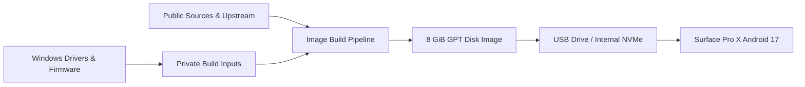

<div align="center">
  

  <h1>Googlebook OS on Surface Pro X</h1>
  <p>
    Android 17 + Linux 6.18.60 hybrid port for Microsoft Surface Pro X SQ1 / SQ2
  </p>

  <p>
    <strong>English</strong> | <a href="README.zh-CN.md">简体中文</a>
    &nbsp;·&nbsp; <a href="#overview-and-architecture">Overview</a>
    &nbsp;·&nbsp; <a href="#device-compatibility-and-feature-matrix">Status</a>
    &nbsp;·&nbsp; <a href="#performance-benchmarks">Benchmarks</a>
    &nbsp;·&nbsp; <a href="#real-device-deployment-guide">Install</a>
    &nbsp;·&nbsp; <a href="#debugging-and-development">Debug</a>
    &nbsp;·&nbsp; <a href="#building-from-source">Build</a>
    &nbsp;·&nbsp; <a href="#documentation-index">Docs</a>
  </p>

  <p>
    
    
    
    
    
    
  </p>

  <p>
    <a href="https://drive.google.com/drive/folders/1uVAA6UnydSyUHQAO8Y5rTm8SxZ62Zykr"></a>
    <a href="https://pan.baidu.com/s/51GjLdmTGir0PelomZvboYw"></a>
  </p>
</div>

---

## Overview and Architecture

**Googlebook OS on Surface Pro X** is an ARM64 port of Android 17 desktop Googlebook OS based on `mica 16833189` (`CL3B.260622.286.R2`) and Linux `6.18.60` for Microsoft Surface Pro X SQ1 and SQ2.

The project maintains a single unified image shared across SQ1 and SQ2:

- **Unified Boot & Device Routing**: Both SQ1 and SQ2 share the same kernel, modules, and initramfs. UEFI loads a custom GRUB bootloader and dispatches the corresponding EL2 boot payload and device tree based on SMBIOS detection.
- **Hybrid Graphics & Display Stack**: Mesa Freedreno / Turnip handles EGL / GLES and default desktop rendering, while a dual-Vulkan router switches per-app between Turnip and QTI native Vulkan with `VM_BIND` support for regular apps. Display composition and memory allocation are handled by QTI Display / HWC / SDM and Gralloc.
- **Multimedia, Biometrics & Hardware**: Integrates OMX and Venus hardware video decode/encode, audio routing, V4L2/CAMSS + software ISP cameras, SLPI sensors, IPTSd touch/stylus, dual Type-C DP multi-display, Wi-Fi SoftAP, QMI LOC GNSS, Hall lid sleep, OV7251 850nm IR Face Unlock, and [Advanced Settings](docs/ADVANCED-SETTINGS.md).

### Prebuilt Image Downloads

- **Release Notes & Changelogs**: [docs/RELEASE-NOTES.md](docs/RELEASE-NOTES.md) · [GitHub Releases](https://github.com/lhf1a/googlebookos_surface_pro_x/releases)
- **Google Drive**: [surface_pro_x_gbos_images](https://drive.google.com/drive/folders/1uVAA6UnydSyUHQAO8Y5rTm8SxZ62Zykr)
- **Baidu Netdisk**: https://pan.baidu.com/s/51GjLdmTGir0PelomZvboYw



---

## Device Compatibility and Feature Matrix

### Target Devices

| Device | SoC | Boot Mode | Max GPU Clock | Build Profile |
| :--- | :--- | :---: | :---: | :---: |
| **Surface Pro X Gen 1** | Microsoft SQ1 | EL2 | 661 MHz | hybrid |
| **Surface Pro X Gen 2** | Microsoft SQ2 | EL2 | 700 MHz | hybrid |

### Feature Support Matrix

Legend: `✅ Available` · `🟡 Partially Available` · `❌ Unavailable`

| Subsystem | SQ1 | SQ2 |
| :--- | :---: | :---: |
| **UEFI / NVMe / USB Boot & Storage** | ✅ Available | ✅ Available |
| **Audio: Speakers / Mic / USB-C** | ✅ Available | ✅ Available |
| **Root / KernelSU** | ✅ Available | ✅ Available |
| **Android Desktop & Graphics: GLES / Vulkan** | 🟡 Partially Available | 🟡 Partially Available |
| **Video Decode & Encode: OMX / Venus** | ✅ Available | ✅ Available |
| **Camera: Front / Rear** | ✅ Available | ✅ Available |
| **Touchscreen & Stylus** | ✅ Available | ✅ Available |
| **Sensors: Auto-Brightness / Rotation** | ✅ Available | ✅ Available |
| **Suspend s2idle & Power** | 🟡 Partially Available | 🟡 Partially Available |
| **Lid Sleep (Hall `SW_LID`)** | ✅ Available | ✅ Available |
| **LTE Mobile Data** | ✅ Available | ✅ Available |
| **Wi-Fi / Hotspot / Bluetooth / SSH** | ✅ Available | ✅ Available |
| **GNSS / GPS (QMI LOC AIDL V4)** | 🟡 Partially Available | 🟡 Partially Available |
| **USB Storage / Type Cover / Buttons** | ✅ Available | ✅ Available |
| **USB-C DP / Native Multi-Display Settings** | ✅ Available | ✅ Available |
| **Lower-Port USB ADB** | ✅ Available | ✅ Available |
| **Advanced Settings** ([Feature Guide](docs/ADVANCED-SETTINGS.md)) | ✅ Available | ✅ Available |
| **IR Face Unlock (Class 2, OV7251)** | 🟡 Partially Available | ✅ Available |
| **SMS, Hibernate** | ❌ Unavailable | ❌ Unavailable |

---

## Performance Benchmarks

### SQ2 @ GPU 700 MHz: Googlebook OS vs Windows 11

| Benchmark | Windows 11 ARM64 | Googlebook OS | Relative Gain |
| :--- | :--- | :--- | :---: |
| **3DMark Wild Life** | Pending | **6308** score | Pending |
| **Geekbench 6 CPU Single-Core** | **1041.4** | **1098** · [Report](https://browser.geekbench.com/v6/cpu/19492201) | **+5.4%** |
| **Geekbench 6 CPU Multi-Core** | **3509.4** | **3387** · [Report](https://browser.geekbench.com/v6/cpu/19492201) | `-3.5%` |
| **Geekbench 6 GPU Vulkan** | **5791** | **5923** · [Report](https://browser.geekbench.com/v6/compute/6978708) | **+2.3%** |

### Additional Observed Metrics

| Category | Workload | Observed Result |
| :--- | :--- | :--- |
| **Display / HWC** | `2880×1920@60` | **20/20** RGB readback pass, **0** plane disables |
| **Video Decode** | OMX H.264 / HEVC | H.264 `1080p@60` **562** frames / `9981 ms`, `320×240@30` **293** frames / `9961 ms` |
| **Camera** | Native JPEG & sw-ISP video | Rear **4224×3136**, Front **2592×1944**; 480p / 720p / 1080p |
| **CPU & Thermal** | 8-core 20s load | Little **300–1766.4 MHz**, Big **825.6–3148.8 MHz**, peak **53.3 °C** |
| **Suspend s2idle** | Single-boot suspend | Up to **59.199 s**; display, touch, and audio resumed |

---

## Real-Device Deployment Guide

Download the prebuilt 8 GiB compressed disk image or build it from source. On first normal boot, `userdata` automatically expands to fill the target disk.

> [!CAUTION]
> **Back up Windows & BitLocker recovery keys before starting.**
> - To keep Windows, use the Windows same-disk dual-boot script below or flash to an external USB drive.
> - Ensure only one flashed disk is connected when booting.

### 1. Prerequisites

1. Verify the image archive and checksums:
   ```sh
   sha256sum -c SHA256SUMS
   gzip -t disk/surface-pro-x-6.18-hybrid-generic.img.gz
   ```
2. Disable **Secure Boot** in Surface UEFI, and enable **USB Storage** if booting externally.

### 2. Flashing & Installation

#### Option A: balenaEtcher
Select `surface-pro-x-6.18-hybrid-generic.img.gz` or the extracted `.img`, choose your external USB drive, and click **Flash!**.

#### Option B: Rufus
Decompress the `.img` file first and write it to your external USB drive in **DD Image** mode.

#### Option C: Linux USB-NVMe Installer
```sh
python3 tools/deploy-experimental-usb.py --manifest MANIFEST --layout LAYOUT --image IMAGE
```

#### Option D: Windows Same-Disk Dual-Boot Script
Run `tools/Install-GooglebookDualBoot.cmd` as Administrator, or execute in an elevated PowerShell prompt:

```powershell
# Check disk and dual-boot status
powershell -NoProfile -ExecutionPolicy Bypass -File .\tools\Install-GooglebookDualBoot.ps1 -Action Status

# Install same-disk dual-boot
powershell -NoProfile -ExecutionPolicy Bypass -File .\tools\Install-GooglebookDualBoot.ps1 -Action Install -ImagePath D:\surface-pro-x-6.18-hybrid-generic.img.gz -TargetDiskNumber 0 -ShrinkOSVolumeGB 32

# Switch default OS
powershell -NoProfile -ExecutionPolicy Bypass -File .\tools\Install-GooglebookDualBoot.ps1 -Action SwitchDefault -DefaultOS Windows
```

#### Option E: LiveCD USB Boot -> Install to Internal NVMe SSD
Boot from USB, complete Touch Calibration, connect AC power, and open **Advanced Settings -> Install to Internal Disk** ([ADVANCED-SETTINGS](docs/ADVANCED-SETTINGS.md)). Confirm the target NVMe disk—this erases all internal partitions including Windows and does not migrate USB `userdata`—wait for the 5-partition GPT copy, SHA-256 verification, and UEFI setup, then tap **Shut down now**, **unplug the USB drive**, and power on.

### 3. Booting & First-Boot Setup

1. Hold **Volume Down** and press **Power** to boot from USB, or adjust the boot order in Surface UEFI.
2. The GRUB menu boots the Android 17 desktop by default, with options for rescue mode or power off.
3. First boot skips Android OOBE and launches the Touch Calibration Wizard; reaching the desktop may take up to 15 minutes, so keep the device powered.

### 4. Upgrading Existing Installations (OTA & ADB)

- **On-device OTA**: Open **Settings -> System update** (or **Advanced Settings -> System update**), pick a `.tar.gz` OTA archive or full `.img` / `.img.gz`, and choose **Keep user data** (preserves `/data`, calibration, settings, and `grub.cfg`) or **Clean install**.
- **PC ADB One-Click Upgrade**: Run `tools/Upgrade-GooglebookViaAdb.cmd` / `tools/Upgrade-GooglebookViaAdb.ps1` (Windows) or `tools/upgrade-googlebook-via-adb.sh` (Linux/macOS). See [OTA-HANDOFF](docs/OTA-HANDOFF.md).

---

## Debugging and Development

**Advanced Settings** (`SurfaceAdvancedControl.apk`) provides built-in hardware controls and debugging with no manual KernelSU root grant required (see [ADVANCED-SETTINGS](docs/ADVANCED-SETTINGS.md)):

- **Live IPs & Network ADB (`TCP 5555`)**: Shows LAN / VM IPs and toggles persistent TCP `5555` (`adb connect <LAN_IP>:5555`, RSA-authenticated via `ro.adb.secure=1`), while keeping `tcp:localhost:5555` active for lower-port `adb-usb-bridge`.
- **Initramfs `root` SSH (`TCP 22`)**: Toggles early-boot Dropbear SSH (`root` password locked by default) with in-app password/key management plus `/root/.ssh` symlink persistence so `ssh-copy-id root@<LAN_IP>` survives reboots.
- **Lower-Port USB ADB & GRUB Rescue Mode**: Lower Type-C port supports wired `adb devices` ([TYPEC](docs/TYPEC.md)). For pre-Android recovery, select **Rescue Mode** (`spx-rescue` / `sq2.rescue=1`) in GRUB for port `22` SSH, USB Ethernet drivers, and `wifi-tui` ([BUILD](docs/BUILD.md#7-boundaries)).

---

## Building from Source

> [!IMPORTANT]
> Proprietary OEM firmware, recovery artifacts, and closed-source vendor libraries are not distributed in Git and must be staged in a local private input directory.

### Step 1: Collect Dependencies on Windows Surface Pro X

```powershell
powershell -NoProfile -ExecutionPolicy Bypass -File .\scripts\Prepare-HybridDependencies.ps1 -Output D:\spx-deps -Plan
powershell -NoProfile -ExecutionPolicy Bypass -File .\scripts\Prepare-HybridDependencies.ps1 -Output D:\spx-deps -IncludeThirdParty
```

### Step 2: Import & Build on Linux x86_64

```sh
python3 scripts/import-hybrid-dependencies.py --archive downloads/spx-deps.tar --sha256 SHA256 --output private/dependency-import
python3 scripts/build-spx-camera-bundle.py --inputs private/camera-build.json --output out/camera-from-source
python3 scripts/build.py --private-root PREPARED_INPUTS --output FRESH_LINUX_OUTPUT --jobs 8
```

### Repository Layout

```text
.
├── assets/
├── configs/
├── docs/
├── patches/
├── probe/
├── scripts/               # Build pipeline & developer scripts
├── source-dependencies/
├── tests/
├── tools/                 # User flashing, dual-boot & ADB upgrade tools
└── upstream/
```

---

## Documentation Index

### Build, Dependencies & Deployment
- [RELEASE-NOTES](docs/RELEASE-NOTES.md) — Version history and changelogs (`v0.7.0`–`v0.9.9`)
- [BUILD](docs/BUILD.md)
- [STANDARD-BUILD](docs/STANDARD-BUILD.md)
- [DEPENDENCIES](docs/DEPENDENCIES.md)
- [IMAGE](docs/IMAGE.md)
- [DEVELOPMENT](docs/DEVELOPMENT.md)
- [PROVENANCE](docs/PROVENANCE.md)
- [ADVANCED-SETTINGS](docs/ADVANCED-SETTINGS.md) — Full reference for all **Advanced Settings** modules (Vulkan, Performance Mode, Touch, Debugging, Lid & IR Face Unlock, System update, LiveCD Install)
- [OTA-HANDOFF](docs/OTA-HANDOFF.md) — On-device OTA & PC ADB upgrade guide
- [USB-NVME-DEPLOY](docs/USB-NVME-DEPLOY.md)
- [TODO](docs/TODO.md)

### Subsystems & Hardware Bring-Up
- [UNIFIED-SQ1-SQ2](docs/UNIFIED-SQ1-SQ2.md)
- [CAMERA-BUILD](docs/CAMERA-BUILD.md)
- [IR-HALL-FACE-UNLOCK-PLAN](docs/IR-HALL-FACE-UNLOCK-PLAN.md)
- [SENSORS](docs/SENSORS.md)
- [TOUCH-CALIBRATION](docs/TOUCH-CALIBRATION.md)
- [TOUCH-DEVICE-COMPAT](docs/TOUCH-DEVICE-COMPAT.md)
- [WILD-LIFE](docs/WILD-LIFE.md)
- [VIDEO-CAPABILITY-ALIGNMENT](docs/VIDEO-CAPABILITY-ALIGNMENT.md)
- [SPEAKER-LOUDNESS](docs/SPEAKER-LOUDNESS.md)
- [MICROPHONE](docs/MICROPHONE.md)
- [LTE-PRODUCT](docs/LTE-PRODUCT.md)
- [USB-FUNCTIONS](docs/USB-FUNCTIONS.md)
- [TYPEC](docs/TYPEC.md)
- [BLUETOOTH-INPUT](docs/BLUETOOTH-INPUT.md)
- [SUSPEND](docs/SUSPEND.md)
- [UNRESTRICTED-POWER](docs/UNRESTRICTED-POWER.md)
- [ROOT-MANAGEMENT](docs/ROOT-MANAGEMENT.md)
- [DEFAULT-DISPLAY-DENSITY](docs/DEFAULT-DISPLAY-DENSITY.md)
- [PAGE-MODE-NOTIFICATION](docs/PAGE-MODE-NOTIFICATION.md)
- [External Kernel Modules](source-dependencies/kernel-6.18/README.md)

---

## Acknowledgements and Disclaimer

- Sincere thanks to the upstream open-source projects and community contributors behind **linux-surface**, **Mesa Freedreno / Turnip**, **AOSP / Googlebook**, **Cuttlefish**, **QTI CAF**, and **KernelSU Next**, on whose work this port is built. Licenses remain with their respective authors.
- **License**: Multi-licensed per directory and file SPDX headers; upstream and annotated files retain their original licenses, and unannotated original scripts and tooling default to the MIT License. See [LICENSE](LICENSE).
