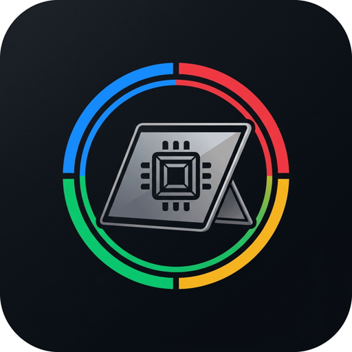
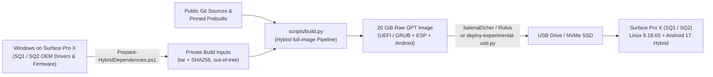

<div align="center">
  

  <h1>Googlebook OS on Surface Pro X</h1>
  <p>
    Android 17 (<code>mica 16471258</code>) + Linux <code>6.18.60-sq2-android1</code> hybrid port for Microsoft Surface Pro X (SQ1 / SQ2 · Snapdragon 8cx Gen 1/2)
  </p>

  <p>
    <strong>English</strong> | <a href="README.zh-CN.md">简体中文</a>
    &nbsp;·&nbsp; <a href="#overview-and-architecture">Overview</a>
    &nbsp;·&nbsp; <a href="#device-compatibility-and-feature-matrix">Status</a>
    &nbsp;·&nbsp; <a href="#capability-support-and-performance-benchmarks">Benchmarks</a>
    &nbsp;·&nbsp; <a href="#real-device-deployment-guide">Install</a>
    &nbsp;·&nbsp; <a href="#building-from-source">Build</a>
    &nbsp;·&nbsp; <a href="#documentation-index">Docs</a>
  </p>

  <p>
    
    
    
    
    
  </p>
</div>

---

## Overview and Architecture

**Googlebook OS on Surface Pro X** is an ARM64 port of Android-based Googlebook OS (`mica 16471258`, Android 17) running on Linux `6.18.60-sq2-android1` for the **Microsoft Surface Pro X SQ1 and SQ2** (`sc8180x` / Snapdragon 8cx Gen 1 & Gen 2). It is an Android desktop system, **not** ChromeOS Flex.

The project maintains a single unified **Hybrid** product line shared across SQ1 and SQ2:

- **Unified Boot & SoC Routing (EL2)**: Both models share the same Linux `Image`, kernel modules, `initramfs.cpio.gz`, and **EL2 (`sq2.el2=1`)** boot path. Surface ARM64 UEFI loads custom GRUB (`BOOTAA64.EFI`), which launches `start.efi` to inspect SMBIOS and dispatch `el2launch.efi` + `android-el2.dtb` on SQ2, or `el1launch.efi` (a cloned copy of `el2launch.efi` keeping `sq2.el2=1`) + `android-sq1.dtb` (retaining SQ1 GPU/GMU OPPs from `SQ1EL2/android-el2.dtb`) on SQ1, alongside `qebspilaa64.efi` (SLPI PAS12) and `tcblaunch.exe`.
- **Hybrid Graphics & Display Stack**:
  - **EGL / GLES**: **Mesa Freedreno `26.2.4`** + `libdrm 2.4.133` (donor EGL/GLES stripped).
  - **Dual-Vulkan Router (`vulkan.freedreno.so`)**: Routes per-process via `/vendor/etc/sq2-vulkan-policy.conf` between hardware-GMEM **Mesa Turnip** (`vulkan.turnip.so`, default for system UI, browsers, emulators, benchmarks, and general apps) and **Qualcomm Quest 2 v77 native Vulkan** (`vulkan.qti.so` + `libgsl`/`libadreno_utils`, default for Unity/Unreal and select titles).
  - **Display & Gralloc**: **QTI SM8350 Display/HWC/SDM** and **AOSP/QTI `mapper5`/`allocator`**, backed by Quest 2 v77 `gralloc.kona.so` / `qdMetaData` and bridged to Mesa via `gralloc.sq2_mesa.so`, linear RGB layout façade (`libsq2_grallocutils_vendor.so`), and SDM-to-`pwm-backlight` shim (`libsq2_sdm_backlight.so`).
- **Multimedia & Subsystems**: **QTI SM8250 native OMX** (`quest2-omx-service`, native ANW surface decode) paired with Linux **Venus** (`venus-core.ko`/`venus-dec.ko`/`venus-enc.ko` with `s2idle` power hooks), **V4L2/CAMSS + software ISP Camera2 HAL**, **SLPI PAS12 + `sensors.spx.so` SubHal**, and **IPTSd `3.1.1`** touchscreen/stylus handling.



---

## Device Compatibility and Feature Matrix

### Target Devices

| Device | SoC | Boot Mode & DTB | Build Profile | Current Scope |
| :--- | :--- | :--- | :---: | :--- |
| **Surface Pro X (Gen 1)** | Microsoft SQ1 (8cx Gen 1) | **EL2** (`el1launch.efi` [`el2launch` clone] + `android-sq1.dtb`) | `hybrid` (shared) | Shared EL2 image target; LTE & Touch enumeration verified on earlier builds, full `6.18` parity pending |
| **Surface Pro X (Gen 2)** | Microsoft SQ2 (8cx Gen 2) | **EL2** (`el2launch.efi` + `android-el2.dtb`) | `hybrid` (shared) | Primary verification platform across `6.3.8` and `6.18.60` builds |

### Feature Support Matrix

Legend: `✅ Available` · `🟡 Partially Available` · `❌ Unavailable`

| Subsystem | Status | Verified Behavior, Hardware Scope & Caveats |
| :--- | :---: | :--- |
| **UEFI / NVMe / USB Boot & Storage** | ✅ Available | ARM64 UEFI → custom GRUB (`BOOTAA64.EFI`) → SMBIOS router (`start.efi`) → **EL2** (`sq2.el2=1`; SQ1 uses `el1launch.efi` clone + `android-sq1.dtb`, SQ2 uses `el2launch.efi` + `android-el2.dtb`). 20 GiB GPT image auto-expands `userdata` online on first normal boot (`grow-image-userdata` + `resize2fs`). *Note: the `2026-11-16` universal image has passed host verification; real-device boot on it is pending.* |
| **Audio (Speakers / Mic / USB-C)** | ✅ Available | Verified on SQ2: SoundWire WCD9340 speakers (`+12 dB` RX7/RX8 `raw=84`, FIFO fix), DMIC (`CARD_0_DEV_1`, `raw=96`), and USB-C audio (`05ac:110b`, 48 kHz play/record). *Caveats: built-in speakers lack bass and have a slight right-skewed stereo image; SQ1 audio and BT A2DP/HFP are untested.* |
| **Root / KernelSU** | ✅ Available | KernelSU Next (`v3.2.0-legacy`) + Zygisk Next (`1.5.2`) + `sq2-ksu-modules-boot`, plus optional lab `device_faker_gfx`. Generic images strip personal credentials, lock `root`, and disable SSH by default. |
| **Android Desktop & Graphics (GLES / Vulkan)** | 🟡 Partially Available | `2880×1920@60` desktop, Mesa 26.2.4 Freedreno/Turnip, Dual-Vulkan router, and QTI HWC/SDM are usable on SQ2. *Caveats: graphics compatibility remains limited; A680.1 Wild Life GMEM root cause is open and `6.18` GMEM Wild Life re-testing is pending.* |
| **Video Decode (Venus / OMX)** | 🟡 Partially Available | Hardware H.264, HEVC (Main8), VP8, and VP9 (profile 0) via QTI OMX + Venus (`c2.sq2.*.experimental` for C2 trials). *Caveats: internal display is SDR-only (HDR disabled, Main10 filtered in default OMX), AV1 is unsupported by firmware, MPEG-1/2 are incomplete.* |
| **Camera (Front / Rear)** | 🟡 Partially Available | OV5693 (front) and OV13858 (rear) via V4L2/CAMSS + software ISP + Camera2 HAL; native JPEG and 480p/720p/1080p H.264/AAC verified on SQ2. *Caveats: low software-ISP fps at 720p/1080p, rear AF/exposure tuning pending, occasional CCI open/switch timeout, SQ1 untested.* |
| **Touchscreen & Stylus** | 🟡 Partially Available | IPTSd `3.1.1` supports both SQ2 (`045E:0C21`) and SQ1 (`045E:0996`). Bilingual calibration wizard (`probe/touch-calibration/`) included; learned noise profiles stay device-bound. *Caveats: end-to-end touch latency, post-sleep `0996` recovery, and Surface Pen pressure/tilt drawing are untested.* |
| **Sensors (Auto-Brightness / Rotation)** | 🟡 Partially Available | TCS3430 ALS + SLPI PAS12 (`qcslpi8180.mbn`, `qebspilaa64.efi`, `hexagonrpcd`) + `sensors.spx.so` SubHal + rotation overlay. Verified on SQ2 (across reboot); *SQ1 verification and post-long-sleep recovery are pending.* |
| **Suspend (`s2idle`) & Power** | 🟡 Partially Available | SQ2 `6.18.60` Venus `s2idle` handshake + `desktop-services.jar` AC wakelock patch (`1000 ms`) verified once (`59.2s` sleep). *Caveats: `timerfd` early wakeups and freezer aborts remain, long-run battery/wattage curves and SQ1 suspend are untested.* |
| **LTE Mobile Data** | 🟡 Partially Available | Dynamic EFI SCM/GPT FSG cache (`EFI/SPX/LTE/<uuid>.bin`, max 2 MiB) + IPA4.1/QMI/RMNET IPv4 data demonstrated on SQ1 and SQ2. *Caveats: fresh dual-device universal image acceptance, IPv6, and roaming are pending.* |
| **Wi-Fi / Bluetooth / SSH** | 🟡 Partially Available | Android-managed Wi-Fi (`ath10k_snoc`, WCN3990) and QCA UART BT (`sq2-hci-bridge`) work on SQ2. *Caveats: BLE HID pairing/`uhid` publication verified, but live cursor/scroll events remain unconfirmed; SSH is disabled by default in generic builds (key-only when enabled).* |
| **USB Storage / Type Cover / Buttons** | 🟡 Partially Available | FAT32 USB storage (`PUBLIC` SAF volume), USB-C audio (`05ac:110b`), Surface Type Cover (`045E:09AE/09AF/09B0`, hotplug recovery), and Volume/Power buttons work on SQ2. *Caveats: exFAT is read-only; arbitrary USB peripherals are untested.* |
| **IR / Windows Hello, Voice/SMS/5G/eSIM, Hibernate, Lid Sleep, USB-C DP Alt Mode** | ❌ Unavailable | IR camera/Hello auth unimplemented (chip ID only); no cellular voice, SMS, IMS, eSIM, or 5G; `nohibernate` and `lid_behavior=0` (`SW_LID` unavailable); USB-C DisplayPort Alt Mode (`CONFIG_TYPEC_DP_ALTMODE=y`) unimplemented/untested. |

---

## Capability Support and Performance Benchmarks

> [!NOTE]
> **Baseline Metadata**: All hardware metrics below were measured on **Surface Pro X SQ2** across pre-collapse `6.18.60-sq2-android1` (Hybrid, sensors, camera, OMX, `s2idle`) and `6.3.8-sq2-android1` (Wild Life, CPU/GPU OPP) test builds unless noted otherwise. The **`2026-11-16` universal hybrid disk image** (`surface-pro-x-6.18-hybrid-generic.img`) has passed host packaging and integrity verification only; real-device boot and **SQ1** parity benchmarks are still pending.

### Verified Quantitative Metrics

| Category | Workload / Check | Hardware & Baseline | Observed Result | Source & Caveats |
| :--- | :--- | :--- | :--- | :--- |
| **3D / Vulkan** | 3DMark Wild Life (`v2.7.5093`), Turnip `26.2.4` forced `sysmem` (514 MHz) | SQ2 (`A680.1`), Linux `6.3.8` | **4311** score / **25.82 FPS** | [WILD-LIFE](docs/WILD-LIFE.md); sampled scenes clean |
| **3D / Vulkan** | 3DMark Wild Life, Turnip `26.2.4` forced `sysmem` (661 MHz) | SQ2 (`A680.1`), Linux `6.3.8` | **4920** score / **29.46 FPS** | [WILD-LIFE](docs/WILD-LIFE.md); sampled scenes clean |
| **3D / Vulkan** | 3DMark Wild Life, scoped `A680.1 + 3DMark` `sysmem` patch (661 MHz) | SQ2 (`A680.1`), Linux `6.3.8` | **5279** / **31.61 FPS** (pre-reboot); **5264** / **31.52 FPS** (post-reboot) | [WILD-LIFE](docs/WILD-LIFE.md). On `6.18`, Turnip reverted to clean HW GMEM after kernel `0003` fix; **6.18 GMEM Wild Life re-benchmark is pending** |
| **3D / Vulkan** | 3DMark Wild Life, closed-source `v819.1` + QTI/mapper5 bridge | SQ2 (`A680.1`), Linux `6.3.8` | 6357 / 38.07 FPS, 57.2 °C — **INVALIDATED** | [WILD-LIFE](docs/WILD-LIFE.md); severe black blocks & pink/white bands |
| **GPU Compute** | 30s `vulkan-readback` stress (`4096` words/round, `4096` ALU iters) | SQ2, Linux `6.3.8` | 590 MHz: **28,462 rounds** (`41.3 → 44.4 °C`)<br/>661 MHz: **26,626 rounds** (`43.2 → 45.9 °C`) | `scripts/test-sq2-gpu-opp.sh`; 75 °C passive throttle |
| **Display / HWC** | `2880×1920@60` (`density=320`), QTI mapper5 + EGL + HWC | SQ2, Linux `6.18.60` (`v21`) | **20/20** RGB AHB→EGL pass; **135** YUV frames (max error `0.00048447`); **0** HWC plane disables | [DEFAULT-DISPLAY-DENSITY](docs/DEFAULT-DISPLAY-DENSITY.md), `configs/deployment-status.json` |
| **Video (Default OMX)** | H.264 / HEVC native `quest2-omx-service` | SQ2, Linux `6.18.60` | H.264 `320×240@30`: **293** rendered / `9961 ms`; `1080p@60`: **562** rendered / `9981 ms`; HEVC `v21`: **30** exact RAM / **6** post-reboot DRC frames (`0` bad pixels) | `configs/deployment-status.json`; `1080p@60` pixel equality not checked |
| **Video (Exp. C2)** | Experimental `c2.sq2.*.experimental` RAM trials *(not default OMX)* | SQ2, Linux `6.18.60` | HEVC Main8 `4K@60`: **600 frames / 9978 ms** (192 MiB pool); HEVC Main10 `240p@30`: **300 / 9962 ms**; VP8 `4K@30`: **300 / 9962 ms**; VP9 p0 `4K@60`: **600 / 10056 ms** | [VIDEO-CAPABILITY-ALIGNMENT](docs/VIDEO-CAPABILITY-ALIGNMENT.md); ordinary 4K Main10/60fps & Bilibili 4K persistence untested |
| **Camera** | OV5693 (front) / OV13858 (rear) native JPEG & sw-ISP H.264+AAC | SQ2, Linux `6.18.60` | JPEG: Rear **4224×3136**, Front **2592×1944**<br/>480p: **28.6** (F) / **30.0** (R) fps; 720p: **18.3** (F) / **10.0** (R) fps; 1080p: **6.3** (F, MP4 ~5.7) / **7.7** (R, MP4 ~7.1) fps | [CAMERA-BUILD](docs/CAMERA-BUILD.md), [TODO](docs/TODO.md) |
| **Audio** | Speakers (`RX7/8 raw=84`), DMIC (`raw=96`), USB-C (`05ac:110b`) | SQ2, Linux `6.18.60` | Speakers: `864k` + `2×192k` frames (**0 XRUNs** in isolation); DMIC: `483,328` ALSA / `480,000` `AudioRecord` frames (`0` clip); USB-C: `192k` out / `240k` in (`~5202 ms`) | [SPEAKER-LOUDNESS](docs/SPEAKER-LOUDNESS.md), [MICROPHONE](docs/MICROPHONE.md), [USB-FUNCTIONS](docs/USB-FUNCTIONS.md) |
| **Touch & Sensors** | IPTSd `3.1.1` + TCS3430 ALS / SLPI PAS12 | SQ2, Linux `6.18.60` | Touch: `30s` idle **0** phantoms; `32` offline calibration tests passed. Sensors: **52–160 lux** → backlight **643–1053 / 4095**, rotation `0/3` verified | [TOUCH-CALIBRATION](docs/TOUCH-CALIBRATION.md), [TOUCH-DEVICE-COMPAT](docs/TOUCH-DEVICE-COMPAT.md), [SENSORS](docs/SENSORS.md) |
| **CPU & Thermal** | 8-core 20s pinned load (`qcom-cpufreq-hw`, `schedutil`) | SQ2, Linux `6.18.60` | Little `0–3`: **300–1766.4 MHz**; Big `4–7`: **825.6–3148.8 MHz**; peak sampled CPU temp **53.3 °C** (80 °C throttle) | `scripts/test-sq2-cpu-frequency.sh` |
| **Suspend (`s2idle`)** | Single-boot Venus + `desktop-services.jar` (`1000 ms`) check | SQ2, Linux `6.18.60` | `success=4`, Venus `stops=5/starts=5`, `failed_resume=0`, longest sleep **59.199 s** (display/touch/audio resumed) | [SUSPEND](docs/SUSPEND.md); single-boot verification only |

### Qualitative Verified Behavior & Untested Areas

- **Verified qualitatively**: On SQ2, Android desktop (`2880×1920@60`), Bilibili `720p/1080p/4K` switching, Dual-Vulkan (`SQ2VkRouter` Turnip/QTI paths), Type Cover hotplug recovery, FAT32 USB drives, Wi-Fi (`ath10k_snoc`), Bluetooth ON/OFF state, and KernelSU Next + Zygisk Next work in testing. Native LTE IPv4 data has been demonstrated on both SQ1 and SQ2.
- **Not yet benchmarked / open gaps**:
  - **SQ1 hardware parity**: SQ1 sensors, `s2idle`, camera, sustained CPU/GPU (capped at `2995.2 / 661 MHz`), and `2026-11-16` universal image boot.
  - **Standard 3D & Web benchmarks**: No `glmark2`, `vkmark`, WebGL, or `6.18` GMEM Wild Life / game FPS-per-watt numbers.
  - **Audio / Input / Display gaps**: Speaker bass and stereo balance; Bilibili seek/switch audio skip/XRUN (`1×4096` HAL skip observed); BT A2DP/HFP audio; live BLE HID cursor/scroll events; Surface Pen drawing/pressure/tilt; end-to-end touch latency; USB-C DP Alt Mode.
  - **Power & Long-Run**: Multi-cycle `s2idle` reliability (`timerfd` wakeups & freezer aborts remain), battery discharge curves, wattage telemetry, and `sq2-game-opt` FPS/power deltas.
- **Host vs Device Tests**: `tests/` contains `336` host-side packaging, policy, calibration, and ASan/UBSan suites (`232` Python, `92` C/C++, `5` PowerShell, `7` fixtures); `scripts/` provides on-device diagnostics (`test-sq2-cpu-frequency.sh`, `test-sq2-gpu-opp.sh`, `test-sq2-audio-reopen.sh`, `verify-sq2-mediacodec-frames.py`). Host checks do not certify device boot.

---

## Real-Device Deployment Guide

Prebuilt disk images, proprietary firmware, and donor binaries are **not** distributed in this Git repository; build your own image first (see [Building from Source](#building-from-source)). A standard build produces a 20 GiB (`21,474,836,480` bytes) sparse raw GPT disk image and its gzip archive:

- `disk/surface-pro-x-6.18-hybrid-generic.img` (20 GiB raw MBR+GPT full-disk image)
- `disk/surface-pro-x-6.18-hybrid-generic.img.gz` (~7.64 GiB / `8,199,981,130` bytes compressed)

> [!CAUTION]
> **Back up Windows & BitLocker keys before starting.**
> - Flashing the **internal NVMe SSD** overwrites your Windows installation and all local data. For safe testing, flash to an **external USB drive** or a spare NVMe SSD inside a **USB-NVMe enclosure** (`>= 20 GiB` capacity, 512-byte logical sectors).
> - **Single-Image-Disk Rule**: At boot, `prepare-image-ssd` scans all attached block devices for `PARTNAME=SQ2PROBE` + `SPX-IMAGE.txt`. If **more than one** attached disk contains this image, boot aborts with `ambiguous-image-disk`. **Never leave two flashed disks connected at the same time.**

### 1. Prerequisites on Surface Pro X

1. **Verify integrity** of your built image on the build host before flashing (see [IMAGE](docs/IMAGE.md) for current local build checksums):
   ```sh
   cd IMAGE_OUTPUT
   sha256sum -c SHA256SUMS
   gzip -t disk/surface-pro-x-6.18-hybrid-generic.img.gz
   ```
2. **Disable Secure Boot in Surface UEFI**: The generated ARM64 EFI loaders (`BOOTAA64.EFI`, `start.efi`, `el1launch.efi`, `el2launch.efi`) are unsigned.
   - Shut down Surface Pro X completely.
   - Hold **Volume Up (`+`)** and press **Power** (keep holding Volume Up until the Surface UEFI menu appears).
   - Under **Security**, set **Secure Boot** to **Disabled** (or None).
   - Under **Boot configuration**, ensure **USB Storage** is enabled if booting externally.

### 2. Flashing the Disk Image

You do **not** need to resize `userdata` manually when flashing with standard raw block writers: on first normal boot, `grow-image-userdata` automatically relocates the backup GPT header (`sgdisk --move-second-header`), extends `userdata` to the end of the target disk, and runs `resize2fs` online.

#### Option A: balenaEtcher (Windows / macOS / Linux — Recommended for USB Drives)

1. Open **balenaEtcher** and click **Flash from file**.
2. Select `surface-pro-x-6.18-hybrid-generic.img.gz` (or the decompressed `.img`).
3. Click **Select target** and carefully choose your external USB drive or USB-NVMe enclosure (`>= 20 GiB`).
4. Click **Flash!** and wait for flashing and verification to complete, then safely eject the drive.

#### Option B: Rufus (Windows — `.img` Raw / DD Write)

1. Decompress `surface-pro-x-6.18-hybrid-generic.img.gz` to `surface-pro-x-6.18-hybrid-generic.img` (20 GiB raw file).
2. Open **Rufus** and select your target USB drive / USB-NVMe enclosure under **Device**.
3. Click **SELECT** under **Boot selection** and choose `surface-pro-x-6.18-hybrid-generic.img`.
   - Rufus writes raw `.img` files in **DD Image (raw block)** mode. **Never** extract partitions manually onto FAT32/NTFS or use ISO extraction mode.
4. Click **START**, confirm the data-erasure warning, wait for completion, and safely eject.

#### Option C: Linux USB-NVMe Enclosure Installer (`deploy-experimental-usb.py`)

When preparing a replacement NVMe SSD in a USB-NVMe enclosure from a native Linux host (or Linux VM with exclusive USB passthrough — not WSL) using an extent-bearing image manifest, use `scripts/deploy-experimental-usb.py` ([USB-NVME-DEPLOY](docs/USB-NVME-DEPLOY.md); offline-tested only). Note that `deploy-experimental-usb.py` requires a `MANIFEST` with an `extents` list; standard `build.py` `full-image` outputs (`IMAGE-MANIFEST.json` does not include `extents`) should be flashed via **balenaEtcher**, **Rufus (`DD Image`)**, or a raw block write:

```sh
# Dry-run preview (lists eligible USB disks and checks manifest/layout)
python3 scripts/deploy-experimental-usb.py \
  --manifest MANIFEST --layout LAYOUT --image IMAGE

# Add --execute --device /dev/sdX and type the exact printed ERASE confirmation string
# ERASE ["/dev/sdX","<serial>",<size_bytes>] (or pass --confirm-erase)
```

### 3. Booting & First-Boot Setup

1. Attach only **one** flashed disk to the Surface Pro X.
2. **To boot from USB**: Power off, hold **Volume Down (`-`)** and press **Power** (release Volume Down once the Surface logo spins), or reorder **USB Storage** above **Internal Storage** in Surface UEFI.
3. **GRUB Boot Menu** (5-second timeout):
   - **`Surface Pro X Linux 6.18 - single user 0`** (`spx-single-user`, default): Boots Android 17 Hybrid desktop via `/EFI/SQ2Nat/start.efi`.
   - **`Surface Pro X Linux 6.18 - rescue (no Android data mount)`** (`spx-rescue`): Diagnostic fallback (`sq2.rescue=1`) via `/EFI/SQ2Res/start.efi` without mounting Android `userdata` or expanding partitions.
   - **`Power off`**: Powers down the device.
4. **First Boot**: `surface-first-boot` automatically skips the Android OOBE wizard (`device_provisioned=1`, `user_setup_complete=1`) and launches HOME. The standalone bilingual **Touch Calibration Wizard** remains active on first boot to calibrate touchscreen noise thresholds for your panel and digitizer.

---

## Building from Source

> [!IMPORTANT]
> **Why Windows Blob Collection & Private Inputs Stay Out of Git**
> Proprietary Microsoft/Qualcomm OEM firmware (`ADSP`, `CDSP`, `SLPI`, `WLAN/BT`, `MCFG`, sensor configs), Google/Cuttlefish recovery artifacts, Quest 2 v77 vendor blobs, credentials, and disk images cannot be redistributed in Git. All private inputs live locally under `private/build-inputs/` (or `--private-root`).

### Step 1: Collect Shared Inputs on Windows Surface Pro X

On an original **Surface Pro X (SQ1 or SQ2) Windows ARM64** installation (PowerShell 5.1+, Git for Windows, `curl.exe`, `tar.exe`; store output on NTFS/exFAT with sufficient space for ~7.6 GB of downloads):

```powershell
# Preview manifest without downloading
powershell -NoProfile -ExecutionPolicy Bypass -File .\scripts\Prepare-HybridDependencies.ps1 -Output D:\spx-deps -Plan

# Download pinned upstream inputs + read-only Surface DriverStore export + package tar/SHA256
powershell -NoProfile -ExecutionPolicy Bypass -File .\scripts\Prepare-HybridDependencies.ps1 -Output D:\spx-deps -IncludeThirdParty
```

- **Read-only OEM extraction**: `scripts/Export-SurfaceHybridDependencies.ps1` (also runnable offline via `-WindowsRoot`) extracts only specific `DriverStore\FileRepository` INF packages (`qcbtfmuart8180`, `qcdx8180`, `qcwlan8180`, `surfaceprox_{mcfg,subextadsp,subextcdsp,subextmpss,subextscss,sensorsconfig}`, `surfacelightsensor`) and `Windows\System32\tcblaunch.exe`. It **never** reads live registry state, user accounts, Wi-Fi profiles, SSH keys, per-device calibration, or modem EFS/NV.
- **Clean-room boundary**: Per [DEPENDENCIES](docs/DEPENDENCIES.md), public downloads + Windows export alone cannot yet synthesize every Android/QTI runtime, `board.dts`, EFI (`start.efi`/`el2launch.efi`/`qebspilaa64.efi`), and `template.img` from scratch (`hybrid_bootstrap.py --stage all` explicitly exits non-zero at that remaining gap; see [STANDARD-BUILD](docs/STANDARD-BUILD.md) for required `private/build-inputs/` files).

### Step 2: Import & Build on Linux (x86_64)

Copy `spx-deps.tar` and its `.sha256.json` receipt to a Linux x86_64 host (Ubuntu 24.04, Python 3.12+; build on a native Linux filesystem, not `/mnt/c` or NTFS/9p):

```sh
# 1. Verify tar + hashes and extract OEM firmware / 1480-byte CRC-checked ALS golden calibration
python3 scripts/import-hybrid-dependencies.py \
  --archive downloads/spx-deps.tar --sha256 SHA256 \
  --output private/dependency-import

# 2. Prepare camera & sensor bundles from source against matched 6.18 kernel tree
python3 scripts/build-spx-camera-bundle.py --inputs private/camera-build.json --output out/camera-from-source
# (Prepare sensors bundle via scripts/build-spx-sensor-bundle.py — see docs/SENSORS.md)

# 3. Default build: full-image + --kernel-mode source + --graphics hybrid
python3 scripts/build.py --private-root PREPARED_INPUTS --output FRESH_LINUX_OUTPUT --jobs 8
```

- **Build modes & reuse**:
  - `scripts/build.py` (delegating to `scripts/build-lts.py`) defaults to `full-image` with `--kernel-mode source` and `--graphics hybrid` (the only supported graphics mode).
  - Pass `--esp-only` to generate only the ESP payload (`disk/esp/`) instead of the 20 GiB GPT image.
  - Reuse pre-verified components (kernel, modules, camera, sensors, Mesa, glue) with `--reuse-components REUSE.json` (generated by `scripts/full_image_reuse.py`; modified `probe/touch-calibration/` Java/Manifest automatically invalidates and rebuilds `wizard.apk`).
  - Incrementally rebuild only Venus against the exact matching `KOUT` before repacking:
    ```sh
    python3 scripts/rebuild-hybrid-venus.py --reuse-components PREV_REUSE.json \
      --kernel-build MATCHED_KOUT --source PREV_VENUS_SOURCE --output FRESH_VENUS_OUTPUT
    python3 scripts/build.py --reuse-components FRESH_VENUS_OUTPUT/REUSE.json \
      --private-root PREPARED_INPUTS --output FRESH_IMAGE_OUTPUT
    ```
  - `compile` builds standalone kernel/external modules (`Image`, `modules`, `dtbs`) without an initramfs or disk image; legacy `verify` / `package` only verify or copy the pinned `EFI/SQ2Nat` baseline in `configs/kernel-baseline.json`.

### Repository Layout

```text
.
├── assets/                 # Project logo and visual assets
├── configs/                # Locked dependency manifests, Vulkan routing, SoC profiles, known-issues JSON
├── docs/                   # Build, dependency, image, deployment, and subsystem documentation
├── patches/                # Linux 6.18 Surface baseline & DRM/A6xx MMIO/GMEM patchsets
├── probe/                  # On-device services, Touch Calibration Wizard, Dual-Vulkan/gralloc/camera/sensor glue
├── reference/              # Upstream reference configs and donor helper sources
├── scripts/                # Build entrypoints (build.py, full_image.py), Windows PowerShell collectors, deployers
├── source-dependencies/    # Reviewed kernel 6.18 external module sources and DT overlays
├── tests/                  # Host-side Python unittest, C/C++ ASan/UBSan, and PowerShell test suites
└── upstream/               # Git submodules / pinned external component trees
```

---

## Documentation Index

### Build, Dependencies & Deployment
- [BUILD](docs/BUILD.md) — Current `build.py` entry, private inputs, build order, and output artifacts
- [STANDARD-BUILD](docs/STANDARD-BUILD.md) — Full Hybrid pipeline flow, component reuse, and `PRIVACY.json` rules
- [DEPENDENCIES](docs/DEPENDENCIES.md) — Windows dependency collection, Quest 2 donor handling, and `hybrid_bootstrap.py` stages
- [IMAGE](docs/IMAGE.md) — Current image checksums, first-boot OOBE policy, Touch Wizard, and host verification scope
- [DEVELOPMENT](docs/DEVELOPMENT.md) — Portability contract (`SPX-PORTABLE-SQ1-SQ2`) across any SQ1/SQ2 unit
- [PROVENANCE](docs/PROVENANCE.md) — Pinned runtime sources, commits, and component licensing
- [USB-NVME-DEPLOY](docs/USB-NVME-DEPLOY.md) — Linux USB-NVMe enclosure deployment (`deploy-experimental-usb.py`)
- [TODO](docs/TODO.md) — Open P0 portability tasks and unverified hardware/software work

### Subsystems & Hardware Bring-Up
- [UNIFIED-SQ1-SQ2](docs/UNIFIED-SQ1-SQ2.md) — Shared SQ1/SQ2 kernel/initramfs design and per-SoC DT/OPP routing
- [CAMERA-BUILD](docs/CAMERA-BUILD.md) — Front/rear V4L2/CAMSS + software ISP + Camera2 HAL build guide
- [SENSORS](docs/SENSORS.md) — TCS3430 ALS, SLPI PAS12, `sensors.spx.so`, and auto-rotation setup
- [TOUCH-CALIBRATION](docs/TOUCH-CALIBRATION.md) — Bilingual Touch Calibration Wizard workflow and key derivation
- [TOUCH-DEVICE-COMPAT](docs/TOUCH-DEVICE-COMPAT.md) — IPTSd `3.1.1` compatibility for SQ2 (`045E:0C21`) and SQ1 (`045E:0996`)
- [WILD-LIFE](docs/WILD-LIFE.md) — A680.1 Wild Life GMEM issue, `sysmem` workaround, and Dual-Vulkan routing notes
- [VIDEO-CAPABILITY-ALIGNMENT](docs/VIDEO-CAPABILITY-ALIGNMENT.md) — Venus firmware limits, OMX vs experimental C2, and SDR/AV1 constraints
- [SPEAKER-LOUDNESS](docs/SPEAKER-LOUDNESS.md) — SoundWire WCD9340 speaker gain and FIFO configuration
- [MICROPHONE](docs/MICROPHONE.md) — WCD9340 DMIC routing (`audio-microphone-route`) and capture verification
- [LTE-PRODUCT](docs/LTE-PRODUCT.md) — Dynamic EFI FSG cache and IPA4.1/QMI/RMNET IPv4 cellular data
- [USB-FUNCTIONS](docs/USB-FUNCTIONS.md) — Validated USB storage, USB-C audio, and DisplayPort Alt Mode status
- [BLUETOOTH-INPUT](docs/BLUETOOTH-INPUT.md) — QCA UART Bluetooth and BLE HID (`uhid`) status
- [SUSPEND](docs/SUSPEND.md) — `s2idle` Venus handshake, `desktop-services.jar` AC wakelock patch, and limits
- [UNRESTRICTED-POWER](docs/UNRESTRICTED-POWER.md) — Thermal/power policy, `nohibernate`, and `lid_behavior=0`
- [ROOT-MANAGEMENT](docs/ROOT-MANAGEMENT.md) — KernelSU Next, Zygisk Next, and `device_faker` configuration
- [DEFAULT-DISPLAY-DENSITY](docs/DEFAULT-DISPLAY-DENSITY.md) — `2880×1920@60` display density (`320` dpi) policy
- [PAGE-MODE-NOTIFICATION](docs/PAGE-MODE-NOTIFICATION.md) — 4 KB page size notification and runtime notes
- [External Kernel Modules](source-dependencies/kernel-6.18/README.md) — Reviewed 6.18 external module source archive and DT overlays

---

## Acknowledgements and Disclaimer

- Built on upstream work from **linux-surface** (ARM64 kernel/GRUB/IPTSd foundations), **Mesa Freedreno / Turnip**, **AOSP / Googlebook (`mica`)**, **Cuttlefish**, **QTI CAF** (`SM8350` display / `SM8250` media), and **KernelSU Next**.
- Component licenses remain with their respective authors (see [PROVENANCE](docs/PROVENANCE.md) and `source-dependencies/kernel-6.18/README.md`). No single blanket license overrides third-party binaries or upstream sources.
- **Verification Disclaimer**: Host-side build success, checksum validation, and unit tests do **not** guarantee real-device boot, SQ1/SQ2 cross-device acceptance, long-term `s2idle` stability, or battery/thermal safety. Flashing storage devices carries data-loss risk — back up important data before testing.
