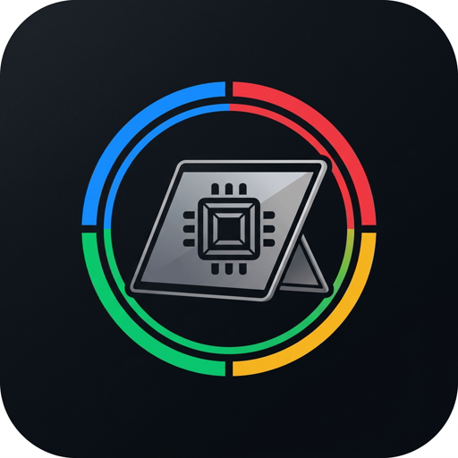
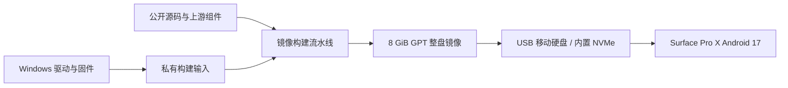

<div align="center">
  

  <h1>Googlebook OS on Surface Pro X</h1>
  <p>
    面向 Microsoft Surface Pro X SQ1 / SQ2 的 Android 17 + Linux 6.18.60 混合模式移植系统
  </p>

  <p>
    <a href="README.md">English</a> | <strong>简体中文</strong>
    &nbsp;·&nbsp; <a href="#架构与概览">概览</a>
    &nbsp;·&nbsp; <a href="#设备兼容性与功能支持矩阵">支持状态</a>
    &nbsp;·&nbsp; <a href="#性能基准">性能基准</a>
    &nbsp;·&nbsp; <a href="#真机部署指南">安装指南</a>
    &nbsp;·&nbsp; <a href="#调试与开发">调试开发</a>
    &nbsp;·&nbsp; <a href="#从源码构建">源码构建</a>
    &nbsp;·&nbsp; <a href="#文档索引">文档</a>
  </p>

  <p>
    
    
    
    
    
    
  </p>

  <p>
    <a href="https://drive.google.com/drive/folders/1uVAA6UnydSyUHQAO8Y5rTm8SxZ62Zykr"></a>
    <a href="https://pan.baidu.com/s/51GjLdmTGir0PelomZvboYw"></a>
  </p>
</div>

---

## 架构与概览

**Googlebook OS on Surface Pro X** 是面向 Microsoft Surface Pro X SQ1 与 SQ2 的 ARM64 Android 17 桌面系统移植，基于 `mica 16471258` 与 Linux `6.18.60` 内核构建。

项目维护一套统一镜像，同时覆盖 SQ1 与 SQ2：

- **统一引导与设备路由**：SQ1 与 SQ2 共用同一套内核、模块与 initramfs。开机由 UEFI 加载定制 GRUB，并根据 SMBIOS 机型自动分发对应的 EL2 启动载荷与设备树。
- **混合图形与显示栈**：EGL / GLES 与默认桌面由 Mesa Freedreno / Turnip 驱动；Vulkan 通过双 Vulkan 路由器按应用策略在 Turnip 与高通原生 Vulkan 之间切换，并为普通应用启用 `VM_BIND`；显示合成与内存分配由 QTI Display / HWC / SDM 与 Gralloc 协同完成。
- **多媒体与硬件子系统**：集成 OMX 与 Venus 硬件视频编解码、音频路由、V4L2/CAMSS 与软件 ISP 摄像头、SLPI 传感器、IPTSd 触控与手写笔、双 Type-C 多屏输出、Wi-Fi 热点、QMI LOC GNSS、霍尔合盖休眠、OV7251 850nm 红外人脸解锁以及系统[高级设置](docs/ADVANCED-SETTINGS.md)。

### 预构建镜像下载

- **更新日志**：[docs/RELEASE-NOTES.md](docs/RELEASE-NOTES.md) · [GitHub Releases](https://github.com/lhf1a/googlebookos_surface_pro_x/releases)
- **Google Drive**：[surface_pro_x_gbos_images](https://drive.google.com/drive/folders/1uVAA6UnydSyUHQAO8Y5rTm8SxZ62Zykr)
- **百度网盘**：https://pan.baidu.com/s/51GjLdmTGir0PelomZvboYw



---

## 设备兼容性与功能支持矩阵

### 目标设备

| 设备型号 | SoC | 引导模式 | GPU 最高频率 | 构建配置 |
| :--- | :--- | :---: | :---: | :---: |
| **Surface Pro X 一代** | Microsoft SQ1 | EL2 | 661 MHz | hybrid |
| **Surface Pro X 二代** | Microsoft SQ2 | EL2 | 700 MHz | hybrid |

### 功能支持矩阵

图例：`✅ 可用` · `🟡 部分可用` · `❌ 不可用`

| 子系统 | SQ1 | SQ2 |
| :--- | :---: | :---: |
| **UEFI / NVMe / USB 启动与存储** | ✅ 可用 | ✅ 可用 |
| **音频：扬声器 / 麦克风 / USB-C** | ✅ 可用 | ✅ 可用 |
| **Root / KernelSU** | ✅ 可用 | ✅ 可用 |
| **Android 桌面与图形：GLES / Vulkan** | 🟡 部分可用 | 🟡 部分可用 |
| **视频编解码：OMX / Venus** | ✅ 可用 | ✅ 可用 |
| **摄像头：前置 / 后置** | ✅ 可用 | ✅ 可用 |
| **触控屏与手写笔** | ✅ 可用 | ✅ 可用 |
| **传感器：自动亮度 / 自动旋转** | ✅ 可用 | ✅ 可用 |
| **休眠 s2idle 与电源管理** | 🟡 部分可用 | 🟡 部分可用 |
| **合盖休眠（霍尔 `SW_LID`）** | ✅ 可用 | ✅ 可用 |
| **LTE 移动数据** | ✅ 可用 | ✅ 可用 |
| **Wi-Fi / 热点 / 蓝牙 / SSH** | ✅ 可用 | ✅ 可用 |
| **GNSS / GPS（QMI LOC AIDL V4）** | 🟡 部分可用（HAL 已就绪，待搜星实测） | 🟡 部分可用（HAL 已就绪，待搜星实测） |
| **USB 存储 / Type Cover / 物理按键** | ✅ 可用 | ✅ 可用 |
| **USB-C DP / 原生多屏设置** | ✅ 可用 | ✅ 可用 |
| **下口 USB ADB** | ✅ 可用 | ✅ 可用 |
| **高级设置**：[全部功能说明](docs/ADVANCED-SETTINGS.md)（Vulkan、性能模式、触控、调试、霍尔与红外解锁、OTA 与 LiveCD 安装） | ✅ 可用 | ✅ 可用 |
| **红外人脸解锁（Class 2，OV7251）** | 🟡 部分可用（待 SQ1 实测） | ✅ 可用 |
| **短信、休眠到磁盘** | ❌ 不可用 | ❌ 不可用 |

---

## 性能基准

### SQ2 @ GPU 700 MHz：Googlebook OS vs Windows 11 对比

| 基准项目 | Windows 11 ARM64 | Googlebook OS | 相对提升 |
| :--- | :--- | :--- | :---: |
| **3DMark Wild Life** | 待补充 | **6308** 分 | 待补充 |
| **Geekbench 6 CPU 单核** | **1041.4** | **1098** · [报告](https://browser.geekbench.com/v6/cpu/19492201) | **+5.4%** |
| **Geekbench 6 CPU 多核** | **3509.4** | **3387** · [报告](https://browser.geekbench.com/v6/cpu/19492201) | `-3.5%` |
| **Geekbench 6 GPU Vulkan** | **5791** | **5923** · [报告](https://browser.geekbench.com/v6/compute/6978708) | **+2.3%** |

### 其他实测指标

| 类别 | 测试项 | 实测结果 |
| :--- | :--- | :--- |
| **显示 / HWC** | `2880×1920@60` | **20/20** RGB 回读通过，**0** 次图层禁用 |
| **视频解码** | OMX H.264 / HEVC | H.264 `1080p@60` **562** 帧 / `9981 ms`，`320×240@30` **293** 帧 / `9961 ms` |
| **摄像头** | 原生 JPEG 与软件 ISP 录像 | 后置 **4224×3136**，前置 **2592×1944**；支持 480p / 720p / 1080p |
| **CPU 与温控** | 8 核 20 秒满载 | 小核 **300–1766.4 MHz**，大核 **825.6–3148.8 MHz**，峰值 **53.3 °C** |
| **休眠 s2idle** | 单次休眠唤醒 | 最长 **59.199 s**，唤醒后显示、触控与音频正常 |

---

## 真机部署指南

可从网盘下载预构建的 8 GiB 整盘镜像压缩包，或通过源码自行构建。首次正常启动会自动将 `userdata` 扩展至目标磁盘剩余空间。

> [!CAUTION]
> **操作前请务必备份 Windows 系统与 BitLocker 恢复密钥。**
> - 如需保留 Windows，请使用下方的 Windows 同盘双启动脚本，或刷入外接 USB 磁盘。
> - 启动时请确保只连接一块已刷入本系统的磁盘。

### 1. 前置准备

1. 校验镜像压缩包与 SHA256：
   ```sh
   sha256sum -c SHA256SUMS
   gzip -t disk/surface-pro-x-6.18-hybrid-generic.img.gz
   ```
2. 在 Surface UEFI 中关闭 **Secure Boot**；若从外置盘启动，确认已启用 **USB Storage**。

### 2. 烧录与安装

#### 方案 A：balenaEtcher
选择 `surface-pro-x-6.18-hybrid-generic.img.gz` 或解压后的 `.img`，选中外接 USB 磁盘后点击 **Flash!**。

#### 方案 B：Rufus
先解压得到 `.img` 文件，在 Rufus 中以 **DD 镜像** 模式写入外接 USB 磁盘。

#### 方案 C：Linux USB-NVMe 部署脚本
```sh
python3 tools/deploy-experimental-usb.py --manifest MANIFEST --layout LAYOUT --image IMAGE
```

#### 方案 D：Windows 同盘双启动脚本
以管理员身份运行 `tools/Install-GooglebookDualBoot.cmd`，或在管理员 PowerShell 中执行：

```powershell
# 查看磁盘与双启动状态
powershell -NoProfile -ExecutionPolicy Bypass -File .\tools\Install-GooglebookDualBoot.ps1 -Action Status

# 本机同盘安装双系统
powershell -NoProfile -ExecutionPolicy Bypass -File .\tools\Install-GooglebookDualBoot.ps1 -Action Install -ImagePath D:\surface-pro-x-6.18-hybrid-generic.img.gz -TargetDiskNumber 0 -ShrinkOSVolumeGB 32

# 切换默认启动系统
powershell -NoProfile -ExecutionPolicy Bypass -File .\tools\Install-GooglebookDualBoot.ps1 -Action SwitchDefault -DefaultOS Windows
```

#### 方案 E：USB LiveCD 模式写入内置硬盘
先通过方案 A/B 从外接 USB 启动并完成触控校准，接通电源后在 **高级设置 -> 写入内置硬盘**（[ADVANCED-SETTINGS](docs/ADVANCED-SETTINGS.md)）选中内置 NVMe 并确认不可逆提示（**会清空内置盘全部现有分区含 Windows，且不迁移 USB 盘上的 `userdata`**）；完成 5 分区 GPT 重建、SHA-256 校验与独立 UEFI 写入后点击 **立即关机**，**拔出 USB 盘**再开机即可。

### 3. 启动与首次开机

1. 关机后按住音量减与电源键从 USB 启动，或在 UEFI 中调整启动顺序。
2. GRUB 菜单默认启动 Android 17 桌面，也可选择救援模式或关机。
3. 首次启动会自动跳过初始向导并运行触控校准向导，进入桌面最长可能需要约 15 分钟，请保持供电。

### 4. 已有系统的升级（OTA 与 ADB）

- **设备端 OTA 升级**：打开 **系统设置 -> 系统更新**（或 **高级设置 -> 系统更新**），选择 `.tar.gz` 升级包或 `.img` / `.img.gz` 整盘镜像，可选择 **保留用户数据**（保留 `/data`、触控校准、设置与 `grub.cfg`）或 **清除数据并重装**。
- **PC 端 ADB 一键升级**：Windows 运行 `tools/Upgrade-GooglebookViaAdb.cmd` / `.ps1`，Linux / macOS 运行 `tools/upgrade-googlebook-via-adb.sh`，详见 [OTA-HANDOFF](docs/OTA-HANDOFF.md)。

---

## 调试与开发

系统内置 **高级设置（`SurfaceAdvancedControl.apk`）**，提供免手动 KernelSU 授权的调试与硬件调优能力（完整六个模块说明见 [ADVANCED-SETTINGS](docs/ADVANCED-SETTINGS.md)）：

- **IP 展示与网络 ADB（`TCP 5555`）**：实时查看 LAN / VM IP，一键持久化开关网络 ADB（`adb connect <LAN_IP>:5555`，开启 `ro.adb.secure=1` 授权）；关闭时自动保留 `tcp:localhost:5555`，不影响下口有线 `adb-usb-bridge`。
- **initramfs `root` SSH（`TCP 22`）**：开关早期命名空间 Dropbear SSH（默认锁定 `root` 密码），支持应用内密码/公钥管理及 `/root/.ssh` 软链持久化（开发机可直接 `ssh-copy-id root@<LAN_IP>`）。
- **下口 USB ADB 与 GRUB 救援模式**：**下方** Type-C 接口支持有线 `adb devices`（[TYPEC](docs/TYPEC.md)）。若系统进桌面异常，可在 GRUB 选择 **救援模式**（`spx-rescue` / `sq2.rescue=1`）启用内置 USB 网卡驱动、`wifi-tui` 配网与端口 `22` SSH（[BUILD](docs/BUILD.md#7-边界)）。

---

## 从源码构建

> [!IMPORTANT]
> 专有 OEM 固件、恢复产物及第三方闭源库不随 Git 分发，需按流程采集后置于本地私有输入目录。

### 第一步：在 Windows 版 Surface Pro X 上采集依赖

```powershell
powershell -NoProfile -ExecutionPolicy Bypass -File .\scripts\Prepare-HybridDependencies.ps1 -Output D:\spx-deps -Plan
powershell -NoProfile -ExecutionPolicy Bypass -File .\scripts\Prepare-HybridDependencies.ps1 -Output D:\spx-deps -IncludeThirdParty
```

### 第二步：在 Linux x86_64 上导入并构建

```sh
python3 scripts/import-hybrid-dependencies.py --archive downloads/spx-deps.tar --sha256 SHA256 --output private/dependency-import
python3 scripts/build-spx-camera-bundle.py --inputs private/camera-build.json --output out/camera-from-source
python3 scripts/build.py --private-root PREPARED_INPUTS --output FRESH_LINUX_OUTPUT --jobs 8
```

### 仓库目录结构

```text
.
├── assets/
├── configs/
├── docs/
├── patches/
├── probe/
├── reference/
├── scripts/               # 构建流水线与开发脚本
├── source-dependencies/
├── tests/
├── tools/                 # 用户侧刷机、双启动与 ADB 升级脚本
└── upstream/
```

---

## 文档索引

### 构建、依赖与部署
- [RELEASE-NOTES](docs/RELEASE-NOTES.md) — 版本发布与更新日志（`v0.7.0`–`v0.9.0`）
- [BUILD](docs/BUILD.md)
- [STANDARD-BUILD](docs/STANDARD-BUILD.md)
- [DEPENDENCIES](docs/DEPENDENCIES.md)
- [IMAGE](docs/IMAGE.md)
- [DEVELOPMENT](docs/DEVELOPMENT.md)
- [PROVENANCE](docs/PROVENANCE.md)
- [ADVANCED-SETTINGS](docs/ADVANCED-SETTINGS.md) — **高级设置**全部功能说明（Vulkan、性能模式、触控、调试、霍尔与红外解锁、系统更新、LiveCD 写入内置硬盘）
- [OTA-HANDOFF](docs/OTA-HANDOFF.md) — 设备端 OTA 与 PC ADB 一键升级指南
- [USB-NVME-DEPLOY](docs/USB-NVME-DEPLOY.md)
- [TODO](docs/TODO.md)

### 子系统与硬件适配
- [UNIFIED-SQ1-SQ2](docs/UNIFIED-SQ1-SQ2.md)
- [CAMERA-BUILD](docs/CAMERA-BUILD.md)
- [IR-HALL-FACE-UNLOCK-PLAN](docs/IR-HALL-FACE-UNLOCK-PLAN.md)
- [SENSORS](docs/SENSORS.md)
- [TOUCH-CALIBRATION](docs/TOUCH-CALIBRATION.md)
- [TOUCH-DEVICE-COMPAT](docs/TOUCH-DEVICE-COMPAT.md)
- [WILD-LIFE](docs/WILD-LIFE.md)
- [VIDEO-CAPABILITY-ALIGNMENT](docs/VIDEO-CAPABILITY-ALIGNMENT.md)
- [SPEAKER-LOUDNESS](docs/SPEAKER-LOUDNESS.md)
- [MICROPHONE](docs/MICROPHONE.md)
- [LTE-PRODUCT](docs/LTE-PRODUCT.md)
- [USB-FUNCTIONS](docs/USB-FUNCTIONS.md)
- [TYPEC](docs/TYPEC.md)
- [BLUETOOTH-INPUT](docs/BLUETOOTH-INPUT.md)
- [SUSPEND](docs/SUSPEND.md)
- [UNRESTRICTED-POWER](docs/UNRESTRICTED-POWER.md)
- [ROOT-MANAGEMENT](docs/ROOT-MANAGEMENT.md)
- [DEFAULT-DISPLAY-DENSITY](docs/DEFAULT-DISPLAY-DENSITY.md)
- [PAGE-MODE-NOTIFICATION](docs/PAGE-MODE-NOTIFICATION.md)
- [外部内核模块归档](source-dependencies/kernel-6.18/README.md)

---

## 致谢与免责声明

- 衷心感谢 **linux-surface**、**Mesa Freedreno / Turnip**、**AOSP / Googlebook**、**Cuttlefish**、**QTI CAF** 与 **KernelSU Next** 等上游开源项目与社区开发者的贡献；本项目基于上述成果构建，各组件版权与许可归原著作权人所有。
- **开源协议**：采用分目录 / SPDX 多协议模式，上游及已标注文件保留原协议，本仓未另行标注的原创脚本与工具默认采用 MIT 协议，详见 [LICENSE](LICENSE)。
- 刷写存储设备存在数据丢失风险，请在操作前备份重要数据。
