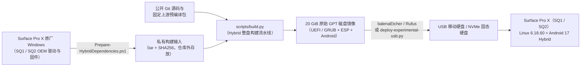

<div align="center">
  

  <h1>Googlebook OS on Surface Pro X</h1>
  <p>
    面向 Microsoft Surface Pro X（SQ1 / SQ2 · 骁龙 8cx Gen 1/2）的 Android 17（<code>mica 16471258</code>）+ Linux <code>6.18.60-sq2-android1</code> hybrid（混合模式）移植系统
  </p>

  <p>
    <a href="README.md">English</a> | <strong>简体中文</strong>
    &nbsp;·&nbsp; <a href="#架构与概览">概览</a>
    &nbsp;·&nbsp; <a href="#设备兼容性与功能支持矩阵">支持状态</a>
    &nbsp;·&nbsp; <a href="#功能能力与性能基准">性能基准</a>
    &nbsp;·&nbsp; <a href="#真机部署指南">安装指南</a>
    &nbsp;·&nbsp; <a href="#从源码构建">源码构建</a>
    &nbsp;·&nbsp; <a href="#文档索引">文档</a>
  </p>

  <p>
    
    
    
    
    
  </p>
</div>

---

## 架构与概览

**Googlebook OS on Surface Pro X** 是面向 **Microsoft Surface Pro X（SQ1 / SQ2）**（`sc8180x` / 骁龙 8cx Gen 1 与 Gen 2）的 ARM64 移植系统，基于 Android 17 的 Googlebook OS（`mica 16471258`）与 Linux `6.18.60-sq2-android1` 内核构建。它是一套完整的 Android 桌面操作系统，**并非** ChromeOS Flex。

本项目维护单一且统一的 **hybrid（混合模式）** 产品线，由 SQ1 与 SQ2 共用同一套镜像：

- **统一引导与 SoC 路由（EL2）**：SQ1 与 SQ2 共用同一份 Linux `Image`、内核模块、`initramfs.cpio.gz` 以及 **EL2（`sq2.el2=1`）** 引导路径。Surface ARM64 UEFI 加载定制 GRUB（`BOOTAA64.EFI`），再由 `start.efi` 检测 SMBIOS 机型并动态分发：SQ2 加载 `el2launch.efi` + `android-el2.dtb`，SQ1 加载 `el1launch.efi`（`el2launch.efi` 的克隆副本，仍保留 `sq2.el2=1`）+ `android-sq1.dtb`（基于 `android-el2.dtb` 保留 `SQ1EL2/android-el2.dtb` 中的 GPU/GMU OPP 配置），并协同加载 `qebspilaa64.efi`（SLPI PAS12）与 `tcblaunch.exe`。
- **混合图形与显示栈**：
  - **EGL / GLES**：采用 **Mesa Freedreno `26.2.4`** + `libdrm 2.4.133`（已剔除参考镜像中的 EGL/GLES 库）。
  - **双 Vulkan 路由器（`vulkan.freedreno.so`）**：通过 `/vendor/etc/sq2-vulkan-policy.conf` 按进程路由——系统 UI、浏览器、模拟器、基准测试及常规应用默认使用硬件 GMEM 模式下的 **Turnip / Mesa**（`vulkan.turnip.so`）；Unity / Unreal 引擎及部分特定游戏默认使用 **Qualcomm Quest 2 v77 原生 Vulkan**（`vulkan.qti.so` + `libgsl` / `libadreno_utils`）。
  - **显示合成与 Gralloc**：采用 **QTI SM8350 Display / HWC / SDM** 与 **AOSP / QTI `mapper5` / `allocator`**，由 Quest 2 v77 `gralloc.kona.so` / `qdMetaData` 提供底层分配，并通过 `gralloc.sq2_mesa.so` 桥接至 Mesa，配合线性 RGB 布局适配层（`libsq2_grallocutils_vendor.so`）及 SDM 转 `pwm-backlight` 背光垫片（`libsq2_sdm_backlight.so`）。
- **多媒体与硬件子系统**：集成 **QTI SM8250 原生 OMX**（`quest2-omx-service`，原生 ANW Surface 解码）与 Linux **Venus 硬解**模块（`venus-core.ko` / `venus-dec.ko` / `venus-enc.ko`，含 `s2idle` 电源状态钩子）、**V4L2 / CAMSS + 软件 ISP Camera2 HAL**、**SLPI PAS12 + `sensors.spx.so` SubHal**，以及 **IPTSd `3.1.1`** 触控屏与手写笔服务。



---

## 设备兼容性与功能支持矩阵

### 目标设备

| 设备型号 | SoC | 引导模式与设备树（DTB） | 构建配置 | 当前支持范围 |
| :--- | :--- | :--- | :---: | :--- |
| **Surface Pro X（一代）** | Microsoft SQ1（8cx Gen 1） | **EL2**（`el1launch.efi` [`el2launch` 副本] + `android-sq1.dtb`） | `hybrid`（共用） | 共用 EL2 镜像目标平台；早期构建已验证 LTE 与触控枚举，完整 `6.18` 对等验收待完成 |
| **Surface Pro X（二代）** | Microsoft SQ2（8cx Gen 2） | **EL2**（`el2launch.efi` + `android-el2.dtb`） | `hybrid`（共用） | `6.3.8` 与 `6.18.60` 阶段的主力验证平台 |

### 功能支持矩阵

图例：`✅ 可用` · `🟡 部分可用` · `❌ 不可用`

| 子系统 | 状态 | 已验证行为、硬件范围与限制 |
| :--- | :---: | :--- |
| **UEFI / NVMe / USB 启动与存储** | ✅ 可用 | ARM64 UEFI → 定制 GRUB（`BOOTAA64.EFI`）→ SMBIOS 路由（`start.efi`）→ **EL2**（`sq2.el2=1`；SQ1 使用 `el1launch.efi` 副本 + `android-sq1.dtb`，SQ2 使用 `el2launch.efi` + `android-el2.dtb`）。20 GiB GPT 镜像在首次正常启动时自动在线扩容 `userdata`（`grow-image-userdata` + `resize2fs`）。*注：`2026-11-16` 通用镜像已通过构建主机校验，真机启动验收待完成。* |
| **音频（扬声器 / 麦克风 / USB-C）** | ✅ 可用 | SQ2 已验证：SoundWire WCD9340 扬声器（`+12 dB` RX7/RX8 `raw=84`，含 FIFO 修复）、DMIC 麦克风（`CARD_0_DEV_1`，`raw=96`）及 USB-C 音频（`05ac:110b`，48 kHz 放音/录音）。*限制：内置扬声器低频不足且声场略偏右；SQ1 音频与蓝牙 A2DP/HFP 尚未测试。* |
| **Root / KernelSU** | ✅ 可用 | 集成 KernelSU Next（`v3.2.0-legacy`）+ Zygisk Next（`1.5.2`）+ `sq2-ksu-modules-boot`，并提供实验性 `device_faker_gfx` 模块。通用镜像默认清除个人凭据、锁定 `root` 密码并禁用 SSH。 |
| **Android 桌面与图形（GLES / Vulkan）** | 🟡 部分可用 | SQ2 上 `2880×1920@60` 桌面、Mesa 26.2.4 Freedreno/Turnip、双 Vulkan 路由器及 QTI HWC/SDM 均可正常使用。*限制：图形兼容性仍有限；A680.1 Wild Life GMEM 根因尚未定位，`6.18` 下开启硬件 GMEM 的 Wild Life 复测待完成。* |
| **视频硬解（Venus / OMX）** | 🟡 部分可用 | 通过 QTI OMX + Venus 硬解支持 H.264、HEVC（Main8）、VP8 与 VP9（Profile 0），另有实验性 `c2.sq2.*.experimental` 供 C2 调试。*限制：内置屏幕仅支持 SDR（默认 OMX 已禁用 HDR 并过滤 Main10），固件不支持 AV1，MPEG-1/2 未完整集成。* |
| **摄像头（前置 / 后置）** | 🟡 部分可用 | 通过 V4L2/CAMSS + 软件 ISP + Camera2 HAL 驱动 OV5693（前置）与 OV13858（后置）；SQ2 已验证原生 JPEG 拍照与 480p/720p/1080p H.264/AAC 录像。*限制：720p/1080p 下软件 ISP 帧率偏低，后置自动对焦与曝光待调优，偶发 CCI 打开/切换超时，SQ1 未测。* |
| **触控屏与手写笔** | 🟡 部分可用 | IPTSd `3.1.1` 同时适配 SQ2（`045E:0C21`）与 SQ1（`045E:0996`）。内置双语触控校准向导（`probe/touch-calibration/`），学习得到的噪声基线按设备绑定。*限制：端到端触控延迟、`0996` 休眠唤醒恢复以及 Surface 触控笔压感/倾角绘图尚未测试。* |
| **传感器（自动亮度 / 自动旋转）** | 🟡 部分可用 | TCS3430 环境光传感器 + SLPI PAS12（`qcslpi8180.mbn`、`qebspilaa64.efi`、`hexagonrpcd`）+ `sensors.spx.so` SubHal + 旋转配置覆盖层。已在 SQ2 验证（含重启保持）；*SQ1 验证及长时休眠后恢复待测。* |
| **休眠（`s2idle`）与电源管理** | 🟡 部分可用 | SQ2 `6.18.60` 已完成单次实机验证（Venus `s2idle` 握手 + `desktop-services.jar` 交流电持锁补丁 `1000 ms`，最长单次休眠 `59.2s`）。*限制：仍存在 `timerfd` 提前唤醒与进程冻结中止问题，长时续航/功耗曲线及 SQ1 休眠未测。* |
| **LTE 移动数据** | 🟡 部分可用 | 动态 EFI SCM/GPT FSG 缓存（`EFI/SPX/LTE/<uuid>.bin`，上限 2 MiB）+ IPA4.1 / QMI / RMNET IPv4 数据连接已在 SQ1 与 SQ2 跑通。*限制：双机全新通用镜像验收、IPv6 与漫游尚未完成验证。* |
| **Wi-Fi / 蓝牙 / SSH** | 🟡 部分可用 | SQ2 上 Android 托管的 Wi-Fi（`ath10k_snoc`，WCN3990）与 QCA UART 蓝牙（`sq2-hci-bridge`）可用。*限制：BLE HID 配对及 `uhid` 节点注册已确认，但真实光标/滚轮输入事件尚未确认；通用构建默认关闭 SSH（开启时仅允许密钥登录）。* |
| **USB 存储 / Type Cover / 物理按键** | 🟡 部分可用 | SQ2 已验证 FAT32 USB 存储（`PUBLIC` SAF 卷）、USB-C 音频（`05ac:110b`）、Surface Type Cover 键盘保护盖（`045E:09AE/09AF/09B0`，含热插拔恢复）及音量/电源按键。*限制：exFAT 仅支持只读，其他各类 USB 外设未测。* |
| **USB-C DP / 原生多屏设置** | ✅ SQ2 可用 | 两口 DP 出图、拔插/换口和内屏保持已验收；原生屏幕排列、镜像/扩展可用。默认构建接入 SAM/QMP、HWC 热插拔/非无缝模式分组及未知合盖状态修复。SQ1、DP 音频与外屏长时休眠未验收。 |
| **下口 USB ADB** | ✅ SQ2 可用 | 默认下口为需授权的 USB ADB（`ro.adb.secure=1`）；Windows 枚举、shell、重启恢复及 host 回切实测通过。使用下口 DP/USB 外设前，通过 root SSH 执行 `spx-lower-usb host --save`。设备选择及授权不嵌入通用包，见 [Type-C](docs/TYPEC.md)。 |
| **红外 / Windows Hello、通话/短信/5G/eSIM、休眠到磁盘、合盖休眠** | ❌ 不可用 | 红外摄像头/人脸认证未实现（仅识别芯片 ID）；无蜂窝语音通话、短信、IMS、eSIM 或 5G；禁用休眠到磁盘（`nohibernate`）与合盖休眠（`lid_behavior=0`，无 `SW_LID`） |

---

## 功能能力与性能基准

> [!NOTE]
> **基线元数据**：除非另有说明，以下实测数据均采集自 **Surface Pro X SQ2** 在整合前里程碑构建上的表现，分别对应 `6.18.60-sq2-android1`（Hybrid 图形、传感器、摄像头、OMX、`s2idle`）与 `6.3.8-sq2-android1`（Wild Life、CPU/GPU OPP）测试版本。**`2026-11-16` 通用混合模式整盘镜像**（`surface-pro-x-6.18-hybrid-generic.img`）目前仅通过构建主机打包与完整性校验，实机启动与 **SQ1** 对等基准测试尚待开展。

### 已验证量化指标

| 类别 | 测试负载 / 检查项 | 硬件与基线 | 实测结果 | 来源与说明 |
| :--- | :--- | :--- | :--- | :--- |
| **3D / Vulkan** | 3DMark Wild Life（`v2.7.5093`），Turnip `26.2.4` 强制 `sysmem`（514 MHz） | SQ2（`A680.1`），Linux `6.3.8` | **4311** 分 / **25.82 FPS** | [WILD-LIFE](docs/WILD-LIFE.md)；抽样画面干净 |
| **3D / Vulkan** | 3DMark Wild Life，Turnip `26.2.4` 强制 `sysmem`（661 MHz） | SQ2（`A680.1`），Linux `6.3.8` | **4920** 分 / **29.46 FPS** | [WILD-LIFE](docs/WILD-LIFE.md)；抽样画面干净 |
| **3D / Vulkan** | 3DMark Wild Life，限定 `A680.1 + 3DMark` `sysmem` 补丁（661 MHz） | SQ2（`A680.1`），Linux `6.3.8` | 重启前 **5279** / **31.61 FPS**；重启后 **5264** / **31.52 FPS** | [WILD-LIFE](docs/WILD-LIFE.md)。`6.18` 在内核 `0003` 修复后已将 Turnip 恢复为硬件 GMEM；**`6.18` GMEM 版 Wild Life 复测待完成** |
| **3D / Vulkan** | 3DMark Wild Life，闭源 `v819.1` + QTI/mapper5 桥接 | SQ2（`A680.1`），Linux `6.3.8` | 6357 / 38.07 FPS，57.2 °C —— **成绩无效** | [WILD-LIFE](docs/WILD-LIFE.md)；存在严重黑块与粉/白条纹渲染错误 |
| **GPU 计算** | 30 秒 `vulkan-readback` 压测（每轮 `4096` words，`4096` 次 ALU 迭代） | SQ2，Linux `6.3.8` | 590 MHz：**28,462 轮**（`41.3 → 44.4 °C`）<br/>661 MHz：**26,626 轮**（`43.2 → 45.9 °C`） | `scripts/test-sq2-gpu-opp.sh`；75 °C 触发被动温控 |
| **显示 / HWC** | `2880×1920@60`（`density=320`），QTI mapper5 + EGL + HWC | SQ2，Linux `6.18.60`（`v21`） | **20/20** RGB AHB→EGL 回读通过；**135** 帧 YUV（最大误差 `0.00048447`）；**0** 次 HWC 图层禁用 | [DEFAULT-DISPLAY-DENSITY](docs/DEFAULT-DISPLAY-DENSITY.md)、`configs/deployment-status.json` |
| **视频（默认 OMX）** | H.264 / HEVC 原生 `quest2-omx-service` | SQ2，Linux `6.18.60` | H.264 `320×240@30`：**293** 帧渲染 / `9961 ms`；`1080p@60`：**562** 帧渲染 / `9981 ms`；HEVC `v21`：内存端 **30** 帧精确比对 / 重启后 **6** 帧 DRC 精确比对（`0` 坏点） | `configs/deployment-status.json`；`1080p@60` 未做逐像素一致性校验 |
| **视频（实验性 C2）** | 实验性 `c2.sq2.*.experimental` 内存测试*（非默认持久化 OMX）* | SQ2，Linux `6.18.60` | HEVC Main8 `4K@60`：**600 帧 / 9978 ms**（192 MiB 缓冲池）；HEVC Main10 `240p@30`：**300 / 9962 ms**；VP8 `4K@30`：**300 / 9962 ms**；VP9 p0 `4K@60`：**600 / 10056 ms** | [VIDEO-CAPABILITY-ALIGNMENT](docs/VIDEO-CAPABILITY-ALIGNMENT.md)；常规 4K Main10/60fps 及 Bilibili 4K 持久化未测 |
| **摄像头** | OV5693（前置）/ OV13858（后置）原生 JPEG 与软件 ISP H.264+AAC | SQ2，Linux `6.18.60` | JPEG：后置 **4224×3136**，前置 **2592×1944**<br/>480p：前置 **28.6** / 后置 **30.0** fps；720p：前置 **18.3** / 后置 **10.0** fps；1080p：前置 **6.3**（MP4 约 5.7）/ 后置 **7.7**（MP4 约 7.1）fps | [CAMERA-BUILD](docs/CAMERA-BUILD.md)、[TODO](docs/TODO.md) |
| **音频** | 扬声器（`RX7/8 raw=84`）、DMIC（`raw=96`）、USB-C（`05ac:110b`） | SQ2，Linux `6.18.60` | 扬声器：`864k` + `2×192k` 帧（单独测试 **0 XRUN**）；DMIC：ALSA `483,328` 帧 / `AudioRecord` `480,000` 帧（`0` 削波）；USB-C：输出 `192k` / 录入 `240k` 帧（`~5202 ms`） | [SPEAKER-LOUDNESS](docs/SPEAKER-LOUDNESS.md)、[MICROPHONE](docs/MICROPHONE.md)、[USB-FUNCTIONS](docs/USB-FUNCTIONS.md) |
| **触控与传感器** | IPTSd `3.1.1` + TCS3430 ALS / SLPI PAS12 | SQ2，Linux `6.18.60` | 触控：`30s` 静置 **0** 误触；`32` 项离线校准测试全部通过。传感器：**52–160 lux** → 背光 **643–1053 / 4095**，屏幕旋转 `0/3` 验证通过 | [TOUCH-CALIBRATION](docs/TOUCH-CALIBRATION.md)、[TOUCH-DEVICE-COMPAT](docs/TOUCH-DEVICE-COMPAT.md)、[SENSORS](docs/SENSORS.md) |
| **CPU 与温控** | 8 核绑核 20 秒满载（`qcom-cpufreq-hw`，`schedutil`） | SQ2，Linux `6.18.60` | 小核 `0–3`：**300–1766.4 MHz**；大核 `4–7`：**825.6–3148.8 MHz**；采样峰值 CPU 温度 **53.3 °C**（80 °C 降频阈值） | `scripts/test-sq2-cpu-frequency.sh` |
| **休眠（`s2idle`）** | 单次启动 Venus + `desktop-services.jar`（`1000 ms`）验证 | SQ2，Linux `6.18.60` | `success=4`，Venus `stops=5/starts=5`，`failed_resume=0`，最长单次休眠 **59.199 s**（唤醒后显示/触控/音频正常） | [SUSPEND](docs/SUSPEND.md)；仅为单次启动验证 |

### 定性验证行为与待测项

- **定性已验证行为**：在 SQ2 上，Android 桌面（`2880×1920@60`）、Bilibili `720p/1080p/4K` 清晰度切换、双 Vulkan（`SQ2VkRouter` Turnip/QTI 双路径）、Type Cover 热插拔恢复、FAT32 U 盘挂载、Wi-Fi（`ath10k_snoc`）、蓝牙开关状态以及 KernelSU Next + Zygisk Next 均可在测试中正常运行。原生 LTE IPv4 数据连接已在 SQ1 与 SQ2 上实测跑通。
- **尚未测试与待解决缺口**：
  - **SQ1 硬件对等验证**：SQ1 的传感器、`s2idle`、摄像头、持续 CPU/GPU 负载（限制在 `2995.2 / 661 MHz`）以及 `2026-11-16` 通用镜像启动尚待实测。
  - **标准 3D 与 Web 基准**：缺少 `glmark2`、`vkmark`、WebGL 以及 `6.18` 硬件 GMEM 模式下的 Wild Life / 游戏帧率功耗比数据。
  - **音频 / 输入 / 显示缺口**：内置扬声器低频与左右声道平衡；Bilibili 拖放/切换清晰度时的音频跳帧或 XRUN（实测出现过 `1×4096` 帧 HAL 跳帧）；蓝牙 A2DP/HFP 音频；BLE HID 实际光标/滚轮事件；Surface 触控笔绘图/压感/倾角；端到端触控延迟。
  - **功耗与长时稳定性**：多轮连续 `s2idle` 可靠性（仍存在 `timerfd` 唤醒与冻结中止）、电池放电曲线、实时整机瓦数遥测以及 `sq2-game-opt` 开启前后的帧率/功耗对比。
- **构建主机测试 vs 真机测试**：`tests/` 目录包含 `336` 个构建主机端打包、策略、校准及 ASan/UBSan 测试用例（`232` 个 Python、`92` 个 C/C++、`5` 个 PowerShell、`7` 个测试夹具）；`scripts/` 目录提供真机诊断脚本（`test-sq2-cpu-frequency.sh`、`test-sq2-gpu-opp.sh`、`test-sq2-audio-reopen.sh`、`verify-sq2-mediacodec-frames.py`）。主机侧校验通过并不代表真机启动已获认证。

---

## 真机部署指南

本 Git 仓库**不**分发预构建磁盘镜像、专有固件或参考二进制文件；请先自行构建镜像（参见[从源码构建](#从源码构建)）。标准构建会生成一份 20 GiB（`21,474,836,480` 字节）的稀疏原始 GPT 磁盘镜像及其 gzip 压缩包：

- `disk/surface-pro-x-6.18-hybrid-generic.img`（20 GiB 原始 MBR+GPT 整盘镜像）
- `disk/surface-pro-x-6.18-hybrid-generic.img.gz`（约 7.64 GiB / `8,199,981,130` 字节压缩包）

> [!CAUTION]
> **操作前请务必备份 Windows 系统与 BitLocker 恢复密钥。**
> - 直接刷写**内置 NVMe 固态硬盘**会彻底覆盖原有 Windows 系统及全部本地数据。如需安全试用，建议刷入**外接高速 USB 移动硬盘**或装在 **USB-NVMe 硬盘盒**中的备用固态硬盘（容量 `>= 20 GiB`，512 字节逻辑扇区）。
> - **单镜像磁盘规则**：启动阶段 `prepare-image-ssd` 会扫描所有已连接的块设备以查找 `PARTNAME=SQ2PROBE` + `SPX-IMAGE.txt`。若同时连接了**两块及以上**刷有该镜像的磁盘，启动会以 `ambiguous-image-disk` 报错中止。**切勿同时接入两块包含本镜像的磁盘。**

### 1. Surface Pro X 前置准备

1. **校验镜像完整性**：刷盘前请先在构建主机上校验镜像文件（当前本地构建校验值参见 [IMAGE](docs/IMAGE.md)）：
   ```sh
   cd IMAGE_OUTPUT
   sha256sum -c SHA256SUMS
   gzip -t disk/surface-pro-x-6.18-hybrid-generic.img.gz
   ```
2. **在 Surface UEFI 中关闭安全启动（Secure Boot）**：生成的 ARM64 EFI 引导文件（`BOOTAA64.EFI`、`start.efi`、`el1launch.efi`、`el2launch.efi`）均为未签名程序。
   - 将 Surface Pro X 完全关机。
   - 按住**音量加（`+`）**不放，再按一下**电源键**（保持按住音量加直到进入 Surface UEFI 设置界面）。
   - 在 **Security** 页面中，将 **Secure Boot** 设为 **Disabled**（或 None）。
   - 若从外置磁盘启动，请在 **Boot configuration** 中确认已启用 **USB Storage**。

### 2. 烧录磁盘镜像

使用标准块设备写入工具刷盘后，**无需**手动调整 `userdata` 分区大小：首次正常开机时，`grow-image-userdata` 会自动迁移备份 GPT 表头（`sgdisk --move-second-header`）、将 `userdata` 扩展至目标磁盘末尾，并在线执行 `resize2fs`。

#### 方案 A：balenaEtcher（Windows / macOS / Linux —— 推荐用于外接 USB 磁盘）

1. 打开 **balenaEtcher**，点击 **Flash from file**（从文件烧录）。
2. 选择 `surface-pro-x-6.18-hybrid-generic.img.gz`（或解压后的 `.img` 文件）。
3. 点击 **Select target**（选择目标磁盘），仔细核对并选中你的外接 U 盘或 USB-NVMe 硬盘盒（容量 `>= 20 GiB`）。
4. 点击 **Flash!** 开始烧录，等待写入与校验完成后安全弹出设备。

#### 方案 B：Rufus（Windows —— 使用 `.img` 进行 DD 镜像模式写入）

1. 先将 `surface-pro-x-6.18-hybrid-generic.img.gz` 解压为 `surface-pro-x-6.18-hybrid-generic.img`（20 GiB 原始镜像文件）。
2. 打开 **Rufus**，在 **设备（Device）** 中选择目标 U 盘或 USB-NVMe 硬盘盒。
3. 在 **引导类型选择（Boot selection）** 点击 **选择（SELECT）**，选中 `surface-pro-x-6.18-hybrid-generic.img`。
   - **Rufus（DD 镜像模式）**：Rufus 会以 **DD 镜像（原始块写入）** 模式写入 `.img` 文件。**切勿**手动解包分区复制到 FAT32/NTFS 分区，也不要使用 ISO 解压模式。
4. 点击 **开始（START）** 并确认数据清除警告，等待写入完成后安全弹出。

#### 方案 C：Linux USB-NVMe 硬盘盒安装脚本（`deploy-experimental-usb.py`）

在原生 Linux 主机（或配置了独占 USB 直通的 Linux 虚拟机，不支持 WSL）上使用包含区段信息的镜像清单向 USB-NVMe 硬盘盒中的替换固态硬盘写入镜像时，可使用 `scripts/deploy-experimental-usb.py`（详见 [USB-NVME-DEPLOY](docs/USB-NVME-DEPLOY.md)，目前仅通过离线校验测试）。注意：`deploy-experimental-usb.py` 需要包含 `extents` 列表的 `MANIFEST`；标准 `build.py` `full-image` 产出的 `IMAGE-MANIFEST.json` 不含 `extents`，应直接使用 **balenaEtcher**、**Rufus（DD 镜像模式）** 或原始块设备写入工具烧录：

```sh
# 预演检查（列出符合条件的目标 USB 磁盘并校验清单与布局）
python3 scripts/deploy-experimental-usb.py \
  --manifest MANIFEST --layout LAYOUT --image IMAGE

# 添加 --execute --device /dev/sdX 后，需完整输入屏幕打印的 ERASE 确认串：
# ERASE ["/dev/sdX","<serial>",<size_bytes>]（或通过 --confirm-erase 传入）
```

### 3. 启动与首次开机设置

1. 确保 Surface Pro X 仅连接了**一块**已烧录本镜像的磁盘。
2. **从 USB 启动**：关机状态下按住**音量减（`-`）**不放并按下**电源键**（看到 Surface 旋转图标后松开音量减），或在 Surface UEFI 中将 **USB Storage** 顺序调至 **Internal Storage** 之前。
3. **GRUB 启动菜单**（5 秒倒计时）：
   - **`Surface Pro X Linux 6.18 - single user 0`**（`spx-single-user`，默认项）：通过 `/EFI/SQ2Nat/start.efi` 启动 Android 17 Hybrid 桌面。
   - **`Surface Pro X Linux 6.18 - rescue (no Android data mount)`**（`spx-rescue`）：诊断救援模式（`sq2.rescue=1`），经由 `/EFI/SQ2Res/start.efi` 启动，不挂载 Android `userdata` 且不触发分区扩容。
   - **`Power off`**：关闭设备电源。
4. **首次开机**：`surface-first-boot` 会自动跳过 Android 初始设置向导（`device_provisioned=1`、`user_setup_complete=1`）并直接进入桌面。独立的双语**触控校准向导（Touch Calibration Wizard）**会在首次启动时自动运行，为当前屏幕模组校准触控噪声阈值。

---

## 从源码构建

> [!IMPORTANT]
> **为何 Windows OEM 驱动提取与私有输入不随 Git 分发**
> Microsoft/Qualcomm 专有 OEM 固件（`ADSP`、`CDSP`、`SLPI`、`WLAN/BT`、`MCFG` 及传感器配置）、Google/Cuttlefish 恢复包产物、Quest 2 v77 vendor 库、个人凭据以及整盘镜像均受版权或隐私约束，无法随公开 Git 仓库分发。所有私有输入均保存在本地 `private/build-inputs/`（或通过 `--private-root` 指定）。

### 第一步：在 Windows 版 Surface Pro X 上采集共用输入

在原厂 **Windows ARM64 版 Surface Pro X（SQ1 或 SQ2）** 上操作（需 PowerShell 5.1+、Git for Windows、`curl.exe`、`tar.exe`；建议将输出目录放在可用空间充足的 NTFS/exFAT 分区，下载总量约 7.6 GB）：

```powershell
# 仅预览清单，不执行下载
powershell -NoProfile -ExecutionPolicy Bypass -File .\scripts\Prepare-HybridDependencies.ps1 -Output D:\spx-deps -Plan

# 下载固定版本的上游公开输入 + 只读导出 Surface DriverStore 驱动 + 打包 tar 与 SHA256 校验文件
powershell -NoProfile -ExecutionPolicy Bypass -File .\scripts\Prepare-HybridDependencies.ps1 -Output D:\spx-deps -IncludeThirdParty
```

- **只读 OEM 提取规则**：`scripts/Export-SurfaceHybridDependencies.ps1`（亦可通过 `-WindowsRoot` 针对离线解包的恢复镜像执行）仅从 `DriverStore\FileRepository` 抽取指定的 INF 驱动包（`qcbtfmuart8180`、`qcdx8180`、`qcwlan8180`、`surfaceprox_{mcfg,subextadsp,subextcdsp,subextmpss,subextscss,sensorsconfig}`、`surfacelightsensor`）以及 `Windows\System32\tcblaunch.exe`。脚本**绝不**读取实时注册表、用户账户、Wi-Fi 密码、SSH 密钥、单机出厂校准或基带 EFS/NV 数据。
- **净室构建边界**：如 [DEPENDENCIES](docs/DEPENDENCIES.md) 所述，仅靠公开下载与 Windows 导出包目前尚不能从零合成全部 Android/QTI 运行时、`board.dts`、EFI 引导程序（`start.efi` / `el2launch.efi` / `qebspilaa64.efi`）与 `template.img`（`hybrid_bootstrap.py --stage all` 会在该剩余缺口处明确返回非零退出码）；仍需按 [STANDARD-BUILD](docs/STANDARD-BUILD.md) 备齐 `private/build-inputs/` 所需文件。

### 第二步：在 Linux（x86_64）上导入并构建

将生成的 `spx-deps.tar` 与 `.sha256.json` 回执文件复制到 Linux x86_64 构建主机（推荐 Ubuntu 24.04、Python 3.12+；请在原生 Linux 文件系统下构建，切勿放在 `/mnt/c` 或 NTFS/9p 挂载目录）：

```sh
# 1. 校验 tar 与哈希，提取 OEM 固件及经 CRC 校验的 1480 字节 ALS 基准校准数据
python3 scripts/import-hybrid-dependencies.py \
  --archive downloads/spx-deps.tar --sha256 SHA256 \
  --output private/dependency-import

# 2. 基于匹配的 6.18 内核构建树源码编译摄像头与传感器组件包
python3 scripts/build-spx-camera-bundle.py --inputs private/camera-build.json --output out/camera-from-source
# （传感器组件包请通过 scripts/build-spx-sensor-bundle.py 构建 —— 参见 docs/SENSORS.md）

# 3. 执行默认构建：full-image + --kernel-mode source + --graphics hybrid
python3 scripts/build.py --private-root PREPARED_INPUTS --output FRESH_LINUX_OUTPUT --jobs 8
```

- **构建模式与组件复用**：
  - `scripts/build.py`（底层调用 `scripts/build-lts.py`）默认执行 `full-image`，并固定启用 `--kernel-mode source` 与 `--graphics hybrid`（唯一支持的图形模式）。
  - 传入 `--esp-only` 可仅生成 ESP 分区载荷（`disk/esp/`），跳过 20 GiB 整盘镜像打包。
  - 通过 `--reuse-components REUSE.json`（由 `scripts/full_image_reuse.py` 生成）可复用已验证组件（内核、模块、摄像头、传感器、Mesa 与胶水层）；若修改了 `probe/touch-calibration/` 下的 Java/Manifest 代码，流水线会自动失效缓存并重编 `wizard.apk`。
  - 仅需针对匹配的 `KOUT` 增量重编 Venus 模块并重新打包时，可执行：
    ```sh
    python3 scripts/rebuild-hybrid-venus.py --reuse-components PREV_REUSE.json \
      --kernel-build MATCHED_KOUT --source PREV_VENUS_SOURCE --output FRESH_VENUS_OUTPUT
    python3 scripts/build.py --reuse-components FRESH_VENUS_OUTPUT/REUSE.json \
      --private-root PREPARED_INPUTS --output FRESH_IMAGE_OUTPUT
    ```
  - `compile` 子命令仅独立编译内核与外部模块（`Image`、`modules`、`dtbs`），不生成 initramfs 或磁盘镜像；旧版 `verify` / `package` 仅用于校验或拷贝 `configs/kernel-baseline.json` 中锁定的 `EFI/SQ2Nat` 历史基线。

### 仓库目录结构

```text
.
├── assets/                 # 项目徽标与视觉资源
├── configs/                # 锁定依赖清单、Vulkan 路由策略、SoC 配置与已知问题 JSON
├── docs/                   # 构建、依赖、镜像、部署及各子系统文档
├── patches/                # Linux 6.18 Surface 基线及 DRM/A6xx MMIO/GMEM 补丁集
├── probe/                  # 机内服务、触控校准向导及双 Vulkan/gralloc/摄像头/传感器胶水层
├── reference/              # 上游参考配置与辅助源码
├── scripts/                # 构建入口（build.py、full_image.py）、Windows 采集脚本与部署工具
├── source-dependencies/    # 经审核的 6.18 外部内核模块源码与设备树覆盖层
├── tests/                  # 构建主机端 Python unittest、C/C++ ASan/UBSan 及 PowerShell 测试套件
└── upstream/               # Git 子模块与固定版本的外部组件源码树
```

---

## 文档索引

### 构建、依赖与部署
- [BUILD](docs/BUILD.md) —— 当前 `build.py` 构建入口、私有输入、执行顺序与输出产物
- [STANDARD-BUILD](docs/STANDARD-BUILD.md) —— 完整 Hybrid 流水线流程、组件复用与 `PRIVACY.json` 脱敏规则
- [DEPENDENCIES](docs/DEPENDENCIES.md) —— Windows 依赖采集、Quest 2 参考二进制处理与 `hybrid_bootstrap.py` 各阶段说明
- [IMAGE](docs/IMAGE.md) —— 当前镜像校验值、首次开机 OOBE 策略、触控校准向导与主机侧校验范围
- [DEVELOPMENT](docs/DEVELOPMENT.md) —— 跨任意 SQ1/SQ2 设备通用的交付规范（`SPX-PORTABLE-SQ1-SQ2`）
- [PROVENANCE](docs/PROVENANCE.md) —— 固定版本的运行时来源、Commit 记录与组件开源许可
- [USB-NVME-DEPLOY](docs/USB-NVME-DEPLOY.md) —— Linux 下通过 USB-NVMe 硬盘盒部署镜像指南（`deploy-experimental-usb.py`）
- [TODO](docs/TODO.md) —— P0 级通用化待办事项及尚未验证的软硬件工作

### 子系统与硬件适配
- [UNIFIED-SQ1-SQ2](docs/UNIFIED-SQ1-SQ2.md) —— SQ1/SQ2 共用内核与 initramfs 设计及分机型 DT/OPP 路由
- [CAMERA-BUILD](docs/CAMERA-BUILD.md) —— 前/后置 V4L2/CAMSS + 软件 ISP + Camera2 HAL 构建指南
- [SENSORS](docs/SENSORS.md) —— TCS3430 ALS、SLPI PAS12、`sensors.spx.so` 与自动旋转配置
- [TOUCH-CALIBRATION](docs/TOUCH-CALIBRATION.md) —— 双语触控校准向导工作流与设备绑定密钥派生
- [TOUCH-DEVICE-COMPAT](docs/TOUCH-DEVICE-COMPAT.md) —— IPTSd `3.1.1` 对 SQ2（`045E:0C21`）与 SQ1（`045E:0996`）的适配说明
- [WILD-LIFE](docs/WILD-LIFE.md) —— A680.1 Wild Life GMEM 问题、`sysmem` 临时规避与双 Vulkan 路由说明
- [VIDEO-CAPABILITY-ALIGNMENT](docs/VIDEO-CAPABILITY-ALIGNMENT.md) —— Venus 固件上限、默认 OMX 与实验性 C2 对比及 SDR/AV1 约束
- [SPEAKER-LOUDNESS](docs/SPEAKER-LOUDNESS.md) —— SoundWire WCD9340 扬声器增益与 FIFO 配置
- [MICROPHONE](docs/MICROPHONE.md) —— WCD9340 DMIC 路由（`audio-microphone-route`）与录音验证
- [LTE-PRODUCT](docs/LTE-PRODUCT.md) —— 动态 EFI FSG 缓存与 IPA4.1 / QMI / RMNET IPv4 蜂窝数据
- [USB-FUNCTIONS](docs/USB-FUNCTIONS.md) —— 已验证 USB 存储、USB-C 音频及 DisplayPort Alt Mode 状态
- [BLUETOOTH-INPUT](docs/BLUETOOTH-INPUT.md) —— QCA UART 蓝牙与 BLE HID（`uhid`）当前状态
- [SUSPEND](docs/SUSPEND.md) —— `s2idle` Venus 握手、`desktop-services.jar` 交流电持锁补丁与已知限制
- [UNRESTRICTED-POWER](docs/UNRESTRICTED-POWER.md) —— 温控与电源策略、`nohibernate` 及 `lid_behavior=0`
- [ROOT-MANAGEMENT](docs/ROOT-MANAGEMENT.md) —— KernelSU Next、Zygisk Next 与 `device_faker` 配置
- [DEFAULT-DISPLAY-DENSITY](docs/DEFAULT-DISPLAY-DENSITY.md) —— `2880×1920@60` 显示密度（`320` dpi）策略
- [PAGE-MODE-NOTIFICATION](docs/PAGE-MODE-NOTIFICATION.md) —— 4 KB 内存页大小通知与运行时说明
- [外部内核模块归档](source-dependencies/kernel-6.18/README.md) —— 经审核的 6.18 外部模块源码归档与设备树覆盖层

---

## 致谢与免责声明

- 本项目基于 **linux-surface**（ARM64 内核 / GRUB / IPTSd 基础）、**Mesa Freedreno / Turnip**、**AOSP / Googlebook（`mica`）**、**Cuttlefish**、**QTI CAF**（`SM8350` 显示 / `SM8250` 多媒体）及 **KernelSU Next** 等上游项目构建。
- 各上游组件与二进制文件的版权及许可均归原著作权人所有（详见 [PROVENANCE](docs/PROVENANCE.md) 与 `source-dependencies/kernel-6.18/README.md`），不存在覆盖全部第三方二进制或上游源码的单一统括许可证。
- **验证免责声明**：构建主机侧编译成功、校验和通过及单元测试完成，并**不**保证真机一定能够成功引导、通过 SQ1/SQ2 跨机型验收、实现长期稳定 `s2idle` 休眠或保障电池与温控安全。刷写存储设备存在数据丢失风险，请在测试前做好重要数据备份。
