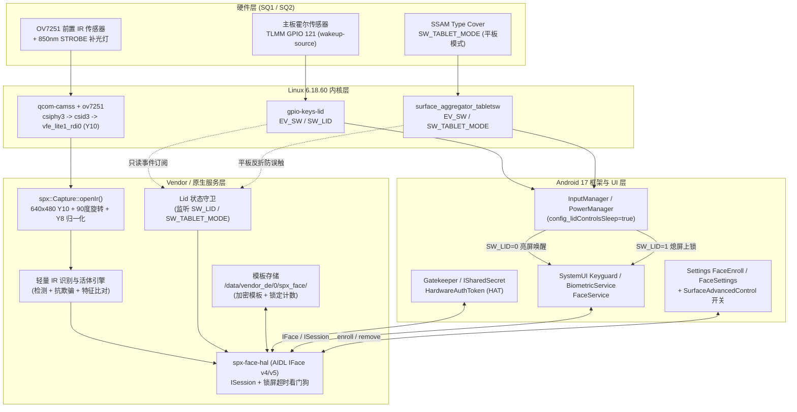
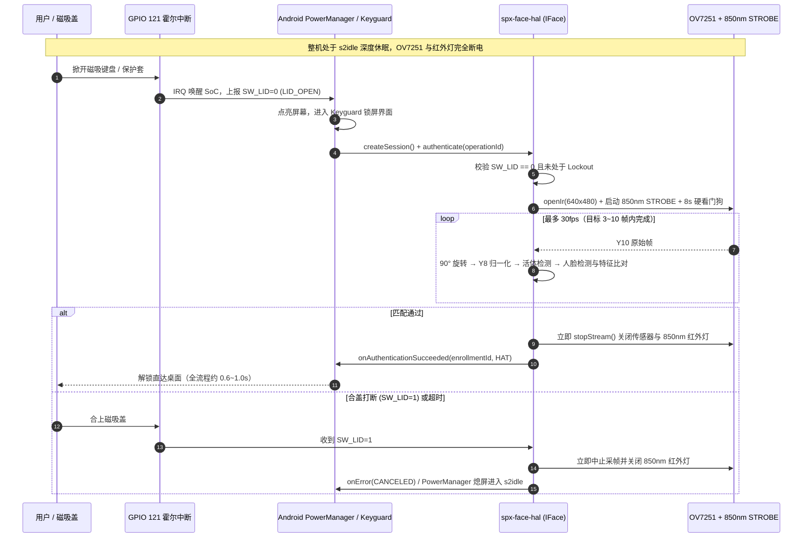

# Surface Pro X (SQ1/SQ2) 霍尔传感器 + OV7251 IR 人脸解锁实施计划

> **适用平台**：Microsoft Surface Pro X (SQ1 / SQ2)，Android 17 (`mica 16471258`) + Linux `6.18.60-sq2-android1` Hybrid (EL2)  
> **状态**：Phase 1–5 代码与主机验证已实现于分支 `feat/ir-hall-face-unlock`（包含霍尔 `SW_LID` DT 补丁与反折保护内核补丁 `0012`、OV7251 850nm 预处理/加密/活体/识别引擎、`IFace/default` AIDL V4 Class 2 HAL、initramfs 阶段挂载脚本及 `SurfaceAdvancedControl` 控制面板）；Phase 0 / Gate 5 实机端到端验收尚未执行（`hardware_validated = false`，仍需 SQ2 与 SQ1 真机实测确认极性、误识别率与续航功耗）。  
> **核心原则**：不启用 QSEE fTPM、保持 `SPX-PORTABLE-SQ1-SQ2` 单镜像通用性、零常驻功耗回归、`s2idle` 休眠安全优先

---

## 1. 目标与边界

### 1.1 目标体验
在 Surface Pro X 上构建一套原生接入 Android 17 生物识别框架、**不依赖 TPM** 的“开盖即解锁”闭环：
1. **掀盖秒醒**：通过主板硬件霍尔传感器（TLMM GPIO 121，`SW_LID` + `wakeup-source`）直接以硬件中断唤醒 `s2idle` 休眠并亮屏进入锁屏界面，无需按电源键。
2. **无感 IR 识别**：锁屏亮起瞬间自动触发 `android.hardware.biometrics.face.IFace` HAL，拉起前置 OV7251 红外摄像头与 850nm 红外补光灯，在 0.5–1.0 秒内完成人脸比对并直接进入桌面。
3. **合盖即锁与防误触**：合上磁吸键盘/保护套触发 `SW_LID=1` 后立即中止任何 IR 采帧、关闭 850nm 红外灯、锁屏并进入 `s2idle`，同时杜绝合盖状态下的误唤醒、误扫黑屏与连续失败锁定。

### 1.2 明确边界与非目标
- **不启用 QSEE fTPM**：避免误触发 donor 镜像里的 ChromebookOS `gscutil`/`check_tpm_clear`、避免污染同机 Windows BitLocker/Windows Hello 的共享 fTPM 状态、避免引入 EL2 (`slbounce`) 下未验证的 QSEECOM SHM Bridge SMC 风险。
- **诚实的安全分级（Class 2 / Weak）**：人脸特征提取与比对运行在 Linux/Android 用户态而非签名锁死的 TrustZone TA 中，按 Android Biometrics CDD 定义应声明为 **Class 2 (`WEAK`)**（支持锁屏解锁与普通便捷认证，**不宣称**满足 Class 3 `STRONG` 硬件隔离支付/KeyMint 密钥解锁要求）。
- **单镜像通用性 (`SPX-PORTABLE-SQ1-SQ2`)**：禁止硬编码 `/dev/videoN`、`/dev/input/eventN` 或单机序列号；所有设备节点通过 sysfs/media/evdev 能力动态发现，缺失任一硬件时自动降级且不影响正常开机与密码解锁。

---

## 2. 已验证的现状基线（基于 SQ2 真机实测）

以下能力已在真机 `root@10.126.126.3` 上实测确认，构成方案基础：

| 子系统 | 真机实测状态 | 关键事实 / 证据 |
| :--- | :--- | :--- |
| **OV7251 IR 硬件链路** | **已打通（30.0 fps 稳定采帧）** | `ov7251 2-0060` (rev 7 / `1F`) → `csiphy3` → `csid3` → `vfe_lite1_rdi0`（与前/后 RGB 管线独立）；`spx::Capture::openIr(640, 480)` 实测输出 `V4L2_PIX_FMT_Y10` (`0x20303159`)，`stride=1280`，`614,400 B/帧`，帧间隔 `33.32–33.34 ms`，`0x3005=0x08` 850nm STROBE 随流自动开关。传感器物理安装为 **90° 竖屏旋转**。 |
| **霍尔盖子开关 (`SW_LID`)** | **待实测极性与姿态** | 当前真机 `/proc/bus/input/devices` 仅存在 `Microsoft Surface KIP Tablet Mode Switch`（`SW=2`，仅上报 `SW_TABLET_MODE`），**无 `SW_LID` 上报**。仓库已具备冲突保护脚本 `scripts/prepare-spx-lid-dtb.py`（TLMM GPIO 121，`GPIO_ACTIVE_LOW`，`wakeup-source`）。 |
| **Android 17 盖子策略** | **框架已就绪** | `config_lidControlsSleep = true` 已开启；系统自带 `touchpad-inhibitor-service` 支持监听 `SW_LID`。 |
| **Android 17 人脸框架** | **框架与设置 UI 已内置，仅缺 HAL** | `compatibility_matrix.202604.xml` 原生声明支持 `android.hardware.biometrics.face.IFace/default`（AIDL **v3–v5**）；`com.android.settings` 已内置 `FaceSettingsActivity`、`FaceEnroll`、`BiometricEnrollActivity`、`FaceEnrollConfirmation`；`DesktopTrafficLightFaceOverlay` 已启用。当前仅缺少 `IFace/default` HAL 与 `android.hardware.biometrics.face` feature XML。 |
| **认证密钥与 Gatekeeper** | **可用（软件后端）** | 系统当前运行 `IKeyMintDevice/default`（软件 KeyMint）、`ISharedSecret/default`、`ISharedSecret/gatekeeper`、`IGatekeeper/default`（`gatekeeper-service.nonsecure`），可参与 `HardwareAuthToken (HAT)` 协商与校验。 |

---

## 3. 整体架构与联动状态机

### 3.1 分层架构

### 3.2 开盖无感解锁与合盖安全中止时序

---

## 4. 分阶段实施路线图

### Phase 0：前置基线与真机霍尔硬件摸底（预计 0.5 天）

> **目标**：消除已知阻塞项，并拿到 GPIO 121 在真实物理姿态下的实测数据，避免拍脑袋改 DT。

1. **合入并发布相机 `mapper.quest2.so` 修复**
   - 提交已修复的 `scripts/full_image_camera.py` 与 `tests/test_full_image_camera.py`，确保基础相机栈 100% 稳定。
2. **真机只读摸底 TLMM GPIO 121 电平与姿态**
   - 在 SQ2 上检查 TLMM GPIO 121 在以下 4 种姿态下的实际电平与极性：
     - 姿态 A：无盖 / 开盖正常使用；
     - 姿态 B：原装 Type Cover 正面合盖；
     - 姿态 C：原装 Type Cover **反折 180° 至机身背面（平板模式）**；
     - 姿态 D：第三方磁铁靠近霍尔传感区。
   - **关键决策门（Gate 0）**：
     - 若 **姿态 C（键盘反折背面）不会触发 GPIO 121**：可直接将 `gpio-keys-lid` 作为标准 `SW_LID` 启用；
     - 若 **姿态 C 会误吸附触发 GPIO 121**：必须增加平板模式互斥策略（见 Phase 1.2），绝不能在平板模式下误黑屏。
3. **验证 OV7251 光学与画质特征**
   - 离线抓取暗光、室内日光、逆光、戴眼镜、不同距离（30–70 cm）各 20 帧 `Y10` 样本（测试后立即清理设备临时文件），确认 850nm STROBE 在全黑环境与强光环境下的有效信噪比与曝光范围。

---

### Phase 1：霍尔传感器 `SW_LID` 接入与防误触机制（预计 1–2 天）

> **目标**：先独立交付“开盖秒亮屏、合盖即锁屏休眠”的稳定体验，确保 `s2idle` 与平板模式零回归。

1. **DT 集成与单一 `SW_LID` 约束**
   - 将 `scripts/prepare-spx-lid-dtb.py` 接入镜像 DT 构建流程（按实测极性配置 `GPIO_ACTIVE_LOW` / `EV_ACT_DEASSERTED` 与 `wakeup-source`）。
   - 保持与 `scripts/patch-sq2-lid.py`（SSAM `SW_LID`）严格互斥，全系统只允许存在 **唯一** `SW_LID` 输入源，保留 `scripts/patch-spx-unknown-lid.py` 对无霍尔设备/冷启动未知态的保护。
2. **键盘反折防误触（按 Gate 0 实测按需启用）**
   - 如果真机实测确认键盘反折会吸住霍尔传感器：
     - 方案 1（内核层）：在 `surface_aggregator_tabletsw` 或轻量霍尔过滤驱动中，当 `SW_TABLET_MODE == 1` 且处于 `folded` 状态时屏蔽 `SW_LID=1` 上报；
     - 方案 2（默认安全）：在 `SurfaceAdvancedControl` 中提供“霍尔开盖唤醒/合盖休眠”开关（默认按机型实测结果决定，写到持久化配置并在启动时控制 `wakeup` 使能与事件路由）。
3. **功耗与休眠回归验证（Gate 1）**
   - 连续 20 次“合盖 → `s2idle` 休眠 30s → 开盖唤醒”无死机、无丢唤醒、无误唤醒；
   - 验证 `/sys/devices/platform/gpio-keys-lid/power/wakeup` 可控，`dmesg` 无中断风暴；
   - 验证 `touchpad-inhibitor-service` 在合盖时正确抑制触控板，开盖后立即恢复。

---

### Phase 2：OV7251 IR 图像前处理与本地识别/活体引擎（预计 3–5 天）

> **目标**：先在独立 CLI 原型上把识别速度、准确率和抗照片欺骗做到达标，再封装进 Android HAL。

1. **IR 采帧与前处理管线（复用 `probe/camera/spx-capture.cpp`）**
   - 输入：`spx::Capture::openIr(640, 480)` 输出的 `V4L2_PIX_FMT_Y10`（16-bit LE 中有效 10-bit）。
   - 处理链路（纯 C++ / ARM64 NEON 优化）：
     1. **90° 顺/逆时针旋转**（根据 Phase 0 实测样本确定精确方向，输出 `480×640` 正立灰度图）；
     2. **10-bit → 8-bit 稳健映射**：跳过前 2 帧自动曝光稳定期，按 1%–99% 分位数线性拉伸或轻量化直方图均衡（避免过曝白斑与暗部死黑）；
     3. **复用自动曝光**：调用 `spx::Capture::autoExposure()` 根据人脸 ROI 区域均值动态收敛曝光/增益，确保 30–70 cm 内人脸亮度稳定。
2. **模型选型（轻量、离线、ARM64 CPU 高速推理）**
   - **推理运行时**：静态链接或 vendor 私有库方式打包 **ncnn**（体积小、ARM64 NEON 极快、零 Java/GPU 驱动耦合，不占用 Adreno 上下文）或轻量 ONNX Runtime ARM64。
   - **人脸检测 + 5 关键点对齐**：`YuNet`（~230 KB）或 `SCRFD-500M`（~2.5 MB），单帧 ARM64 NEON 耗时 `< 15 ms`。
   - **人脸特征提取（Embedding）**：`MobileFaceNet` / `GhostFaceNet`（INT8/FP16，~2–5 MB，128D 或 512D 归一化向量），针对 850nm 近红外灰度输入做三通道复制（`Y,Y,Y`）并验证跨光照余弦相似度分布。
   - **基础 IR 活体与防照片欺骗（Anti-Spoofing）**：
     - **天然 850nm 物理屏障**：手机/平板 LCD/OLED 屏幕几乎不发射 850nm 红外光，普通亮屏照片在 OV7251 下接近纯黑，直接天然免疫大部分屏幕翻拍；
     - **主动补光差分 / 反射特征检测**：针对纸质打印照片攻击，结合人脸 ROI 亮度分布方差、高频纹理/莫尔纹指标，以及 **STROBE 开/关或连续 3 帧微动/深度反射一致性** 校验（可选二期增强：单帧开 STROBE 与单帧关 STROBE 做主动红外差分图，真实皮肤与纸张在 850nm 下的反射梯度和阴影差异显著）。
3. **性能与精度门槛（Gate 2）**
   - 冷启动采帧到输出匹配结果：目标 **≤ 800 ms**（峰值 ≤ 1200 ms）；
   - 内存常驻：空闲态 **< 5 MB**（模型与推理上下文按需加载或休眠时卸载，不常驻大内存）；
   - 实测通过率：本人正脸/微侧脸/暗光/正常光/戴眼镜 ≥ 95%，手机屏幕照片与普通打印照片拒绝率 ≥ 99%。

---

### Phase 3：Android 17 `IFace` AIDL HAL 与认证绑定（预计 4–6 天）

> **目标**：让 Android 17 系统设置、锁屏 Keyguard 与 `BiometricPrompt` 原生识别并使用该 IR 人脸解锁。

1. **AIDL 接口实现 (`android.hardware.biometrics.face.IFace/default`)**
   - 目标版本：对齐真机 `compatibility_matrix.202604.xml` 的 **AIDL V4 或 V5**（`IFace` + `ISession` + `ISessionCallback`）。
   - `SensorProps` 关键声明：
     - `sensorStrength = SensorStrength::WEAK`（Class 2，诚实合规，允许锁屏解锁且避免欺骗安全审计）；
     - `sensorType = FaceSensorType::IR`；
     - `supportsSelfIllumination = true`（具备 850nm 红外补光，暗光可用）；
     - `halControlsPreview = true`（支持 Settings 录入界面通过 `NativeHandle`/Surface 实时显示正立 IR 灰度预览，或纯进度反馈）。
   - 核心方法实现：
     - `generateChallenge()` / `revokeChallenge()`：管理 64-bit 随机 challenge；
     - `enroll(hat, enrollmentType, features, previewSurface)`：校验来自 Gatekeeper 的 `HardwareAuthToken`（防未验证锁屏密码直接录入），采集多角度（正脸 + 轻微左右上下）5–8 个模板嵌入向量并持久化；
     - `authenticate(operationId)`：触发 Phase 2 管线，输出 `onAuthenticationFrame` 引导提示（太近/太远/偏左/偏右/光线不足）与最终结果；
     - `enumerateEnrollments()` / `removeEnrollments()` / `getAuthenticatorId()` / `invalidateAuthenticatorId()`；
     - `resetLockout(hat)` 与标准 Android **5 次连续失败锁定 30 秒 / 20 次永久锁定需输 PIN** 状态机。
2. **与现有 `ISharedSecret` / `Gatekeeper` 签发 `HardwareAuthToken (HAT)`**
   - 在启动时加入 AOSP `ISharedSecret` 协商流程（与 `sq2-software-keymint` 和 `gatekeeper-service.nonsecure` 共用同一套 shared secret），或按 Android Class 2 / 现有非安全 Gatekeeper 约定生成合法 `HAT`（带 `challenge`、`userId`、`authenticatorId`、`authenticatorType=FACE`、`timestamp`、HMAC-SHA256 `mac`），确保 `Keyguard` 与 `Settings` 验签通过。
3. **模板安全存储**
   - 存放路径：`/data/vendor_de/0/spx_face/`（权限 `0700`，仅 HAL 专用 UID/SELinux 域可访问），**绝不保存原始人脸图像**，仅保存归一化特征向量与元数据。
   - 绑定 `userId` 和随机 `authenticatorId`；用户删除录入或清除锁屏密码时同步安全擦除模板文件。
4. **VINTF、Feature XML 与 SELinux 集成**
   - 新增 `/vendor/etc/vintf/manifest/spx-android.hardware.biometrics.face.xml`（注册 `android.hardware.biometrics.face.IFace/default`）；
   - 新增 `/vendor/etc/permissions/android.hardware.biometrics.face.xml`（声明 `android.hardware.biometrics.face` feature，激活 `Settings$FaceSettingsActivity` 入口）；
   - 新增 `/vendor/etc/init/spx-face-hal.rc`（独立服务，按需运行并限制资源与权限）；
   - 补齐 SELinux 规则（允许访问 `/dev/media*`、`/dev/video*`、`/dev/v4l-subdev*`、`/dev/input/event*` 只读、`ISharedSecret` binder、`/data/vendor_de/0/spx_face`）。

---

### Phase 4：霍尔 × IR 深度协同与电源/眼安全加固（预计 1–2 天）

> **目标**：把两个独立能力打磨成可靠、省电、绝对安全的产品级联动体验。

1. **HAL 内建 `SW_LID` 实时门控（核心协同）**
   - `spx-face-hal` 启动轻量 `poll()` 线程动态发现并只读监听 `SW_LID` evdev 设备：
     - 当 `SW_LID == 1`（合盖）时：
       - 若正在 `authenticate()` 或 `enroll()`，**立即中止采帧、关闭 OV7251 与 850nm STROBE**，回调 `Error::CANCELED`；
       - 若收到新的 `authenticate()` 请求，直接静默拒绝/取消，**不点亮红外灯，也不消耗失败重试次数**。
     - 当 `SW_LID == 0`（开盖）时：允许正常响应 Keyguard 的自动人脸认证请求。
2. **850nm 红外灯硬看门狗与零常驻功耗保证**
   - 任何单次 `authenticate()` 最长持续 **6–8 秒**，`enroll()` 最长 **45 秒**；超时后看门狗强制 `close()` V4L2 句柄，确保 `ov7251_s_stream(0)` 必然执行、850nm STROBE 与模拟/数字供电（`vdddo`/`vddd`/`vdda`）彻底断电。
   - 进程崩溃兜底：内核 V4L2 `release` 路径在文件描述符关闭时自动停流断电，防止用户态异常导致红外灯常亮发热或眼部安全隐患。
3. **与前置/后置 RGB 相机的并发仲裁**
   - 硬件上 OV7251 走独立的 `csiphy3`/`csid3`/`vfe_lite1_rdi0`，与 `ov5693` (`vfe0`) / `ov13858` (`vfe1`) 互不抢占 VFE；
   - 仍需在 `spx-camera-provider` 与 `spx-face-hal` 之间做轻量互斥或共享 CCI/media 拓扑检查，确保锁屏解锁瞬间快速打开相机 App 时不会出现 `/dev/media0` link 竞争或 `EBUSY`。

---

### Phase 5：打包集成、控制面板开关与验收体系（预计 2 天）

1. **构建与打包集成**
   - 新增 `scripts/full_image_face.py`（或扩展 `scripts/full_image_camera.py`），遵循 schema 校验与 `install_targets()` 严格路径映射；
   - 新增 `probe/face/spx-face-stage` 在启动阶段将 HAL 二进制、模型权重、VINTF XML、feature XML 和 `.rc` 挂载到 `/vendor` overlay。
2. **用户可控开关（`SurfaceAdvancedControl`）**
   - 在现有 `SurfaceAdvancedControl` 应用里提供清晰开关与状态诊断页：
     - 霍尔开盖唤醒 / 合盖锁屏开关 + 实时状态显示（`OPEN / CLOSED` + `TABLET_MODE`）；
     - IR 人脸解锁总开关（禁用时直接停用 HAL 采帧）；
     - 一键自检（IR 帧率、霍尔事件、硬件温度/电源状态）。
3. **自动化测试与真机验收清单（Gate 5）**
   - **主机单元测试**：DT 冲突守卫、模板加解密/锁定计数器、`SW_LID` 门控状态机、ASan/UBSan 内存安全测试。
   - **真机验收标准**：
     - [ ] `dumpsys biometric` 与 `dumpsys face` 正常列出 `IFace/default`（`WEAK`）；
     - [ ] Android `设置 → 安全 → 人脸解锁` 可完整完成录入、删除与锁屏开关配置；
     - [ ] 连续 20 次“合盖 `s2idle` → 掀盖自动亮屏 → 无感 IR 解锁进桌面”成功率 ≥ 95%，平均开盖到进桌面时间 ≤ 1.5s；
     - [ ] 合盖状态推送通知或插拔电源，850nm 红外灯**绝对不亮**且不累计失败次数；
     - [ ] 手机屏幕显示本人照片、黑夜无光环境、佩戴眼镜分别完成拒绝/通过实测；
     - [ ] 解锁后立即打开前后 RGB 相机正常出画面，无 `EBUSY` 或黑屏；
     - [ ] 息屏 `s2idle` 整晚待机功耗与启用前持平（无唤醒锁泄漏、无红外灯残留）；
     - [ ] 明确标注测试边界：单台 SQ2 通过后，仍需在 SQ1 机型补测 GPIO 121 极性与 OV7251 方向后再作为 SQ1/SQ2 默认开启特性。

---

## 5. 主要风险与缓解措施

| 风险项 | 影响 | 缓解方案 |
| :--- | :--- | :--- |
| **键盘反折平板模式误吸霍尔传感器** | 平板模式使用中突然黑屏锁屏 | Phase 0 先真机实测姿态 C；若存在误吸，联动 `SW_TABLET_MODE` 抑制 `SW_LID=1` 或默认提供手动开关。 |
| **850nm 红外灯异常常亮** | 耗电、发热、眼部舒适度风险 | 内核 `s_stream(0)` 断电 + HAL 6–8s 硬超时看门狗 + `SW_LID=1` 强制停流 + 进程退出 FD 自动释放。 |
| **Android 17 `IFace` AIDL 版本或 `HAT` 校验不兼容** | `FaceService` 绑定失败或录入后解锁被拒 | 直接从系统镜像提取/对齐 `compatibility_matrix.202604.xml` 对应 AIDL 接口（v3–v5），优先在真机做最小 stub 联调通过后再接推理引擎。 |
| **强阳光下 850nm 过曝导致识别失败** | 室外解锁率下降 | 复用 `spx::Capture::autoExposure()` 按人脸 ROI 实时压低曝光与模拟增益；连续 2 秒低质量帧及时回调提示并允许快速回退 PIN。 |
| **与 `spx-camera-provider` 竞争 `/dev/media0`** | 解锁瞬间开相机报 `EBUSY` | OV7251 固定绑定 `csiphy3`/`vfe_lite1_rdi0`（不触碰 RGB 链路），仅对 `MEDIA_IOC_SETUP_LINK` 做文件锁串行化，不执行全局 `media` reset。 |
| **模型体积膨胀 OTA 包** | initramfs/OTA 过大 | 选用 INT8 量化轻量模型（检测 + 识别总计控制在 **3–6 MB** 内），不把重型 Python/OpenCV 运行时带进 initramfs。 |

---

## 6. 已实现的新增与修改文件清单

| 阶段 | 路径 | 用途 / 实现说明 |
| :--- | :--- | :--- |
| Phase 1 | `scripts/prepare-spx-lid-dtb.py` | GPIO 121 `SW_LID`（支持 `--active-high`、`--debounce-ms`、`linux,can-disable` 与冲突检查） |
| Phase 1 | `patches/spx-portable-boot/0012-spx-hall-lid-ignore-folded-cover.patch` | 键盘反折（`folded-back` / `folded-canvas` / `book`）时在输入核心抑制 `SW_LID=1` |
| Phase 1 | `scripts/full_image.py` / `scripts/build-lts.py` | 接入霍尔 DT 与人脸 HAL 可选构建开关（`--without-hall-lid`、`--face-hal`、`--without-face`） |
| Phase 1 | `tests/test_spx_lid_dtb.py` | DT `debounce-interval`/`linux,can-disable`、极性参数与补丁无模糊应用测试 |
| Phase 2 | `probe/face/spx-ir-preprocess.{h,cpp}` | OV7251 `Y10`/`Y10P` 解包、`0/90/180/270` 旋转、ROI 亮度统计与 `gray8ToRgba` |
| Phase 2 | `probe/face/spx-face-crypto.{h,cpp}` | SHA-256 / HMAC-SHA256 / HKDF-SHA256 / ChaCha20 与 37B `hw_auth_token_t` 校验封装 |
| Phase 2 | `probe/face/spx-face-engine.{h,cpp}` | 主动 850nm 近红外检测、三层活体防伪、256-D 归一化嵌入、`/data/vendor_de/<userId>/facedata/` 加密存储与锁定计数 |
| Phase 2 | `probe/face/spx-lid-monitor.{h,cpp}` | 动态 `EV_SW` (`SW_LID`) `poll()` + SSAM posture 只读监听与瞬间中止回调 |
| Phase 2 | `probe/face/spx-face-cli.cpp` | 主机/真机自检（`--self-test`）、状态查询（`--status`）与 IR 基准工具（`--benchmark-ir`） |
| Phase 3–4 | `probe/face/spx-face-hal.cpp` | `android.hardware.biometrics.face.IFace/default`（AIDL V4，Class 2 `WEAK`）HAL + `SW_LID` 门控 + 8s/45s 看门狗 |
| Phase 3–4 | `probe/face/spx-face-stage` + `.xml` + `.rc` | 启动阶段按 `ov7251` 存在动态挂载 HAL、CLI、VINTF/权限 XML（剥离 `unavailable-feature`）与 `.rc` |
| Phase 5 | `scripts/build-spx-face-aidl.py` / `scripts/build-spx-face-hal.py` | AIDL V4 NDK 存根归档、ARM64 NDK 编译与 `--run-host-tests` |
| Phase 5 | `scripts/full_image_face.py` | 全镜像打包、ELF64 AArch64 校验与 initramfs hook 注入 |
| Phase 5 | `probe/test2/spx-advanced-control-boot` & `probe/advanced-control/*.java` | `SurfaceAdvancedControl`「霍尔与红外解锁」页面：开盖开关、姿态监测、人脸开关、旋转角与一键自检 |
| Phase 5 | `tests/spx_face_test.cpp` / `tests/test_spx_face_hal.py` / `tests/test_advanced_control.py` | 主机 ASan/UBSan 单元测试、APK 编译及桥接状态机验证 |

---

## 7. 建议的下一步执行顺序

1. **立刻收尾当前已验证修复**：提交相机 `mapper.quest2.so` 修复并打一版稳定 OTA（`-j 63`），保证相机基线干净。
2. **启动 Phase 0 真机摸底（约 10 分钟）**：在 `root@10.126.126.3` 上完成 GPIO 121 四姿态电平测试 + 采集一组 OV7251 样本确认旋转方向与光照表现，锁定 Phase 1/2 的精确硬件参数后再开始写代码。
