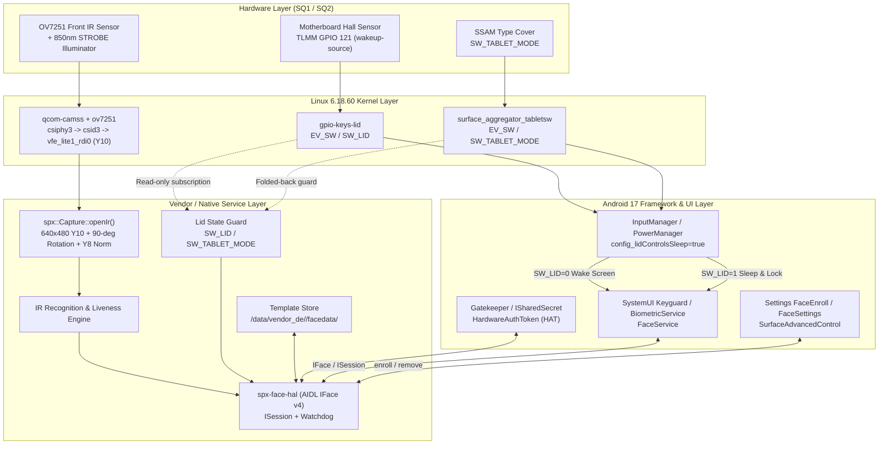

# Surface Pro X (SQ1/SQ2) Hall Sensor + OV7251 IR Face Unlock

> **Target Platform**: Microsoft Surface Pro X (SQ1 / SQ2), Android 17 (`mica 16471258`) + Linux `6.18.60-sq2-android1` Hybrid (EL2)  
> **Core Principles**: No QSEE fTPM, `SPX-PORTABLE-SQ1-SQ2` single-image portability, zero resident power regression, and `s2idle` suspend safety.

---

## 1. Goals and Boundaries

- **Instant Wake on Lid Open**: Motherboard Hall sensor (`TLMM GPIO 121`, `SW_LID` + `wakeup-source`) wakes `s2idle` via hardware IRQ and turns on the screen to Keyguard.
- **Seamless IR Recognition**: Keyguard triggers `android.hardware.biometrics.face.IFace/default`, bringing up the front `OV7251` IR sensor and 850nm illuminator to unlock directly to the home screen.
- **Lock on Lid Close & Anti-False-Trigger**: Closing the cover triggers `SW_LID=1`, immediately aborting IR capture, turning off the 850nm illuminator, locking the screen, and entering `s2idle`.
- **No QSEE fTPM**: Avoids triggering donor `gscutil`/`check_tpm_clear`, polluting Windows BitLocker/Windows Hello shared fTPM state, or introducing unverified QSEECOM SHM Bridge SMC calls under EL2.
- **Class 2 (`WEAK`) Biometric**: Feature extraction and matching run in userspace rather than a TrustZone TA, declared as Android Biometrics Class 2 (`WEAK`).
- **Single-Image Portability**: No hardcoded `/dev/videoN`, `/dev/input/eventN`, or unit serial numbers; all nodes are discovered dynamically via sysfs/media/evdev.

---

## 2. Architecture and State Machine

### 2.1 Layered Architecture



### 2.2 Open-Lid Unlock and Close-Lid Abort Sequence

```mermaid
sequenceDiagram
    autonumber
    participant User as User / Cover
    participant Hall as GPIO 121 Hall IRQ
    participant PM as PowerManager / Keyguard
    participant HAL as spx-face-hal (IFace)
    participant IR as OV7251 + 850nm STROBE

    Note over User,IR: s2idle deep sleep; OV7251 and IR illuminator powered off
    User->>Hall: Opens cover
    Hall->>PM: IRQ wakes SoC, reports SW_LID=0
    PM->>PM: Turns on screen, enters Keyguard
    PM->>HAL: createSession() + authenticate(operationId)
    HAL->>HAL: Verifies SW_LID == 0 and not locked out
    HAL->>IR: openIr(640x480) + 850nm STROBE + 8s watchdog
    loop Up to 30fps
        IR-->>HAL: Y10 raw frame
        HAL->>HAL: 90° rotate -> Y8 norm -> liveness -> face match
    end
    alt Match succeeds
        HAL->>IR: stopStream() shuts down sensor & 850nm STROBE
        HAL->>PM: onAuthenticationSucceeded(enrollmentId, HAT)
        PM-->>User: Unlocks to home screen
    else Lid closed (SW_LID=1) or timeout
        User->>Hall: Closes cover
        Hall->>HAL: Receives SW_LID=1
        HAL->>IR: Aborts capture & shuts off 850nm STROBE
        HAL->>PM: onError(CANCELED) / PowerManager enters s2idle
    end
```

---

## 3. Subsystem Design

### 3.1 Hall Sensor (`SW_LID`) & Folded-Back Protection
- `scripts/prepare-spx-lid-dtb.py` configures `TLMM GPIO 121` (`GPIO_ACTIVE_LOW`, `wakeup-source`, `linux,can-disable`) with `label = "Lid Switch"` so `/vendor/bin/hw/touchpad-inhibitor` binds to it directly.
- System-wide `SW_LID` remains mutually exclusive with `scripts/patch-sq2-lid.py` (SSAM `SW_LID`), while `scripts/patch-spx-unknown-lid.py` protects cold-boot unknown lid states.
- Kernel patch `0012-spx-hall-lid-ignore-folded-cover.patch` suppresses `SW_LID=1` in the input core when the keyboard is folded back (`folded-back`, `folded-canvas`, or `book`).

### 3.2 OV7251 IR Pipeline & Engine
- **Hardware path**: `ov7251 2-0060` → `csiphy3` → `csid3` → `vfe_lite1_rdi0` (`640×480` `V4L2_PIX_FMT_Y10`), independent of front/rear RGB cameras (`vfe0`/`vfe1`).
- **Preprocessing (`probe/face/spx-ir-preprocess.{h,cpp}`)**: Unpacks `Y10`/`Y10P`, rotates `0/90/180/270` degrees, computes ROI brightness statistics, and normalizes to 8-bit grayscale / RGBA preview.
- **Engine (`probe/face/spx-face-engine.{h,cpp}`)**: Active 850nm NIR detection, 3-layer liveness anti-spoofing, 256-D normalized embedding matching, and lockout state machine (5 consecutive failures → 30s lockout; 20 failures → permanent lockout requiring PIN).
- **Encrypted Storage (`probe/face/spx-face-crypto.{h,cpp}`)**: Templates are encrypted with SHA-256 / HMAC-SHA256 / HKDF-SHA256 / ChaCha20 and stored under `/data/vendor_de/<userId>/facedata/` (mode `0700`); raw face images are never saved.

### 3.3 Android 17 `IFace` AIDL HAL & Safety Watchdogs
- **AIDL HAL (`probe/face/spx-face-hal.cpp`)**: Implements `android.hardware.biometrics.face.IFace/default` (AIDL V4, `SensorStrength::WEAK`, `FaceSensorType::IR`, `supportsSelfIllumination = true`, `halControlsPreview = true`).
- **HAT Verification**: Integrates with `ISharedSecret` and `Gatekeeper` (`gatekeeper-service.nonsecure`) to verify 37-byte `hw_auth_token_t` on `enroll()` and `resetLockout()`, and issue HATs on authentication.
- **Lid Gating & Watchdog**: `spx-lid-monitor` polls `SW_LID` and SSAM posture read-only, immediately aborting capture and rejecting new `authenticate()` requests when `SW_LID == 1`. Hard watchdogs cap `authenticate()` at **6–8s** and `enroll()` at **45s**, forcing V4L2 `close()` and `ov7251_s_stream(0)` power-off; the kernel V4L2 `release` path also cuts power if the process exits unexpectedly.

### 3.4 Packaging & `SurfaceAdvancedControl` Bridge
- `probe/face/spx-face-stage` detects `ov7251` at boot and mounts the HAL, `spx-face-cli`, VINTF manifest, `android.hardware.biometrics.face` permission XML, and `.rc` service into `/vendor`.
- `scripts/full_image_face.py` packages and validates ELF64 AArch64 binaries and injects the initramfs hook (build flags: `--without-hall-lid`, `--face-hal`, `--without-face`).
- `SurfaceAdvancedControl` exposes `set-hall-lid 0/1`, `set-face-unlock 0/1`, and `run-face-self-check` over the `request`→`reply` bridge.

---

## 4. Implementation File Inventory

| Component | Path | Purpose |
| :--- | :--- | :--- |
| Hall DT | `scripts/prepare-spx-lid-dtb.py` | GPIO 121 `SW_LID` (`"Lid Switch"`, `--active-high`, `--debounce-ms`, `linux,can-disable`, conflict guard) |
| Folded-back patch | `patches/spx-portable-boot/0012-spx-hall-lid-ignore-folded-cover.patch` | Suppresses `SW_LID=1` in input core when cover is folded back |
| Build integration | `scripts/full_image.py`, `scripts/build-lts.py`, `scripts/full_image_face.py` | Hall DT and Face HAL build switches, ELF64 validation, initramfs hook |
| AIDL & HAL build | `scripts/build-spx-face-aidl.py`, `scripts/build-spx-face-hal.py` | AIDL V4 NDK stubs, ARM64 NDK build, `--run-host-tests` |
| IR preprocessing | `probe/face/spx-ir-preprocess.{h,cpp}` | `Y10`/`Y10P` unpacking, `0/90/180/270` rotation, ROI stats, `gray8ToRgba` |
| Crypto | `probe/face/spx-face-crypto.{h,cpp}` | SHA-256 / HMAC-SHA256 / HKDF-SHA256 / ChaCha20, 37B `hw_auth_token_t` |
| Face engine | `probe/face/spx-face-engine.{h,cpp}` | 850nm NIR detection, 3-layer liveness, 256-D embedding, encrypted template store, lockout |
| Lid monitor | `probe/face/spx-lid-monitor.{h,cpp}` | `EV_SW` (`SW_LID`) `poll()` + SSAM posture monitoring and abort callback |
| CLI & HAL | `probe/face/spx-face-cli.cpp`, `probe/face/spx-face-hal.cpp` | `--self-test`, `--status`, `--benchmark-ir`, AIDL V4 `IFace/default` HAL |
| Stage & manifests | `probe/face/spx-face-stage`, `.xml`, `.rc` | Boot-stage `/vendor` overlay mounting based on `ov7251` presence |
| Control panel | `probe/test2/spx-advanced-control-boot`, `probe/advanced-control/*.java` | `SurfaceAdvancedControl` Hall & IR Unlock UI and bridge |
| Tests | `tests/test_spx_lid_dtb.py`, `tests/spx_face_test.cpp`, `tests/test_spx_face_hal.py`, `tests/test_advanced_control.py` | DT checks, ASan/UBSan host tests, APK build, bridge state-machine tests |
