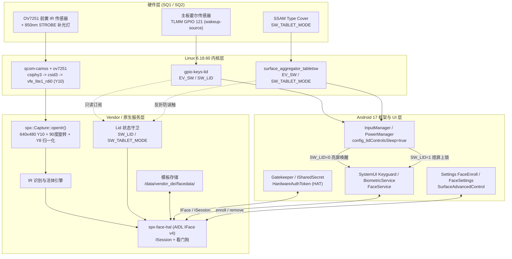
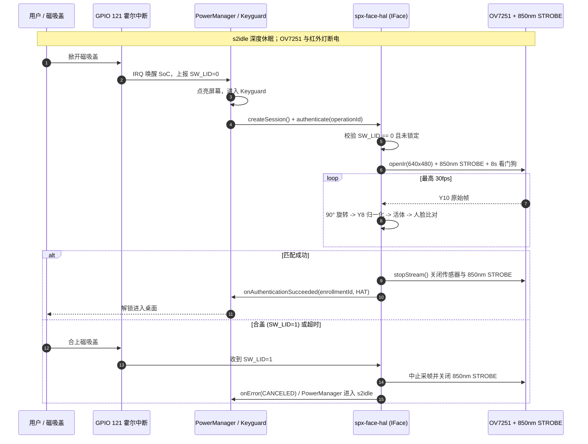

# Surface Pro X (SQ1/SQ2) 霍尔传感器 + OV7251 IR 人脸解锁

> **适用平台**：Microsoft Surface Pro X (SQ1 / SQ2)，Android 17 (`mica 16471258`) + Linux `6.18.60-sq2-android1` Hybrid (EL2)  
> **核心原则**：不启用 QSEE fTPM、保持 `SPX-PORTABLE-SQ1-SQ2` 单镜像通用性、零常驻功耗回归与 `s2idle` 休眠安全。

---

## 1. 目标与边界

- **掀盖秒醒**：主板霍尔传感器（`TLMM GPIO 121`，`SW_LID` + `wakeup-source`）通过硬件中断唤醒 `s2idle` 并亮屏进入 Keyguard。
- **无感 IR 识别**：Keyguard 触发 `android.hardware.biometrics.face.IFace/default`，拉起前置 `OV7251` 红外传感器与 850nm 补光灯完成比对并直达桌面。
- **合盖即锁与防误触**：合盖触发 `SW_LID=1` 后立即中止 IR 采帧、关闭 850nm 红外灯、锁屏并进入 `s2idle`。
- **不启用 QSEE fTPM**：避免误触发 donor 中的 `gscutil`/`check_tpm_clear`、污染同机 Windows BitLocker/Windows Hello 的共享 fTPM 状态，或引入 EL2 下未验证的 QSEECOM SHM Bridge SMC 调用。
- **Class 2 (`WEAK`) 生物识别**：特征提取与比对运行在用户态而非 TrustZone TA 中，按 Android Biometrics CDD 声明为 Class 2 (`WEAK`)。
- **单镜像通用性**：禁止硬编码 `/dev/videoN`、`/dev/input/eventN` 或单机序列号，所有节点通过 sysfs/media/evdev 动态发现。

---

## 2. 整体架构与状态机

### 2.1 分层架构

### 2.2 开盖解锁与合盖中止时序

---

## 3. 子系统设计

### 3.1 霍尔传感器（`SW_LID`）与反折保护
- `scripts/prepare-spx-lid-dtb.py` 将 `TLMM GPIO 121` 配置为 `GPIO_ACTIVE_LOW`、`wakeup-source`、`linux,can-disable`，并设置 `label = "Lid Switch"` 以便 `/vendor/bin/hw/touchpad-inhibitor` 直接绑定。
- 全系统 `SW_LID` 与 `scripts/patch-sq2-lid.py`（SSAM `SW_LID`）保持严格互斥，同时保留 `scripts/patch-spx-unknown-lid.py` 保护冷启动未知态。
- 内核补丁 `0012-spx-hall-lid-ignore-folded-cover.patch` 在键盘反折态（`folded-back`、`folded-canvas` 或 `book`）下于输入核心屏蔽 `SW_LID=1` 上报。

### 3.2 OV7251 IR 管线与识别引擎
- **硬件链路**：`ov7251 2-0060` → `csiphy3` → `csid3` → `vfe_lite1_rdi0`（`640×480` `V4L2_PIX_FMT_Y10`），与前后 RGB 相机（`vfe0`/`vfe1`）独立。
- **前处理（`probe/face/spx-ir-preprocess.{h,cpp}`）**：实现 `Y10`/`Y10P` 解包、`0/90/180/270` 度旋转、ROI 亮度统计与 8-bit 灰度/RGBA 预览归一化。
- **识别引擎（`probe/face/spx-face-engine.{h,cpp}`）**：主动 850nm 近红外检测、三层活体防伪、256-D 归一化嵌入比对与锁定状态机（连续 5 次失败锁定 30 秒，20 次永久锁定需输 PIN）。
- **加密存储（`probe/face/spx-face-crypto.{h,cpp}`）**：模板经 SHA-256 / HMAC-SHA256 / HKDF-SHA256 / ChaCha20 加密存储在 `/data/vendor_de/<userId>/facedata/`（权限 `0700`），绝不保存原始人脸图像。

### 3.3 Android 17 `IFace` AIDL HAL 与安全看门狗
- **AIDL HAL（`probe/face/spx-face-hal.cpp`）**：实现 `android.hardware.biometrics.face.IFace/default`（AIDL V4，`SensorStrength::WEAK`、`FaceSensorType::IR`、`supportsSelfIllumination = true`、`halControlsPreview = true`）。
- **HAT 校验**：对接 `ISharedSecret` 与 `Gatekeeper`（`gatekeeper-service.nonsecure`），在 `enroll()` 与 `resetLockout()` 时校验 37 字节 `hw_auth_token_t`，并在认证通过时签发 HAT。
- **盖子门控与看门狗**：`spx-lid-monitor` 只读轮询 `SW_LID` 与 SSAM 姿态，在 `SW_LID == 1` 时立即中止采帧并拒绝新 `authenticate()` 请求。硬看门狗限制单次 `authenticate()` 最长 **6–8 秒**、`enroll()` 最长 **45 秒**，超时强制关闭 V4L2 句柄并触发 `ov7251_s_stream(0)` 断电；进程异常退出时内核 V4L2 `release` 路径亦会自动停流断电。

### 3.4 打包集成与 `SurfaceAdvancedControl` 桥接
- `probe/face/spx-face-stage` 在启动阶段检测 `ov7251` 存在后，将 HAL、`spx-face-cli`、VINTF 清单、`android.hardware.biometrics.face` 权限 XML 与 `.rc` 服务挂载至 `/vendor`。
- `scripts/full_image_face.py` 负责打包、ELF64 AArch64 校验与 initramfs hook 注入（构建开关：`--without-hall-lid`、`--face-hal`、`--without-face`）。
- `SurfaceAdvancedControl` 通过 `request`→`reply` 桥接提供 `set-hall-lid 0/1`、`set-face-unlock 0/1` 与 `run-face-self-check` 控制接口。

---

## 4. 新增与修改文件清单

| 组件 | 路径 | 用途 |
| :--- | :--- | :--- |
| 霍尔 DT | `scripts/prepare-spx-lid-dtb.py` | GPIO 121 `SW_LID`（`"Lid Switch"`、`--active-high`、`--debounce-ms`、`linux,can-disable`、冲突检查） |
| 反折补丁 | `patches/spx-portable-boot/0012-spx-hall-lid-ignore-folded-cover.patch` | 键盘反折时在输入核心抑制 `SW_LID=1` |
| 构建集成 | `scripts/full_image.py`、`scripts/build-lts.py`、`scripts/full_image_face.py` | 霍尔 DT 与人脸 HAL 构建开关、ELF64 校验、initramfs hook |
| AIDL 与 HAL 构建 | `scripts/build-spx-face-aidl.py`、`scripts/build-spx-face-hal.py` | AIDL V4 NDK 存根归档、ARM64 NDK 编译、`--run-host-tests` |
| IR 前处理 | `probe/face/spx-ir-preprocess.{h,cpp}` | `Y10`/`Y10P` 解包、`0/90/180/270` 旋转、ROI 统计、`gray8ToRgba` |
| 加密封装 | `probe/face/spx-face-crypto.{h,cpp}` | SHA-256 / HMAC-SHA256 / HKDF-SHA256 / ChaCha20 与 37B `hw_auth_token_t` |
| 人脸引擎 | `probe/face/spx-face-engine.{h,cpp}` | 850nm 近红外检测、三层活体、256-D 嵌入、加密模板存储与锁定计数 |
| 盖子监听 | `probe/face/spx-lid-monitor.{h,cpp}` | `EV_SW` (`SW_LID`) `poll()` + SSAM 姿态监听与中止回调 |
| CLI 与 HAL | `probe/face/spx-face-cli.cpp`、`probe/face/spx-face-hal.cpp` | `--self-test`、`--status`、`--benchmark-ir`、AIDL V4 `IFace/default` HAL |
| 挂载与清单 | `probe/face/spx-face-stage`、`.xml`、`.rc` | 按 `ov7251` 存在动态挂载 `/vendor` overlay |
| 控制面板 | `probe/test2/spx-advanced-control-boot`、`probe/advanced-control/*.java` | `SurfaceAdvancedControl` 霍尔与红外解锁界面及桥接 |
| 测试 | `tests/test_spx_lid_dtb.py`、`tests/spx_face_test.cpp`、`tests/test_spx_face_hal.py`、`tests/test_advanced_control.py` | DT 校验、ASan/UBSan 主机测试、APK 编译与桥接状态机测试 |
