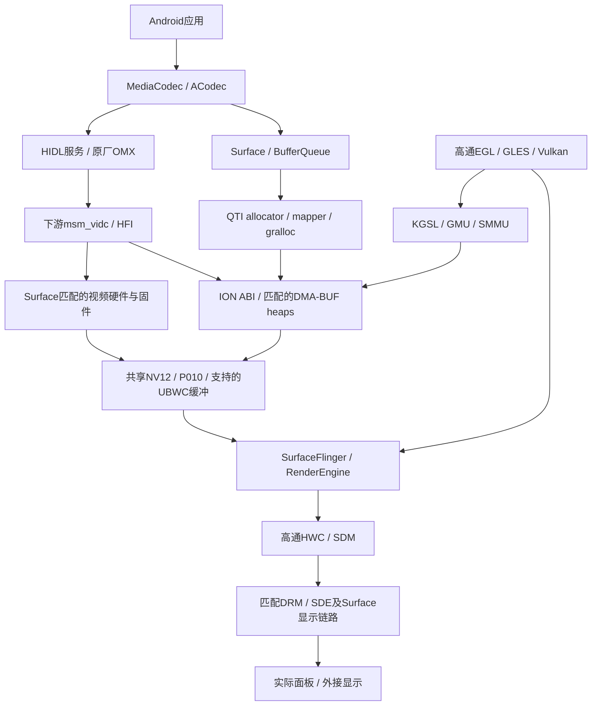

## 2026-11-10：唯一主线基线 v21-release（验收版清理）

清理版正常重启已验证：boot398dd33e…，第146秒首次SSH检查成功，7服务running；
HEVC硬解6帧可见像素与已独立审计父版逐字节一致，PTS/EOS/stop/delete成功，
Venus错误/实例/缓冲归零。50项相关主机测试与标准verify/package通过，临时复核客户端已删除。
未新增听音、长时、休眠或SQ1验证；沿用用户对功能父版的听音/页面验收。

用户确认 v21 听音、Bilibili 播放页/主页切换均正常，授权固定为唯一版本并提交主线，
随后要求设备及提交源码一并清理开发工具、日志和探针。本节覆盖下方历史“未提交”、
“当前 v20”及 Mesa 默认说明；旧日期的实验记录仅用于追溯，不是并列支持版本。

唯一受支持发布基线为 **v21-release / Linux 6.18.60-sq2-android1**，默认 `EFI/SQ2Nat`，
路线为 mapper5 + 原厂 gralloc + 源码 QTI HWC/SDM；initramfs SHA256 `e826df919c358a61ff023f6021ba9dae43d166b1d781a3b107ed8320286456a0`。
原 v21 功能父包为 `71db2317…`；清理版保留 SoundWire 容量/AHB 串行修复、DPU EBUSY
重提修复、原音频 HAL及原 OMX。HEVC CSD/HDR 实验候选未因基线整理被暗中提升。
清理只移除诊断输出/入口：桥接逐缓冲日志及弱观测回调、Venus 启动/阶段/PM 诊断开关、
启动持久日志采集器、随包测试工具；重编成对 Venus 模块与视频桥接，不热换提供者。

源码同时删除废弃采集器、临时探针及对应入口；正式显示/mapper builder 不再顺带编译探针。
保留真实错误处理、驱动安全边界、主机回归测试与构建记录。正常系统错误日志不是持续开发采集。
本机 `/data/local/tmp` 历史工具/向量/采集已清理（17166388→30388 KiB），移除三个测试 APK，
清除 ESP `googlebook-native-*` 日志；应用缓存、用户数据、校准和凭据保留。
旧 `EFI/SQ2QDbg` 仅为现有应急恢复载荷，不是受支持的第二发布版本；未新增备份或启动项。

`configs/kernel-baseline.json` 是唯一发布 pins，标准 `build.py verify/package` 默认选 SQ2Nat；
`compile` 仍产生独立未验收候选，不能凭版本号相同覆盖发布包。私有库、固件、凭据和原始日志
不提交。内屏仅 SDR，Main10 过滤保持，整栈长期目标尚未全部完成；
`full_stack_complete/full_hwc_verified/full_fence_lifecycle_verified` 仍 false。
清理、构建、完整性和本次启动记录位于 ignored `out/qualcomm-full-stack-20261108/v21-release-cleanup`。

## 2026-11-10：无声与 Bili 整屏黑闪修复已持久部署并通过用户验收

用户确认 4K→1080p→4K 无卡顿；独立 CSD RAM 候选下确有三个重建的硬解会话和非空输出，
不是同会话 DRC。验收功能父版为 v21/原 OMX，CSD 候选尚未持久化；旧 EBD tag0 歧义保留。
本轮用户另行授权排查无声、修复播放页/主页整屏黑闪，不自动恢复其他整栈开发。

黑闪原采集三次均为 DRM EBUSY→HWC 错误 Flush→唯一全屏 plane 被撤→下一帧恢复；
没有 eDP/CRTC 重启、欠载或超时。修复仅在 kernel-managed DPU 的真实非阻塞 EBUSY 时，
同一请求改为阻塞重提一次；实际结果/fence 完成一次，其他失败照常传播，真实空画面仍清理。
实际代码 12 场景 ASan/UBSan、旧版红例通过；42TU 配套构建。RAM v2 真机 fence/30 帧所有权/
真实 empty flush/协议恢复通过，页面采集 1601 次提交、零 plane disable/显示超时，用户确认“不会了”。
信息日志受 QTI tag 开关限制，本轮不能从无重提日志断言重提次数。恢复原库后启动期再见 EBUSY。
v1 因 runner 的 set-e/pidof 空返回提前退出，fence 通过但未进入页面验收；v2 已修采集器且收尾0。

无声重启音频服务无效；完整停 HAL 后 WSA 成对 runtime 周期也无效，未重复该路线。
原声道/音量正常，PCM SETUP，SoundWire prepare -61。被动跟踪 40833 次读证明 FIFO 空、读取成功，
但缓存 wr_fifo_depth=0。匹配 ABI 的只读能力探针 16 次均读到 params016840c6、实际 wr/rd16，
缓存仍0；探针仅读 COMP_PARAMS，未重置主端/ADSP或改驱动内存，返回 ECANCELED 后无驻留。
源码 AHB 地址/数据两步缺整体互斥，IRQ 已注册后才缓存容量；竞态可造成错误能力值是待实机验证的解释。
候选补 AHB mutex，并在 IRQ 注册前读取/校验真实容量，恢复时不覆盖固定容量，不填假16、不吞错误。
实际 read/write 并发旧红例、新绿例、四错误解锁路径通过；匹配6.18严格MODPOST完成。
已通过正常重启应用模块，禁止热卸提供者、裸写容量或复位 ADSP。新候选正常重启后用户已确认听音恢复。

证据仅 ignored out/qualcomm-full-stack-20261108：bili-page-blackout-v2、dpu-busy-commit-v1/v2、
audio-blackout-20261109-v1/fifo-read-capture-v2、cap-read-module、soundwire-ahb-capacity-v1。
音频 HAL774cd7e7…及原停流静音/增益/配对端口保持；不恢复旧 HAL pacing/MonoPipe 改动。
v21 默认71db2317…已部署并完成一次正常重启，boot364dc453…；唯一回退5b9f7012…保持。
匹配 SoundWire4671cc9d…/note f9dd9313…、显示e4f0e12a…实读核对；原音频HAL和OMX保持。
等待120秒后首次SSH成功，Android/user10/原服务正常；缓存wr/rd16与16次真实能力读一致，
本次启动无旧FIFO溢出/prepare -61；用户对新默认包Bili听音/页面切换反馈“全部正常”。
无新备份、无提交推送。
两次4秒/各192000帧 AAudio 标准媒体流均成功排空；间隔10秒重开通过，实际PCM RUNNING
各29个样本且hw_ptr持续前进，AAudio XRUN0，无原FIFO溢出/prepare -61。重启后只读显示采集
234提交、零撤层/欠载/超时，收尾0/无丢失；本段是受控输出和空闲UI观察，不能冒充Bili听音/页面复测。
用户随后确认持久v21“全部正常”：内置扬声器恢复、Bili播放页/主页无整屏黑闪。反馈晚于采集收尾，
不伪造精确时间对齐；受控PCM与RAM页面证据分别保留。所有临时trace/挂载已清理。
本轮两项修复完成；整体显示栈目标继续暂停，未新增长时/休眠/跨设备声学验收。
full_stack_complete/full_hwc_verified/full_fence_lifecycle_verified 仍 false。

## 2026-11-09：HEVC 独立 CSD 已通过普通 MediaCodec 基本组，继续实用场景验收

执行路线继续 mapper5 + 原厂 gralloc + 源码 QTI HWC/SDM + Linux 6.18。
当前仍是正常 v20（boot 1566c477…、默认 a65968ee…、唯一回退 5b9f7012…）；未写 EFI、未重启。
源码 SM8250 OMX 候选 d8699271…在有界 RAM 单库绑定中，将独立参数头复制到组件私有存储，
再放入首个完整 Annex-B AU 的既有 DMA 输入槽；保留图片 PTS/flags，不合成 SEQ/FLUSH/END。
普通 MediaCodec 五阶段全部独立通过：原完整 AU Surface、候选完整 AU Surface、剥头 CSD
ByteBuffer、剥头 CSD Surface、独立 CSD + 重复头 ByteBuffer；合计 30 帧像素/PTS 精确，
EOS/stop/delete 均成功。真实 HFI 首包分别为 5161/5244 字节，没有孤立 83 字节参数包；
全部实际 END、传输归还及最终错误/实例/vb2_bytes=0，原五文件与日志属性已恢复，七服务 running。
Surface 是 AImageReader，不是本次物理屏像素验收；仍需真实 Bili 4K→1080p→4K、HEVC DRC、
重复 flush/reset、五组件 HDR 联合与更宽输入契约验证。Main10 继续过滤，候选未持久部署，full_* false。

原始 v1 因 map_files 在能力探测 dlclose 时消失而中止；前三组 18 帧实际精确，但 runner1，
后两组未运行，不能记全通过。v2 只对同 PID 下已消失映射作有界重试，错误 SHA/存活 I/O 错误仍拒绝；
27 项采集器故障注入通过，候选、向量与客户端字节未变。独立像素/HFI审计保留 v1 反例。
此前直接 V4L2 重组 AU 对照也真实通过 6+6 帧；early-DPB 阴性结论不变，未作为正常修复引入。
证据：`out/qualcomm-full-stack-20261108/omx-hevc-csd-prefix-v1/independent-basic-v2-pixels.json`、
`independent-basic-v2-hfi.json`；直接对照见 `hevc-csd-assembled-au-control-v1/independent-control-audit.json`。
私有产物/原始日志仍仅 ignored out；不提交推送。音频 HAL 774cd7e7…保持，原听感修复不回退。

## 2026-11-09 当前状态：首 SEQ 对照阴性，已正常返回 v20

当前 boot 为 1566c477-1442-4ac5-91d5-5d3ead54575f，实际 v20 core/dec note、原五组件和
音频 HAL 774cd7e7…均核对；错误/实例/vb2_bytes 为 0，early-DPB 诊断参数已不存在。
默认 SQ2Nat 为原 v20 a65968ee…，唯一 SQ2QDbg 回退 5b9f7012…保持，无新增启动项/备份。
恢复期间 SSH 观察曾超时，但实际 EFI 恢复脚本成功，核对后才正常重启，未重复写入/重启。
两次启动后的入站网络均在设备反向 ping 电脑后恢复；路由/ARP sysctl/SSH 监听和网络载荷
未发现错误，不能把该关联当根因或修改正常网络策略。详见 network-arp-after-reverse-ping-v1。

真实四组 first-SEQ 对照 runner=1、cleanup=0，测量可用但不是功能通过：关闭/开启 early-DPB
时完整 AU 均产生有效 SEQ，原顺序 90B 独立参数头均等 12 秒超时。开启时各 18 个真实 DPB
确实在 START 成功后、首 ETB 前成功提交，仍不足以修复 CSD。split 的 raw SEQ 只在收尾期
出现，SID 属于本会话但回调已关闭；不得计为等待期首序列成功。全部真实 END/最终资源归零。
两条 EBD 的未用范围字段异常原样保留，整体协议审计 false；实际参数 ABI/同步 packet 生命周期
已核对，INPUT 回调不使用这些范围字段，不能据此宣称越界 DMA 或固件根因。
证据：`hevc-csd-early-dpb-v1/{independent-first-sequence-audit.json,INDEPENDENT_CAPTURE_REVIEW.md}`。

独立修复了原生成器 DPB extradata-size 错误分支重复 kfree：共同 fail 标签负责一次释放。
已补精确增量 --dpb-cleanup-only，实际旧红例/新 ASan/UBSan 绿例和 4 项测试通过；只修主机源码，
正常候选 376ae4e0…已严格构建/打包，独立解析核对仅两份 core 和清单变化，其余 1299 记录保持；
尚未部署，不是 CSD 修复，也不包含 early-DPB 诊断模式。
下一步核对原厂源码现有 HEVC arbitrary_bytes 组帧路径：正常下游 ETB 并不发送 ENDOFFRAME，
不能盲加该标志；评估真实参数头与首 VCL 组合及输入所有权/flush/DRC/EOS契约。
Bili 真实 4K 硬解切换仍必修、Main10 继续过滤，完整整栈目标及 full_* false 保持。

## 2026-11-09：v20 五组件 HDR 联合回归完成，继续 HEVC 首序列定位

默认仍为 v20-capture-lifecycle（a65968ee…），唯一 SQ2QDbg 回退保持。完整五组件 RAM 候选
在同一 boot 上完成：源码 OMX、原生 P010 service/bridge、stagefright 与 renderer 联合回归。
六项独立审计通过：同流 HDR10→SDR→HLG 30 帧、独立 HDR10/HLG/AVC 42 帧、
正常组 150 帧及 BT709 60 帧，共 282 帧像素/PTS 精确；同流后 20 帧静态 HDR 正确清空。
AVC SDR 320×240→1920×1080→320×240 完成 30 帧；物理窗口合计 150 输出/回调，
多平面、缩放与 UI 遮挡通过。这不是严格 DPU 像素、HDR 分辨率切换或 4K 硬解验收。
旧 bridge mixed 日志未记录，不能沿用其日志交叠结论；独立 HFI 另证最大并发 2。
HFI 4269 条事件覆盖 80 个真实成功 END 世代（64 能力探测、16 解码）和 432 非空输出，
全部传输及内部缓冲归还闭合，旧 DPB 在下一 CONTINUE 前归还；同步 flush 0.169–1.112ms。
45 个 HEVC EBD 的未用 filled 字段异常、7 次 EOS 后空 OPB 入队/flush 归还单列保留；
不据这些未用字段推断越界 DMA，也不把 quarantine 函数入口当真实隔离。

两组件 DRC 对照也已独立通过：各 30 精确帧、真实 FTB/FBD 全归还，flush 0.163–0.329ms，
无原 1 秒锁阻塞。历史 joint-v1 固件 fatal 和 v19 DMA 残留证据保留，当前通过不能反证其根因。
完整联合 runner/cleanup 均 0，原五文件 SHA 已恢复、七服务 running，错误/实例/vb2_bytes 全 0；
24 个 trace 丢失计数全 0，全局 tracing 设置未变。未持久部署五组件，Main10 仍过滤。

用户复测“没有卡顿”记录保持；该次 Bili 采集显示 hard→soft，真实硬解清晰度切换仍为必修项。
HEVC 独立 CSD 尚无首 SEQ。匹配下游源码显示 START_DONE 后先排内部 DPB、再交首 ETB；
当前等 SEQ 才分配 DPB。下一有界实验只对照是否产生真实首 SEQ，并以真实 END 收尾，
不伪造 SEQ、不把参数开关或首序列通过称为解码修复；诊断候选尚在本地准备。
路线及 KGSL/msm_vidc/QTI C2/PM/性能/SQ1-SQ2 目标保持，全部 full_* 仍 false。
证据：`source-omx-hdr-joint-v2/independent-summary.json`、`native-p010-drc-trace-v1/independent-hfi-summary.json`，
均位于 ignored `out/qualcomm-full-stack-20261108`。源码手册尚未提交推送，私有资料不上传。

## 2026-11-09：v20 正常启动与 capture 生命周期修复已验收

当前默认qti-system-display-v20-capture-lifecycle a65968ee…，boot1faec9eb-96e7-4885-8e51-5b01569fceec。
匹配corecf3d061d…/dece02fc528…，唯一SQ2QDbg回退5b9f7012…保持；原Image/固件/音频/OMX/桥/显示未改。
120s等待后SSH成功，模块note和原显示/音频组件核对通过。路线仍mapper5 + 原厂gralloc + 源码QTI HWC/SDM + Linux6.18。

修复SQ2 decoder的capture QBUF早于实际启动而提交固件：新队列先保留，真实capture开始时提交。
独立原v18对照有18次preSTART FTB/18次FW state错误，v20实际同流两者均0，6帧像素/PTS精确。
只加gate的v19曾在整组结束残留73211904字节，失败保留；v20配套回收证明未曾提交的VB2 lease，
静态SET_BUFFERS发布前补scope绑定，已发布DMA仍等真实END/PAS，不改通用隔离规则。
实际源码ASan/UBSan、旧版红例、14启动/6静态注册场景及五地址发布点审计通过，严格MODPOST完成。

v20正常联合16客户端/150精确帧/120物理输出回调与额外BT70960精确帧/30物理回调，四独立审计0；
各关闭阶段及最终Venus错误/实例/vb2_bytes均0。不是严格DPU像素或整栈完成证明。
正常与仅P010候选service/bridge的DRC对照各30帧返回0，详细像素/真实HFI独立审计及源码OMX/HDR完整联合继续。
HEVC独立CSD仍未修：直接7槽、无early capture、原顺序90B参数包也0SEQ；完整AU通过。
用户“没有卡顿”仍对应已观察到的软解回退，不能关闭真实硬解清晰度切换或历史DRC fatal问题。
内屏SDR，Main10继续过滤，full_*false；KGSL/下游msm_vidc/QTI C2/PM/性能/跨SQ1-SQ2目标不缩减。
证据native-capture-start-v2、qti-system-display-v20-acceptance-v1、native-p010-drc-trace-v1；复建见BUILD。
本轮源码手册未提交推送，私有库/凭据/固件/原始记录只在ignored out。

## 2026-11-09 当前任务：必须解决动态分辨率／清晰度切换故障

用户在默认系统实际执行4K→1080p→4K后确认播放卡顿。动态分辨率／清晰度切换故障
恢复到之前的优先级，是当前必须解决的执行项；修复和验收必须包含此项，不能只修HDR元数据后结束。
以实际Bilibili清晰度切换为主线；先核对当前boot/实际加载组件、VPU/flush/重配置与音视频时间线，
区分正常v18卡顿和新P010候选固件错误，禁止把二者未经证据合并为同一根因。

本轮源码SM8250 OMX及SurfaceUtils两层缓存修复在RAM候选中已通过同流HDR10→SDR→HLG30帧
和独立HDR10/HLG12帧+AVC30帧像素/PTS/metadata审计；同流用例固定320×240，不证明HDR分辨率切换。
完整联合随后在AVC SDR的320×240→1920×1080→320×240过程中输出13帧后失败，
固件报video_decoder_utils.c:4394 Err_Fatal。7图形和前4解码客户端返回0，未到物理窗口/BT709阶段。
候选五文件已撤销绑定，未持久部署，Main10仍过滤。此前一次正常重启134s读回boot34d0c43a…；
用户随后恢复连接，本次读回boot2fe924fb-3878-4806-ae14-7b6c3f6ca6ea、6.18.60-sq2-android1。
正常五组件/音频HAL/内核note均匹配，七服务running，无候选绑定，Venus错误/实例/缓冲0。
用户本轮反馈没有卡顿；真实采集却显示HEVC硬解无非空输出后hard→soft，不能作为硬解验收。
固定六帧完整AU通过，独立HEVC参数头分包零帧（重复头/去CODECCONFIG也未解决）；
当前主线同时解决HEVC首帧与候选DRC错误，详细对照及恢复核验见HANDOFF最新节和hevc-csd-v18-v1。
证据out/qualcomm-full-stack-20261108/{source-omx-hdr-sequence-v2,source-omx-hdr-joint-v1,bilibilihd-quality-switch-user-v1}。

## 2026-11-09 执行增量：v18 修复 Bili 切换时的一条真实锁依赖

既定mapper5 + 原厂gralloc + 源码QTI HWC/SDM + Linux6.18主线保持。Bili真实取证捕获三次
FLUSH_ALL/SEQ_CHANGED约1秒超时；实际V4L2客户端及callback入口/返回再次复现两次。
v18等待真实flush回包时释放inst.lock、保留ctx_q_lock和错误/END隔离，并协调DRC输出flush，
相同客户端五组全0、0.235–0.550ms，真实sequence回调10/11us完成。已正常启动，原音频/OMX/桥/显示未改。
用户明确“听音也确认修复了”；记录本轮听感恢复，HAL旧skip/PCM欠载证据仍保留，不能称全部音视频根因已修。
完整normal/BT709联合四独立审计通过：150+60精确帧、120+30物理输出回调；
最终七服务正常、Venus错误/实例/缓冲0，用户wake lock1保留，证据与失败边界见HANDOFF/BUILD最新节。
随后继续原厂OMX错误收尾/同流HDR静态缓存、Main10候选联合、严格DPU像素/fence、
KGSL/下游msm_vidc/真实QTI C2与PM/性能/SQ1-SQ2。内屏SDR/HDR→SDR、唯一回退及full_*false保持。

## 2026-11-09 执行增量：v17 修复成功 END 的错误否决并正常启动

继续mapper5 + 原厂gralloc + 源码QTI HWC/SDM + Linux6.18。内屏仅SDR，HDR→SDR映射验收；
Main10仍过滤，同流静态HDR缓存尚未修，严格DPU像素及既有全栈目标保持。

真实损坏AVC负例证明：core_error0且实际HFI END成功，旧session_error仍使deinit返回EIO、
confirmed0并升级quarantine。v17保留旧客户端错误，仅允许独立成功END确认scope结束；
真实END超时/错误回包/core_error仍拒绝，不清隔离、不合成FW事件、不重复PAS。
严格MODPOST/depmod、20个END/12个close源码场景及新增审计检查通过，原v16正常180帧基线精确。

v17 ae39c924…已正常启动，core709e2d42…/note60da3060…匹配；
实际仅两份core+SHA清单三有效记录改变，1299其他记录/metadata/凭据保持，唯一回退不变。
新负例已捕获prior1/reply0/return0/confirmed1，core_error0与DMA归零；
OMX收尾超出原10秒观察、客户端timeout124仍是失败，随后同PID自然恢复零实例/缓冲，
不据此称完整错误策略或历史DRC/PM超时根因已修。同boot正常16客户端/150精确解码帧/120物理输出回调，以及额外BT70960精确帧/30物理输出回调已通过；四独立审计和健康状态见HANDOFF。
所有full_*false，源码/手册未提交推送，私有原始资料仅ignored out。

## 2026-11-09 执行增量：SDR 映射已得物理证据，联合候选仍未通过

路线保持mapper5 + 原厂gralloc + 源码QTI HWC/SDM + Linux6.18。用户确认内屏无HDR；
内屏验收SDR输出和HDR→SDR映射，外接HDR按实际sink/link，不要求内屏HDR直显。
正常v16-bounds c967ade0…和唯一SQ2QDbg回退5b9f7012…保持，Main10仍过滤，候选未持久部署。
物理HDR10/HLG/BT2020 SDR Main10及AVC各30输出/定时release/回调（120合计）通过；
P010最终CLIENT→SDR RGBA_8888_UBWC/0x08810000/KMS AB24，AVC仍DEVICE/NV12。
另90帧lossless中性灰按实际10bit码值对照709、HLG和PQ≤名义300nit标准函数，误差<1个8bit级，
灰阶单调、RGB差/平坦抖动最大1。500nit仅SF软件fallback，非面板实测/HDR能力。
四组--require-dpu全部exit1（含AVC）；证据为色彩保持PNG/SF/HWC/KMS/CRC，
严格DPU像素、面板色准、PQ高光精确曲线、性能/时延仍未验。不能把回调当物理present。
最新桥修复10→8→10的隐式格式重协商：G_FMT规范化后与上一layout格式不同时，
先真实unpadded S_FMT，再padding；fixture区分reported/applied格式并保留busy/失败恢复。
同流30帧像素/PTS、真实AHB P010→NV12→P010和PQ→SDR→HLG VUI/dataspace精确；
但第10..29帧继承首段mastering/CLL，严格metadata审计exit1，整体不通过。
raw native记录证明首帧有0x15(40B)/0x16(8B)/VUI(56B)，之后29帧只有VUI，epoch1/2/3正确。
匹配OEM源码HEVC优先internal缓存，SEI handler只在有record时更新；空SetConfig只改client，
不能清旧internal。不能按“每帧无SEI”清空合法CVS持久状态、合成空FW record或只改mapper掩盖。
联合候选joint-v1的7图形/5解码阶段0，诊断脚本尺寸初始化误插入cleanup，物理阶段未启动；
修正并用真实SF fixture检验后，joint-v2的7图形/4解码阶段0，1080p DRC九帧后timeout124。
Venus报release-end/close-power/close-end END unconfirmed并quarantine，
sys_error1、insts0、vb2_bytes17698560；未到物理阶段，不能记新联合成功。
已取回全部失败/dmesg，撤销绑定，正常service7a6aa750…/bridge2a120b31…恢复；
坏固件准入未恢复时没有继续解码，没有热卸provider/清隔离/重复PAS。
已一次正常重启，新boot fe5f1239-2837-4059-9df2-f45a9772e9b4，内核6.18.60-sq2-android1，
七服务running，原service/bridge哈希正确，Venus错误/实例/vb2_bytes全0。
首次SSH观测在请求后274秒（此前做本地工作，不是启动耗时）；未写EFI/部署新包。
下一步相同DRC输入的正常基线/最新候选对照，记录在native-p010-drc-compare-v1。
Main10能力声明/持久部署须等DRC和同流HDR状态修复、完整联合验收后再推进。
full_fence_lifecycle_verified/full_hwc_verified/full_stack_complete仍false；
继续严格DPU像素/fence实际故障、KGSL/下游msm_vidc/QTI C2、PM/性能与SQ1/SQ2目标。
源码手册尚未提交推送，私有库/固件/凭据/原图/原始日志仅ignored out。

## 2026-11-09：原生 P010/HDR 元数据候选已贯通 ImageReader

mapper5/QTI源码HWC/Linux6.18主线保持。新增成对OMX/native-layout/bridge支持P010真实格式
协商、字节/像素stride区分和minimum_size，不用软件RGB10输出或虚假metadata替代。
RAM候选HDR10/HLG各6帧P010、AVC30帧原生NV12共42帧，对新FFmpeg参考像素/PTS精确；
实际AHB的PQ/HLG/SDR dataspace、HDR10 mastering/CLL/FALL和HLG/SDR空静态metadata正确。
65项相关主机检查与实际布局ASan/UBSan通过，审计拒绝两项像素/metadata负例。

这次是同一服务生命周期的不同decoder节点、ImageReader读回；物理tone-map、同流切换、
完整fence与普通应用能力尚未由此证明。Main10 profiles仍过滤，候选未持久部署；
正常v16与唯一回退保持。本组没有修改EFI/内核/固件/mapper/HWC或重启。
内屏确认仅SDR，下一步优先物理P010/HDR→SDR，不能把面板HDR直出当作完成条件。

SPS-only对照另获得HFI入口固定事件头：同尺寸各仅初始化1次SEQ_CHANGED，DRC3次，
与driver对应；没有全HFI属性payload证据，不据此泛化固件限制，也不桥合成VUI。
实际构建、反例、独立审计及健康状态见HANDOFF/BUILD。
KGSL、下游msm_vidc、真实QTI C2、严格DPU像素/fence故障、PM/性能与SQ1/SQ2保持原范围，
full_stack/fullHWC/full_fence完成标志仍false。

## 2026-11-09：内屏 SDR 验收与真实 VUI 重配边界

用户确认内屏没有HDR支持。内屏目标为正确SDR输出及HDR→SDR tone-map，
保留真实10-bit解码/metadata目标；不要求内屏HDR直显，外接HDR按实际sink/link验收。
目前物理HDR→SDR仍未验证，不能由本条硬件说明宣称完成。

SPS-only同尺寸601→709→601在SPS/PPS编号复用/分离、OMX/直接V4L2及独立
CODEC_CONFIG对照下，native VUI始终停在首段601；像素/PTS正确。
真实320×240→640×480→320×240 DRC则9帧raw VUI6→1→6、SDK4→1→4及像素/PTS通过。
同一服务生命周期function trace对照69帧再次验证，序列回调1/1/3包含各初始化；
全局tracing保持且无丢失。这只界定driver回调，并未捕获原始HFI包。
下一步对照实际HFI事件/属性和匹配下游配置，不能泛化固件限制或桥合成VUI。

沿用正常v16-bounds和固定mapper5/QTI源码HWC路线；本组未部署/重启/写EFI。
源诊断修正、失败记录、实机证据及健康状态见HANDOFF/BUILD。
full_*保持false，继续Main10/HDR→SDR、严格DPU像素/fence故障、KGSL/msm_vidc/QTI C2、
PM/性能和SQ1/SQ2；不重复mapper路线比较。

## 2026-11-09 执行进展：v16 fence 类型/短命令修复已正常部署

用户已确认内屏不支持HDR：内屏按SDR验收，HDR内容验证解码/元数据和HDR→SDR映射；HDR直出仅按外接sink实际能力启用与验收。

继续既定mapper5 + 原厂gralloc + 源码QTI HWC/SDM + Linux6.18执行方案。
v16-bounds已正常重启，最终composer-v22配display-v20；共享FMQ readFence校验
真实sync_file、保持合法负状态和资源错误、拒绝失败后cache/HAL变更，
并修复client-target零长度读取越界。66个实际源码场景及34项相关检查通过。

受控kernel sw_sync负例、30帧缓冲归属/复用和15次错误后恢复通过；明确不是GPU/VPU
故障注入，provider不进入正常包且已由正常重启清除。
正式真实GPU30帧/27复用/29个pending信号在DPU等待内完成、继承平面交接通过；
正常16客户端/150精确解码帧、4物理窗口120输出/回调、多窗缩放/遮挡/撤窗和自动709通过。
60个完整非空解码完成区间交叠有独立证据；零字节末记录配对缺失保留，全trace不称完整，
不作为吞吐或同时硬件执行证明。唯一回退、1297无关记录和凭据保持，详见HANDOFF最新节。

继续SPS/HFI、真实GPU/VPU错误/多点/超时/失败帧策略、严格DPU像素、
HDR/secure/videoUBWC、KGSL、下游msm_vidc、真实QTI C2、PM/性能与SQ1/SQ2验收。
full_fence_lifecycle_verified/full_hwc_verified/full_stack_complete仍false。

## 2026-11-09 执行进展：v15 自动 SDR VUI 已闭合一条正常物理路径

执行主线继续mapper5 + 原厂gralloc + 源码QTI HWC/SDM + Linux6.18。
默认v15已正常重启并通过自动BT709验收；它只启用现有真实VUI extradata路径，
并在SF启动前关闭继承的treat_170m_as_sRGB覆盖。无需额外OMX颜色指导兼容层，
不覆盖真实颜色、不在桥解析SPS伪造固件元数据，不放宽既有严格审计。

正式ByteBuffer/Surface各30帧像素与PTS精确，实际HWC0x10c10000 DEVICE、
KMS709 limited、物理30输出/回调及720CRC扫描/退窗回收通过。
正式normal-v8另有16客户端、150精确解码帧及4窗口120输出/回调，
缩放/多视频/UI遮挡/撤窗由三独立审计通过；52项主机检查通过。
包029a1a8a…，正常桥2a120b31…，成对display/composer-v20与原mapper5/msm保持，
1297无关有效记录和凭据尾保持，唯一回退不变。完整证据和反例见HANDOFF最新节。

SPS-only流内颜色切换仍保持第一段native VUI，尚需HFI/下游驱动调查；
恒定BT709成功不等于所有流内颜色/HDR、严格DPU像素/色准或性能通过。
下一阶段保持真实fence错误、严格DPU像素、HDR/secure/videoUBWC、KGSL、下游msm_vidc、
真实QTI C2、PM/性能与跨SQ1/SQ2目标，full_*完成标志仍false。

## 2026-11-09 执行增量：v14 内核 SDR 状态与 VPU/HWC 归属已验

既定推荐方案保持 mapper5 + 原厂gralloc + 源码QTI HWC/SDM + Linux6.18。
默认v14-color已经部署、正常重启并通过normal-v6整组回归；唯一SQ2QDbg回退保留。
实际msm模块提供YUV平面的标准601/709 limited属性，每次atomic状态驱动真实CSC，
源码成对display-v20/composer-v20为42/46TU；不是只在HWC声明709。

| 路径 | 当前事实 | 边界 |
| --- | --- | --- |
| VPU→AHB→HWC归属 | BT601与显式BT709各60帧，含物理1080p DRC；120个真实kernel release关联，释放后refill，全部分配free | DQBUF同步完成契约，不伪造decoder acquire；错误注入仍未验 |
| 正常v14 | 16客户端/150精确解码帧，4物理窗口120输出/回调，NV12 DEVICE、多视频缩放、UI遮挡和撤窗恢复通过 | 单台SQ2有界功能结果，不是性能/PM/跨设备证明 |
| BT709内核/HWC | 标准enum实际出现，显式709源在NV12 VIG直显；同DMA-BUF可见像素对FFmpeg精确 | 不是DPU严格像素/面板色度量测 |
| OMX自动颜色 | 真实BT709 VUI仍被native OMX/ACodec报BT601，ByteBuffer未报color字段 | 仍是下一执行项，不强制覆盖709或修改审计来放行 |

源码/复跑与全部证据见HANDOFF和BUILD最新节。先定位真实VUI→OMX color-aspects→
framework dataspace的断点，再继续色彩/格式、严格像素与fence错误、HDR/secure/videoUBWC、
性能/PM、KGSL、下游msm_vidc、真实QTI C2和SQ1/SQ2整体验收。
full_fence_lifecycle_verified/full_hwc_verified/full_stack_complete保持false。

## 2026-11-09：真实 GPU acquire/UBWC 缓冲归属通过，修复继承平面交接

以已部署正常v12及真实NV12 release/FMQ修复为基线，整体目标仍进行中。
继续既定mapper5 + 源码QTI HWC/SDM + Linux6.18 + 原厂gralloc，不重新比较mapper路线。

新增GPU生产者直接HIDL诊断：3个真实AHB RGBA UBWC target，按运行时物理分辨率
2880×1920各渲染10次，共30帧、27次缓存复用。GPU直接写入用于client target的同一AHB，
EGL导出真实native sync_file后立即交HWC，不先在CPU等待该acquire；GPU读回逐像素
验证放在物理present fence完成后。合计165,888,000个RGBA像素精确，是GPU内存读回，
不作为DPU严格像素或面板端到端时延证明。

每帧日志记录AHB ID/slot与导出、信号状态；独立tracefs实例记录同一生产者的render/
export/present标记。以实际display commit wait的context/seqno，关联该帧render区间
创建的唯一对应GPU scheduler fence，避免只按FD、anon-inode或相近时间猜身份。
两轮均30个acquire导出时pending，30个内核display wait；实际在wait期间GPU发信号
分别29/27次，其余为已完成后进入等待，不强称每次都阻塞。
调用栈含drm_atomic_helper_wait_for_fences→commit_tail→commit_work。
随后逐帧关联DPU release到下一target替换，重用前已完成；末帧由empty flush撤下。
两轮全局tracing设置保持、所有CPU overrun/commit overrun/dropped events为0，
原始trace统计分别1787与1786项。未注入fence错误。

首轮正常v12实际KMS仍多出一个未由当前SDM提交的XR24/fbcon平面，虽然被不透明
全屏GPU target覆盖，不能写成干净交接。根因是DRMPlane::InitAndParse将assigned CRTC
置0，丢掉上个master/fbcon的实际绑定，既有UnsetUnusedResources无法找到它。
新sm8350-dpu-inherited-planes.patch仅对无下游CAPABILITIES的标准DPU路径，采用
drmModeGetPlane提供的真实CRTC作为初始assigned状态，复用原有TEST_ONLY/commit/
失败重试/按CRTC清理。未按plane号、fbcon名字、样机或CRTC编号写特判；
主机实际源码方法验证解析失败、legacy不变、其他CRTC保留、TEST_ONLY不改归属、
失败commit重试、未请求平面撤下及被请求平面保留。硬件调用为注入，不冒充实机失败注入。

匹配display-v19/composer-v19（42/46TU）在原init服务RAM成对绑定实测：
30帧GPU/acquire/复用继续通过，目标CRTC仅预期AB24 UBWC client target；
原继承平面已撤下，末帧flush和原服务/库/用户恢复完成。
独立GPU审计与负例、实际源码和打包相关39项测试通过。
证据：out/qualcomm-full-stack-20261108/composer-gpu-acquire-v1与v2/
independent-gpu-audit.json；v1按显式baseline保留inherited_plane_handoff=false，
v2严格验收且核对实际service/成对库hash，未用允许遗留选项放宽修复验收。

qti-system-display-v13已部署为默认SQ2Nat并完成正常重启，SHA256
c9e2eedae75c80b7e7d2662e5e685da23d2f94989432f64fedb788981a62a34f；
boot d0af5276-5ab5-420e-8e66-efe44b5daf29，请求后第140秒首次SSH观测成功，
仍为6.18.60-sq2-android1。62显示文件/13链接/17HIDL核验通过；
实际composer进程67ed8868…、libsdedrm7ab1e17a…、libsdmutilsc33e0d21…匹配成对构建。
在任何视频测试占用VIG前，独立boot-drm审计仅有预期AB24 UBWC client target，
证实正常启动也完成继承平面交接。唯一SQ2QDbg回退5b9f7012…保持；
没有新增备份或入口，5显示ELF+2校验清单变更、1295其他有效记录和凭据尾保持。

正常v13的qti-system-display-normal-v5一次连续16客户端单项及runner均exit0：
7图形、5解码、4物理窗口。150帧可见解码像素/PTS对新生成FFmpeg参考精确，
含320×240→1920×1080→320×240真实DRC；paced mixed实际输出交叠793ms、
17次fd切换，不作为吞吐或端到端时延。原生NV12 DEVICE、多视频2x/0.5x、
UI遮挡A/B/A及撤窗平面/CRC恢复由三个独立审计通过，4物理窗口120输出/回调。
最终同boot、OMX PID5288贯穿、六服务running、Awake、用户secure=false、
disabled=true/showing=false，试验holder释放，总wake locks=1（用户应用保留）。
无实验进程/挂载/图层，Venus error/sys_error/hfi_error/insts/vb2_bytes全0，
ESP可用1,243,372KiB，/logs4,180KiB。证据：qti-system-display-deployment-v7/
及qti-system-display-normal-v5/独立审计和final-health.txt，均在本地out。

复跑主机检查：python3 -m unittest tests.test_qti_dpu_inherited_planes
tests.test_sq2_composer_gpu_acquire_audit -v；GPU构建入口
scripts/build-sq2-composer-fence-probe.py，服务端运行run-sq2-composer-fence.sh
TRIAL --gpu-targets。独立审计入口scripts/audit-sq2-composer-gpu-acquire.py，
修复验收必须传成对--composer-build/--display-build，不使用--allow-inherited-plane；
后者仅用于保留首轮反例，不是正常放行条件。完整复跑参数/哈希在各BUILD.json。

逐缓冲VPU/decoder acquire归属、真实fence错误处理、严格DPU像素、物理高分辨率视频/
DRC/更多颜色格式、HDR/secure/videoUBWC、性能/PM、KGSL/下游msm_vidc、
真实QTI C2与跨SQ1/SQ2仍待推进。full_fence_lifecycle_verified/full_hwc_verified/
full_stack_complete保持false；本轮源码/手册尚未提交推送。私有库、截图/trace/raw仅out。

## 2026-11-09：真实 Composer HAL 缓冲所有权与 FMQ 异常契约已闭合一条受控路径

沿用 mapper5 + 源码 QTI HWC/SDM + Linux 6.18 + 原厂 gralloc 主线。
新增标准 HIDL2.4/FMQ 诊断客户端，连接正常 init composer/allocator/Power HAL；
不接管 DRM master，不使用 eventfd 模拟 sync_file。动态 hotplug 发现显示，
先以真实透明 RGB client target 完成 CLIENT 启动帧，再转 NV12 DEVICE。
ClearClientTarget 请求按已清零的目标处理；不放宽合成策略或硬件校验。

HIDL SET_RELEASE_FENCES 属于前一帧，不能把返回 FD 关联到本帧。
原正常服务与修复候选各完成30帧、3个不同 AHB ID、30个逐缓冲 release关联、
27次HAL槽缓存复用；CPU重写前poll及SYNC_IOC_FILE_INFO均确认release已signal，
各点无负error status。末帧先用CLIENT替换取回最后DEVICE的release，再destroy/empty flush。
观察到真实msm-dpu/dpu-video-buffer-release点；FD号和anon-inode不作为唯一fence身份。

实际负例发现并修复 QtiComposerClient.cpp 的两个错误：2.1/2.2/2.3三个execute接口
固定回报NONE，掩盖parse/writeQueue失败；无效长度在parse失败后仍endCommand，
触发底层未消费payload断言并终止服务。新patch在错误处直接返回BAD_PARAMETER，
正常命令再endCommand，三接口回传实际err并保留reset。
原末条无效命令也不再因isEmpty误报成功。主机运行实际parser/三接口方法的24场景，
旧版15个契约不匹配、修复0；FMQ存储/写失败为注入，未称主机模拟完整Binder。
实机12个错误矩阵（3接口×未知末条/未知前缀/截断/错误payload长度）
全部BAD_PARAMETER，且每个之后正常validate/present及真实present fence通过。
未等待异步present的早期恢复诊断曾触发真实EBUSY；保留失败，现按fence等待后继续。

证据：composer-hal-ownership-v5与v8/independent-ownership-audit.json；
v6/v7失败记录保留，v11包未部署并标记superseded。源码patch可重放：
patches/sm8350-composer-command-errors.patch，匹配构建sm8350-composer-v18（46TU）/
sm8350-display-v18（42TU），未直接修改ignored源码冒充保存。
诊断/审计/打包相关26项测试通过。原始记录和私有产物仅out，不上传。

qti-system-display-v12已替换默认SQ2Nat并完成正常重启：SHA256
b435e962b5460dce3ba22b952f7f99567ff9e22e7a0e0f27f78815b81f25555d；
boot ef82f1f3-61f1-46e3-ae78-7a934b13d85b，首次SSH在请求后140秒，内核仍6.18.60-sq2-android1。
实际composer进程SHA c2429eeb49bfa18011155eaa94c1cb4f0e74e45b432e6c35c019ed46c113f42c，
62显示文件/13链接/17HIDL核验通过。仅3显示ELF+2校验清单变更，1297其他有效
记录保持，凭据尾逐字相同；唯一SQ2QDbg回退5b9f7012…保持，没有新增备份或启动项。

正常启动后qti-system-display-normal-v4一次连续联合回归16个客户端单项及外层exit0：
7图形、5解码、4物理窗口客户端。150解码帧可见像素/PTS对新生成FFmpeg参考精确，
DRC320×240→1920×1080→320×240；paced mixed真实输出区间交叠825ms、19次fd切换，
不作为吞吐/时延或硬件同时执行证明。物理NV12 DEVICE、多视频2x/0.5x缩放、
UI遮挡A/B/A和撤窗硬件平面/CRC回收由三个独立审计通过，4窗口共120输出/回调。
最终同boot、OMX PID5476贯穿、六服务running，实验holder释放，无试验进程/挂载/图层，
Awake、总wake locks=1（用户应用保留），Venus error/sys_error/hfi_error/insts/vb2_bytes全0。
动态用户经cmd lock_settings核对secure=false，disabled=true/showing=false。
早期helper误用am is-user-secure的平台差异已修正并实机核验，没有清除凭据。
证据：qti-system-display-deployment-v6/、qti-system-display-normal-v4/三独立审计及final-health/
lockscreen-check.txt，全部位于out/qualcomm-full-stack-20261108。

该受控证明限CPU写入linear NV12 320×240单DEVICE层。逐缓冲GPU/解码acquire归属、
fence错误注入、严格视频DPU像素、更广物理分辨率/DRC/格式、HDR/secure/videoUBWC、
性能/PM、KGSL/下游msm_vidc、真实QTI C2和跨SQ1/SQ2验收仍待完成。
full_fence_lifecycle_verified/full_hwc_verified/full_stack_complete仍false。
本轮源码/手册尚未提交推送。

## 2026-11-09：v10 退窗时钟 CRC 对照与真实内核 fence 顺序/等待路径通过

当前仍是正常v10、boot f36892b1-b79f-4562-bf8c-62fa96ec64a0、默认SHA5a753828…；
本组没有更新系统包、EFI或重启。三轮各30帧全屏原生NV12继续DEVICE-only，
无RGB client target，1080连续硬件CRC与撤窗回收通过；原始日志/截图/trace仅本地out。

自然跨分钟对照显示，前后桌面仅1642像素变化，完整差异bbox[110,24,291,49]，
全部在实际StatusBar frame[0,0,2880,68]内；裁剪目视确认时钟26→27及相邻日期排版变化，
其他桌面像素逐字相同。随后用临时RGB图层遮住运行时发现的68高状态栏、
置于全屏视频下方再跨分钟：前后5,529,600桌面RGB像素完全一致；
双LM CRC在视频前保持192扫描，撤窗后原pair精确恢复179扫描，随后移除遮挡回正常桌面。
遮挡期间视频仍为唯一HWC DEVICE/SDE/KMS NV12，未借新增client target规避全设备路径。

这组受控复现将当前现场的内容变化与显示恢复路径区分开。历史最初v10全屏轮缺少
before PNG，保留其左LM变化原始记录，不据新实验追溯证明所有历史差异原因；
严格视频DPU像素仍未验收。临时遮挡、进程及图层均已移除，没有修改状态栏/时间设置。

三轮使用独立tracefs实例，global tracing设置前后一致，所有CPU overrun/
commit overrun/dropped events=0。新 scripts/audit-sq2-dpu-fence-trace.py 按context/seqno
跨driver名称变化关联信号/销毁，而非依赖FD号或render callback；6个解析/负例测试通过。
实际分别观测36/39/35组同任务相邻retire/release创建，所有可比较release信号均处于
下一已观测commit的init→present区间；每轮最后一个standing-scanout release在trace末仍pending。
销毁有限观测分别66/72/64，不把仍持有的signaled引用或末帧pending当成已证泄漏/错误。

第三轮wait_start栈含dma_fence_wait_timeout→drm_atomic_helper_wait_for_fences→
commit_tail→commit_work，4个真实GPU scheduler fence在显示commit等待期间发信号后结束等待。
这证明实际kernel acquire等待路径；仍不提供每个HAL帧/缓冲身份映射或fence error status，
full_fence_lifecycle_verified/full_hwc_verified/full_stack_complete保持false。
下一步需用真实composer HAL ownership/reuse与release/present接口闭合逐缓冲契约，
并继续高分辨率/物理DRC、HDR/secure/videoUBWC、性能/PM、KGSL/msm_vidc/C2与跨设备目标。

最终同boot、六正常服务running，唤醒holder释放，总wake locks=1（用户应用保留），
Venus error/sys_error/hfi_error/insts/vb2_bytes全0；无试验进程、挂载、图层或trace实例残留。
证据：out/qualcomm-full-stack-20261108/display-sync-discovery-v1/result.json；
display-sync-clock-v1及display-sync-clock-mask-v1/independent-clock-audit.json；
三轮各自independent-fence-audit.json、independent-fullscreen-audit.json和final-health.txt。
本组新增诊断源码与手册尚未提交推送。

## 2026-11-09：v10 正常默认已实测多 NV12、缩放、UI 遮挡和全设备扫描

qti-system-display-v10已部署并正常启动，SHA256
5a753828ea820a55a29b1480a890bfd08a17e8479f2938d2b1488b5d27b1d110；
boot f36892b1-b79f-4562-bf8c-62fa96ec64a0，144秒后首次SSH成功。
62显示文件/13链接/17HIDL核验通过，唯一SQ2QDbg回退5b9f7012…保持。
无密码用户disabled=true/showing=false，没有新增备份或清用户数据。

display-v18/composer-v16分别42/46TU构建通过。源码按真实VIG、blend stage和缩放能力
选择多个opaque NV12层，保留视频顺序并复用框架清洞；全设备合成时省略未重渲染的
client target，资源/真实atomic拒绝仍有GPU回退。新71个ASan/UBSan源码场景通过；
C数组类型与诊断SDK接口的实际编译失败已修正并保留失败记录。主机硬件边界为注入，
最终直显/缩放/清洞以下列实机证据验收，完整fence仍未据此完成。

主runner的16个图形/客户端单项exit及外层均0，含7图形、5解码、4物理窗口客户端。
150帧ByteBuffer/native ImageReader/mixed/DRC像素与PTS对FFmpeg参考逐帧精确；
paced mixed非空DQ输出交叠836ms、29次fd切换，不作吞吐/硬件同时执行或延迟证明。

两个独立视频进程各30帧，实际同时为DEVICE：NV12 plane41/FB135为320×240→160×120，
plane49/FB136为320×240→640×480，另有RGBA UBWC target plane89/FB113。
两NV12真实FB512×512、pitch512/512、offset0/262144；编号仅本轮观测。
左右LM各有六内容×五轮，前29帧各2扫描，撤窗后两侧原桌面均稳定656扫描。

RGB UI覆盖层遮挡中心视频左半部，再撤下、再覆盖：同一NV12末帧仍DEVICE，
硬件CRC出现A/B/A稳定87/90/90扫描，只有对应左LM变化，右LM保持。
这是该部分UI遮挡/清洞功能证据，不能推广为所有UI效果或严格DPU像素验收。

同boot另做全屏30帧：320×240原生NV12按9x/8x缩放到2880×1920，
HWC仅一个DEVICE视频、SDM仅SDE，实际KMS无RGB client target，已实测全设备省略路径。
1080连续CRC含六内容×五轮，前29帧各2扫描；撤窗后NV12释放，
右LM匹配原桌面，两LM随后稳定659扫描。左LM与开始时不同，原因未确定；
不写成完整CRC pair恢复，也不把这项小源缩放当成高分辨率解码验收。

合计5个物理窗口客户端150个output/release/callback；原有150帧原始像素检查另计。
最终仍同boot、六正常服务running，无试验进程/挂载/图层；holder均释放，
最终总wake locks=1（用户应用保留），Venus error/sys_error/hfi_error/insts/vb2_bytes全0。
完整逐帧fence/严格DPU像素、更广分辨率/物理DRC/格式、HDR/secure/videoUBWC、
性能/PM、KGSL/下游msm_vidc、真实QTI C2解码及跨设备仍未完成，fullHWC/fullstack=false。

证据：out/qualcomm-full-stack-20261108/qti-overlay-composition-v1/result.json、
independent-normal-audit.json、independent-composition-audit.json，
qti-overlay-fullscreen-v1/independent-fullscreen-audit.json及final-health.txt。
部署/启动：qti-system-display-deployment-v5。源码/文档尚未提交推送。

## 2026-11-09：v9 正常默认已验收首条原生 NV12 DEVICE 直显

默认SQ2Nat的qti-system-display-v9（SHA1125875d…）已正常启动，新boot
ce7df37a-84e1-4c94-b025-5e274d7af6e5；等待138秒后首次SSH成功。
62显示文件/13链接/17HIDL记录与运行服务hash匹配，唯一SQ2QDbg回退5b9f7012…保持。
无密码用户锁屏disabled=true/showing=false；没有新增备份或清理用户数据。

display-v17/composer-v15成对42/46TU构建，通过正确矩阵metadata及源码策略/资源分配，
将一个边缘opaque linear NV12 BT.601 limited 1:1层交给VIG；其他组合/资源失败/
TEST_ONLY失败保留GPU回退。71个ASan/UBSan场景覆盖实际源码方法及注入硬件边界；
主机注入不是实机TEST_ONLY。v8→v9仅5显示ELF+2校验文件变化，其余1295有效记录保持。

qti-overlay-v1直接使用正常启动服务，连续13阶段和外层exit0。7项图形回归保持；
五个解码阶段150帧像素/PTS对FFmpeg参考逐帧精确，mixed实际非空DQ输出区间交叠826ms、
19次fd切换，DRC320×240→1920×1080→320×240通过；不作吞吐/时延证明。

实际视频层已为DEVICE，SDM为SDE/VIG；同一msm/card0/crtc0上NV12 plane41/FB127，
真实FB512×512、pitch512/512、offset0/262144，裁剪320×240→[1280,840,1600,1080]，
BT.601 limited；RGBA UBWC client target为另一plane89/FB115。编号仅本次观测。
这是原生NV12物理平面，已区别于此前SF CLIENT合成视频；不靠更改Java窗口层级或关闭SF优化。
1080连续双LM CRC包含六内容×五轮；前29帧中index8仅1扫描，其余2扫描，末帧保持178扫描。
sample299撤窗后完整桌面CRC pair恢复并稳定781扫描；NV12 plane和视频层均已释放。

截图不作为DPU像素读回，render callback也不作为物理present；逐帧fence信号/复用、
严格像素、UI遮挡全面覆盖、缩放/多层、视频UBWC、HDR/secure及性能/PM仍未验收。
最终同boot、六正常服务running、实验holder释放且无残留试验进程/挂载；
总wake locks=1（保留用户应用），Venus error/sys_error/hfi_error/insts/vb2_bytes全0。
full_hwc_verified/full_stack_complete仍false，KGSL/下游msm_vidc与跨设备目标保持。
证据：out/qualcomm-full-stack-20261108/qti-overlay-v1/result.json、
independent-normal-audit.json、independent-overlay-audit.json和final-health.txt；
部署/启动见qti-system-display-deployment-v4。源码和文档尚未提交推送。

## 2026-11-09：v8 已成为正常默认，13阶段连续回归通过

**qti-system-display-v8 已部署并正常重启，逐节点 native OMX 已在默认服务生效。**
包SHA f627e683…，boot f1a784c2-080a-4528-ba3c-388c62777ff3，6.18.60-sq2-android1；
实际service/bridge为已验7a6aa750…/282834a0…，原init UID/GID/域保持。HIDL17项、
显示62文件/13链接核验通过；唯一SQ2QDbg回退5b9f7012…保持，首次SSH观测为131秒。

normal-v3为一次连续13phase及外层exit0。七项图形回归通过；五解码phase各30帧，
共150帧可见像素/PTS对新生成FFmpeg精确，三路native ImageReader时间戳精确，
EOS/stop/delete通过。真实DRC可见320×240→1920×1080→320×240各10帧。
混合ByteBuffer/native节点在同PID5590下输出DQBUF交错、区间重叠808ms、19次fd切换；
这是有输入节奏的有界功能并发，不是硬件同时执行、吞吐或时延量测。

正常native物理窗口30 output/release/callback和严格harness通过；1080连续CRC含六内容
五轮，前29帧各2扫描、末帧177。撤窗sample300恢复原桌面pair并稳定24扫描；
sample324后LM0变化，LM1持续稳定780扫描，**不能写成完整pair稳定780扫描**。
NV12原生ANW移除该SoftwareRenderer输出拷贝，经SF CLIENT→RGB UBWC→QTI HWC/SDM/DPU；
不是YUV overlay、压缩视频或端到端零拷贝。callback提前49.109–66.312ms而非物理present。
截图模型最大通道差2、MAE0.077921，量化契约未独立确定，严格物理像素仍false。

最终同boot/OMX PID5590，六正常服务running，用户动态10 disabled=true/showing=false、
Awake、wake0，实验holder释放，无试验进程/挂载或视频层；Venus sys_error/insts/vb2_bytes=0。
full_hwc_verified/full_stack_complete仍false。继续处理source strategy/resource fallback仅支持
GPU_TARGET的后续显示能力；HDR/secure、完整fence生命周期、KGSL、下游msm_vidc、PM、
性能/功耗、普通应用与跨设备保持未完成。证据见HANDOFF最新节，私有库/原始日志不上传。

## 历史阶段（2026-11-09，v8部署前）：逐节点 native OMX 在正常服务环境完成 RAM 联合验收

native-omx-node-v3 使用原 init 的 mediacodec 身份，仅临时 bind 替换 OMX service/bridge；
正常 v7 的 manager、SF、QTI HWC/allocator 与内核保持。五个解码阶段各30帧（合计150）：
ByteBuffer、native ImageReader、并发混合两路和 native DRC，逐帧可见像素/PTS均对新生成
FFmpeg参考精确，三路ImageReader时间戳精确，EOS/stop/delete通过；外层exit0。
DRC实际可见320×240→1920×1080→320×240各10帧，真实分配尺寸与crop分开核验。
并发两节点同服务、不同session/token且ioctl交错，证明模式隔离，不等于并发性能验收。

同一配对二进制的v4追加33333µs输入节奏混合试验，两路各30帧像素/PTS及native
ImageReader时间戳精确，EOS/stop/delete/exit0。真实非零CAPTURE DQBUF双fd交错，
输出区间重叠802ms（日志精度1ms），证明输出活动重叠，不作同时硬件执行或吞吐验收。

物理native窗口30 output/release/callback与严格harness通过；1080连续CRC含六内容×五轮，
撤窗后781扫描恢复桌面。index6的视频帧只有一次扫描，不称完美cadence；callback早于target，
不作物理present/延迟证明。NV12由SF CLIENT合成至RGB UBWC，未证明YUV直显或压缩视频。
末帧模型最大通道差2、MAE0.077921，量化契约仍待核，严格物理像素/full HWC/full stack仍false。

本轮已恢复原service/bridge，**默认仍 qti-system-display-v7 / mapper5-v36 的软件输出**；
未写EFI或重启，boot仍bcd26c8c…。实验wake holder已释放，最终Awake、wake locks=1、
Venus sys_error/insts/vb2_bytes=0；不为追求wake0终止用户应用。逐节点usage/ANW/mixed/DRC
已有上述实测；v8配对包已构建但未部署，下一步为部署与重启验收，HDR/secure、PM、KGSL、
下游msm_vidc、性能与跨机目标保持。证据见HANDOFF最新节；私有库/原始日志仅本地。

## 历史阶段（2026-11-09，native v3前）：36帧正常视频尾部通知区分

默认仍qti-system-display-v7/mapper5-v36，未再部署或重启。追加真实六帧GOP后，
原前30帧callback全部出现，新缺口移到32–35（32/36、严格harness仍exit1）。
1080连续CRC含六内容×六轮及撤窗后123扫描桌面；一帧占3扫描，不称完美cadence。
结果支持SoftwareRenderer后续dequeue驱动通知机制；NDK允许信息性callback缺失，
不是已证API违规或显示丢帧，亦非“回调已修”。源码/输入与实机证据见HANDOFF最新节。
本节记录当时正常服务、wake0/Awake及Venus健康；之后逐节点native usage/ANW/mixed/DRC
已完成RAM联合验收，见本文最新节。完整HWC、HDR/secure、PM及整栈目标仍未完成。

# 高通显示与视频栈整体移植方案

更新时间：2026-11-09。用户选择按整体移植方向编写后续实施说明。
本文是目标架构与实施计划，不表示下游驱动已经移植或整栈已经验收。
当前事实见 [HANDOFF](HANDOFF.md)、[BUILD](BUILD.md) 和
[部署状态](../configs/deployment-status.json)；旧局部桥接方案保留为历史成果。

## 1. 目标与范围

在唯一 Linux 6.18 基线上，逐步替换当前混合实现，接入相互匹配的高通 EGL/GLES/Vulkan、
KGSL、QTI allocator/mapper/gralloc、原厂 OMX/HIDL、下游 msm_vidc，以及 HWC/SDM 和
显示内核接口。最终以原生图形缓冲贯通硬件解码、GPU 合成和显示，覆盖硬件实际支持的
全部视频能力，包括 HDR；不以长期 CPU 拷贝或私有句柄翻译作为整体移植终点。

“整体移植”不是复制整个 donor vendor 分区，也不是替换 Android framework。
保留目标系统 MediaCodec/ACodec、SurfaceFlinger、BufferQueue 与应用接口，适配当前
Android 版本、VINTF、linker namespace、SELinux 和图形 HAL 契约。
闭源用户态库、固件与有源码的内核驱动分别管理；KGSL/msm_vidc 必须从匹配源码移植并
重新编译到 6.18，不能复制不同内核的二进制模块。

用户最新授权已清理其他EFI启动项，仅保留当前SQ2QDbg作为回退；不新建备份，不清用户数据/缓存。
保存和推送进度不触发设备部署；后续实施沿用用户已有自动部署、正常重启及默认项授权。

## 当前执行方案（2026-11-08 用户确认）

**已确定主线：mapper5 统一框架接口 + 可重建的 QTI HWC/SDM + Linux 6.18 显示适配。**
保留当前已验证的原厂 gralloc 缓冲后端作为集成基线，采用小米 11/SM8350 的源码显示实现。
本节取代此前“优先评估 mapper3/4 整套路线、mapper5 仅作对照”的安排；历史实验记录保留。
mapper4 是满足下述证据条件后才考虑的备选，不是当前执行主线。

选择依据是已有目标机兼容证据和剩余工作量，不是接口版本新旧：
mapper5 已完成标准 AHB、跨进程共享、RGB/YUV GPU、RGB UBWC、原生视频及受控 ACodec
Surface 验证；换成公开 mapper4 不能直接复用旧 donor gralloccore，后者缺少新版
GetMetadata/SetMetadata、FlushBuffer/RereadBuffer、GetReservedRegion 等接口。
重建 gralloc 后端还需重新核实 GPU/OMX 的句柄、metadata、内存和缓存 ABI。
QTI HWC/SDM 源码与 mapper5 可以组合，显示后端的进展属于两条路线的共同资产。

### 近期执行顺序与验收

| 顺序 | 实施内容 | 完成证据 |
| --- | --- | --- |
| 1. 显示后端 | 优先完成源码 QTI SDE/SDM 与 6.18 DPU 的真实能力查询、输出 fence、缩放/CSC、UBWC framebuffer/modifier 接口；已完成的 alpha/blend/input fence 转换继续复用 | 源码后端真实初始化；正确的 atomic 提交、同步和物理显示图案。构建、dlopen、AddFB 或只构造属性请求均不替代上屏 |
| 2. 完整 QTI HWC | 将现有 mapper5 importer 扩展到内部 allocator、metadata 查询、句柄所有权和缓冲复用；接通正式 composer 服务、VINTF、linker namespace、init/SELinux | 实际 SurfaceFlinger → QTI HWC/SDM → 面板；原厂 OMX → HIDL → ACodec → 原生 Surface 视频贯通，buffer 身份、fence、像素与呈现可追踪 |
| 3. 按消费需求补齐缓冲能力 | 根据上述集成暴露的具体需求补齐 flexible/implementation-defined 格式、usage、metadata、压缩视频等 mapper5/共享后端能力；必要依赖随步骤 1/2 实施，不等待显示全部完成 | 同一套 AHB/跨进程/GPU/视频回归与新增能力实测通过；没有引入 CPU 像素中转、伪造格式或第二套不兼容缓冲 |
| 4. 整栈收敛 | 完成下文 KGSL、下游 msm_vidc、统一内存路径、HDR/真实安全能力、性能与 PM，以及普通应用和 SQ1/SQ2 验收 | 逐项满足第 6 节；取消软件输出依赖和退休过渡桥接必须由真实替代路径证明，不以单次视频或单机通过代替整栈完成 |

步骤 1 已验证真实 capabilities、源码 DRM manager、线性 XRGB atomic 与 release 时序：
sm8350-scanout-v2 使用 display-v8，八帧、双 LM 硬件 CRC 及 disable 后末帧释放通过。
OUT_FENCE_PTR 表示本次呈现，独立 QCOM_DPU_RELEASE_FENCE_PTR 在后次成功更新/关闭后释放旧帧；
不将标准 32-bit 输出直接当作旧 64-bit 接口。能力来自实际 catalog/驱动。
caps-fence-ubwc-v1 已正常重启加载，恢复受硬件格式检查约束的 UBWC 广告；
正常 minigbm 实测 nocompression 保持。sm8350-ubwc-scanout-v1 已通过独立 mapper5/GPU
RGBA8888 UBWC 物理扫描：四 FB TEST_ONLY、八帧 LINEAR/UBWC 的双 LM CRC 精确一致，
真实 GPU 输入 fence、present/release/disable 后回收通过。使用 donor GetBufferLayout
base0/pitch，标准 payload offset 保持真实；无 CPU 像素上传。
这一步验证 RGB 压缩缓冲与 DPU 解压扫描兼容，不替代完整 HWC、压缩视频或 HDR/secure。

HWC allocator-v4/HWCLayer各120缓冲基线保持。步骤2在此前已验证**display-v16/composer-v14、
system-v14**的真实SF→QTI HWC/SDM→DPU控制图案，以及OMX/HIDL→ACodec→实际Surface的
30帧AVC扫描。图案120CRC两种各60、每15采样交替，四中央区域共1,382,400 RGB像素与源图精确；
边缘BootAnimation shader未源匹配。视频六种CRC顺序重复五遍、前29帧各2采样。
线性NV12以usage0x20400900分配（stride/scan512、393216字节），SF CLIENT GPU合成到
RGBA8888 UBWC target；不代表YUV直显或压缩视频。原ImageReader30帧NV12/PTS精确回归通过。

system-v13发现的退窗末帧残留已在v14修复：video-mode空栈真实Flush解除旧plane，
同次atomic返回真实retire，错误传播且保留重试；6次Flush成功，两次撤窗各8plane FB0/null、
CRTC仍active和30/30双LM黑场CRC。图案→空栈→视频→空栈物理切换已通过。
callback payload等于target且实际提前49.5–66.4ms到达，不能当硬件present或延迟。
末帧AOSP crop/transform独立模型76800像素MAE0.077921/最大差2，厂商滤波/量化验收界限待核。
full_hwc_firstframe=true；完整HWC fence信号/复用/disable、HDR/secure、性能/PM、跨设备
和默认服务接入尚未完成，full_hwc_verified/full_stack_complete仍false。

真实Power HAL接入、client-target未初始化输出、无能力histogram/DPPS请求和空层计数均已越过。
KGSL、下游msm_vidc、统一内存与全部目标保持。默认用户态仍原DRM HWC/minigbm/nocompression，
此前UBWC内核已持久化；本轮没有修改默认用户态/EFI。详细证据见BUILD/HANDOFF及system-v14/result.json。

最新**system-v16**在同套SF/HWC/Power HAL下加入原生Vulkan：计算/光栅、3AHB读回/重新导出、
type0/4小大GPU压力、ImageReader WSI24帧795,672像素bad0/24native fence通过，原物理图案/视频/
blank回归保持。WSI消费者CPU usage修正保留真实GPU生产者usage，mapper5锁契约未放宽。
这是可复用的统一原生缓冲进展，仍不是Vulkan物理Surface、全内存类型GPU或性能验收。
Vulkan只保留真实缓存策略，不再依赖旧synthetic-handle桥；外部导入/export原样交给donor。

**qti-system-display-v7**（mapper5/v36）已正常重启，默认SHA4fb449db…、boot bcd26c8c…，
62安装hash匹配，QTI HWC/allocator/SF/Power/OMX/C2服务运行。normal-v2九独立phase最终
exit0，但原runner在诊断extension库搜索顺序错误时exit1，调整诊断命令后续跑通过。
27AHB、45EGL/54BufferQueue、GLES1 pbuffer、Vulkan AHB/ImageReader WSI、135YUV
（27YV12+108NV12/P010）、126lockPlanes与真实extension/metadata/ownership通过。
默认OMX ByteBuffer及SoftwareRenderer→ImageReader各30帧像素/PTS对FFmpeg精确；
C2只恢复服务注册及全局资源枚举，未完成C2解码验收。

正常物理窗口两轮render callback为26/30、27/30，现有harness严格计数失败；各660连续CRC中右LM
六内容×五轮全部30段可见，包括缺callback尾部。实际YV12 linear usage0x920由SF CLIENT
合成到RGB UBWC，不是native OMX零拷贝、YUV直接扫描或视频UBWC。完整fence/回调、
严格像素量化、HDR/secure、性能/PM、KGSL/msm_vidc与跨机仍待完成，full_stack/fullHWC=false。
官方NDK r28c `media/NdkMediaCodec.h:510–512` 明确OnFrameRendered仅用于信息通知，
可显著延迟/批量送达，已render的帧也可能没有callback。因此26/30、27/30仍是现有harness
额外逐帧计数判据的失败，未被修复；单此结果不证明API违规或显示丢帧，也不构成继续推进
native OMX前必须重写Framework的理由。实际呈现、fence及性能仍按独立证据验收。
第二轮截图源模型比对76,800像素：最大通道差1、MAE0.055026；尚无独立量化容限，full_frame_pixel_pass=false。两轮CRC均未覆盖窗口退出，不能据其证明退出后回到桌面。

收尾另取final-desktop事后样本：正常launcher截图无视频窗口，60个连续CRC样本的59个
frame delta均1、CRC pair恒定，观察器恢复source=none。Wake Locks size=0，旧wake.pid进程
已退出，当前用户disabled=true/showing=false、Awake；Venus sys_error/insts/vb2_bytes均0，
boot仍bcd26c8c…。这份独立事后样本确认收尾桌面和资源状态，不证明退出瞬间的切换时序。
证据：`qti-system-display-normal-v2/final-desktop/{device.txt,crc.txt,sf.txt,desktop.png}`。
细节与失败修复记录见最新HANDOFF/BUILD和normal-v2审计；历史system-v14/v16原生路径保留其原范围。

### 每轮开发节奏（2026-11-08 用户追加要求）

**加大每轮开发步幅，合并能一起推进的内容，尽早跑完整链路，遇到实际问题再 debug。**
以可运行的阶段链路为单轮交付单位，将有依赖的源码修改、消费者接线、构建/打包与对应验证
放在同一轮连续推进；例如能力查询、fence 和后端初始化/提交路径一起集成。
有条件时连同完整 HWC 服务和实机显示验证推进，不因一个辅助接口、一次库加载或一个探针通过就收尾。

避免为了假设风险反复拆成极小实验，或将无实际依赖的离线检查设为集成前置。
已有明确 ABI/资源/所有权事实须在实现中保持正确；出现编译、加载、初始化或运行失败后，
保留原始错误和现场，按失败环节缩小范围 debug，修复后回到完整链路继续推进。
单个辅助测试通过后继续本轮阶段目标，除非出现真实外部阻塞、用户暂停或必须处理的设备故障。
每组实机实验仍记录假设、变化、区分性观测与停止条件；同一失败分支连续两次没有新增证据时
更换诊断方向，不重复试错。最终保留必要回归和真实验收，较大步幅不等于跳过内存/DMA、
固件/模块 ABI、用户数据保护或故障恢复要求；本规则不新增重复确认流程。

### mapper4 备选的切换条件

仅当以下证据同时具备，再评估变更主线并同步本手册：

1. 配套 gralloc/mapper4 已在目标环境构建、加载，GPU/OMX 的私有句柄、metadata、
   内存分配和缓存 ABI 已验证；旧的不完整 mapper4 包装器不能作为这一证据。
2. 通过与当前 mapper5 同等的标准 AHB、跨进程生命周期、GPU/YUV/UBWC、原生视频、
   同步及释放/复用检查。
3. 对当前必要能力的具体阻塞证明有明显工程收益，例如压缩视频或关键 usage 可直接贯通，
   并记录与继续补齐 mapper5 相比的剩余工作；“手机已运行”或“源码功能齐全”不足以触发切换。
4. 不引入额外像素复制或分裂的缓冲契约，不伪报设备 API；性能结论由同条件实测支持。

### 范围与当前边界

采用 mapper5 不缩减 KGSL、下游 msm_vidc、统一内存、HDR、安全能力及 PM 的整体目标。
现有原厂 gralloc 后端和 GSL/VIDC/MSM GEM WC 适配是推进基线，仍须按整栈目标处理其依赖；
不能把当前桥接永久化当作完成。mapper 版本本身没有已证明的端到端延迟或功耗优势。

公开参考 pins 见 configs/sm8350-display-reference.json：小米构建 QTI composer，
一加参考分支保留原厂 composer/SDM/DRM 库，不能混称相同。
Surface 使用真实 SC8180X 资源和面板，不照搬 SM8350 DT、寄存器、固件或性能参数。
当前默认已为源码QTI HWC/SDM、AIDL2 allocator、mapper5/v36与原生GPU闭包；
caps-fence-ubwc-v1内核保持。源码atomic线性/UBWC及system-v14受控native AVC/空栈blank
证据有效；正常默认SoftwareRenderer视频已显示，但回调、完整fence生命周期与严格量化仍未验收。
目标保持 active；源码尚未提交推送，私有库/固件/凭据和原始日志仅留本地。

## 2. 当前进度与已知边界

| 层次 | 已实现与已验证 | 尚未完成 |
| --- | --- | --- |
| 基线 | Linux 6.18.60-sq2-android1，设备默认 Qualcomm Direct | 不是原厂整套下游 BSP |
| GPU | 移植高通 EGL/GLES/Vulkan 与适配层；Direct 规避大窗口花屏，设置/EasyTier及基础探针通过 | 原生 KGSL、GMEM 根因、广泛格式与长期负载 |
| 分配 | 系统默认AIDL2 allocator/mapper5/v36，原厂gralloc直接后端；五种RGB、RGB UBWC、45轮AHB/GPU/同步及54BufferQueue帧；135个YUV（27YV12+108NV12/P010）GPU/exec及126次标准lockPlanes通过；真实单视图extension/metadata/ownership通过 | flexible格式/其他usage与metadata、压缩视频/protected统一、完整契约及跨机验收 |
| 视频服务 | 默认OEM OMX→HIDL→ACodec仍AVC-only；正常ByteBuffer与SoftwareRenderer→ImageReader各30帧像素/PTS精确；C2注册/全局资源枚举阻塞已解除 | C2实际解码、其他codec默认开放、默认native OMX零拷贝及完整回调/生命周期未完成；受控native AVC历史证据不代替默认链路 |
| 视频内核 | Venus 加适配与 VIDC ioctl 桥；真实 cached DMA heap/WC 分配、原生 extradata 已测 | 完整 ION 或下游 msm_vidc 移植 |
| 输出 | 正常源码QTI HWC/SDM已持久接入；线性/RGB UBWC atomic基线、受控native窗口/空栈blank保持；正常SoftwareRenderer窗口两轮各660连续CRC含全部30内容段，YV12 CLIENT→RGB UBWC | 两轮callback26/30、27/30未过harness额外计数判据；完整fence/复用/关闭、严格视频量化、FP16/10bit/HDR/secure/性能未过 |
| HDR | HDR10/HLG 各6帧真实 OMX/HIDL/ACodec→RGB10 ImageReader，像素、dataspace、实际 AHB 静态元数据通过 | 普通容器、物理 SDR tone-map、动态 HDR、保护路径 |
| 普通应用 | 历史AVC 300输入/输出及EOS关闭通过；当前正常窗口30内容段经CRC完整观测 | 原有大样本回调缺口与本次26/30、27/30仍未修复；缺callback不直接证明显示丢帧，广泛应用待验 |
| PM | 最后一次 poll 已就绪却报超时的边界缺陷已修正 | 真实休眠恢复仍 status=0、-110，根因未解决 |

当前默认 EFI/SQ2Nat initramfs：
`4fb449dbb165607d985088a8e3b4d9c8c7e79e9e9cef171af162626a30082251`。
原SQ2QDbg的`5b9f7012ab43db5ec42f6169d57047527f19a0feff0fb824d77d7711ec68c351`保留为回退。
已持久化系统库：

- `libstagefright.so`：`93312fd55e49a61f85483a46137f9bca8a98ae3c0299e07658e32590a9e104b5`
- `libsq2-p010-renderer.so`：`c67c598e90979aa9d85ce0cb8409e82d5f01366ad3c78916a373a96855848a92`

这些 hash 标识产物，不是单机准入条件，也不表示全部能力已开放。
最新正常重启为boot bcd26c8c…，内核6.18.60-sq2-android1及实际模块build-id 1dacaf73…保持，
正常显示/input/window/Power/OMX/C2已运行。重启先等待120秒再SSH；这不保证休眠故障已修复。
本次正常视频仅验AVC；历史HDR使用RAM服务，不代表默认已广告HDR。

## 3. 原厂共享缓冲与目标架构

框架根据 OMX usage/尺寸/格式从 Surface 获取图形缓冲，将真实句柄经 HIDL 交给 OMX。
OMX 导入 DMA-BUF，内核建立视频硬件自己的 SMMU 映射；解码后同一缓冲入 Surface，
由 GPU 或显示引擎消费。设备间 IOVA 可以不同，共享的是 backing allocation，
不能把 GPU 虚拟地址直接交给 VPU。零拷贝指这段没有 CPU 像素搬运，GPU 合成仍会写目标。

统一契约包括 native_handle ABI、平面数、offset/stride/scanline/容量、format/modifier、
usage/cache/security、metadata 布局与所有权。acquire/release fence、解码完成、
BufferQueue归还、flush/DRC/close 必须形成真实复用顺序。
OMX 的视频 metadata 缓冲模式与 HDR extradata 不是同一概念，需要分别接通。

实查 donor `libOmxVdec.so` 有 enableAndroidNativeBuffers、useAndroidNativeBuffer/2、
getAndroidNativeBufferUsage、storeMetaDataInBuffers 及 private_handle_t/P010/UBWC 痕迹。
这证明存在接口代码，不证明其 ABI 和固件路径适用于 Surface。
当前 `quest2-omx-service.cpp` 明确要求软件输出，不能只把该标志改为0冒充原生输出。

## 4. 配套版本与硬件兼容矩阵

每个候选记录来源、版本/commit、hash、构建选项、依赖、授权/分发范围与硬件适用性。
私有库、固件、原始转储、设备身份留在 private/out；Git 保存源码、补丁、清单与摘要。

| 配套组 | 必须核对 |
| --- | --- |
| GPU | 用户态与KGSL UAPI/ioctl，GMU/固件协议，真实GPU revision，SID/页表/fence ABI |
| 视频 | OMX与msm_vidc controls/events/buffer types，HFI版本、固件能力、extradata、DPB/OPB |
| 内存 | allocator/mapper/gralloc私有句柄版本，ION heap/cache ABI，metadata fd/布局，UBWC版本 |
| 显示 | HWC/SDM的DRM私有ioctl/properties，显示IP，panel/bridge/backlight，同步与电源 |
| Android | 实际HIDL/AIDL/mapper接口、C++ ABI、VINTF、linker namespace、SELinux |

SQ2营销GPU名称不能替代SC8180X/A680.1底层身份。Quest donor不是Surface BSP：
不得复制其DT、资源地址、IRQ、SID、clock/reset、电源域、保留内存、面板参数或固件。
SQ1/SQ2按真实硬件适配，不能绑定IP、用户编号、原盘UUID、序列或一次枚举结果。
固件必须同时匹配目标硬件、驱动协议与启动安全环境。

## 5. 分层实施范围

近期优先级按前述“当前执行方案”执行。以下 A–F 保留完整工作范围与依赖，
不要求先完成所有内存/GPU/视频项才开始源码 QTI 显示后端集成。

### A. 完整输入与复现基准

取得匹配KGSL、msm_vidc、gralloc、HWC/显示源码或接口依据，建立上述配套矩阵。
缺项显式记录，不把ABI未定的donor组合称为完整原厂包。保留已有AVC/HDR像素、
metadata向量、普通应用回调对照和PM失败快照，作为替换前后比较基准。

完成条件：组件均有来源/依赖，区分源码重建与私有二进制，并列清硬件、固件和安全缺项。
当前接口字符串存在不能替代该检查。

### B. 统一内存与QTI gralloc

以选定原厂gralloc为契约，移植allocator/mapper及目标Android接口。
精确实现其ION ioctl、heap和cache语义；若由DMA heaps承载，证明分配/导入/同步/释放
等价，不能把所有heap/flags映射到system heap。旧ION移到6.18须适配DMA-BUF、
页分配、shrinker、cache/attachment API与实际IOMMU行为。

Android17当前libui在设备API>35时不选择mapper3/2。已验证的私有候选只解除该后备分支，
通过标准AHB分配与跨进程导入，以及系统EGL/GPU和真实离屏BufferQueue；未改设备API，未全局部署。mapper3不能提供完整现代metadata，
系统切换前必须明确新版mapper适配与GPU/显示消费契约；不能把后备开关当成HDR支持。

当前以 mapper5/v33 为框架入口基线：21 类标准 metadata、跨进程共享、
flush/reread/dump、RGB/YUV GPU、RGB UBWC 与离屏 BufferQueue 已有实测。
私有 AIDL allocator 和 native mapper VINTF 已接入未修改的系统 libui；
旧版 libui 后备补丁不是主线依赖。metadata 共享前缀按公开 ABI 并对照原厂 API 验证，
未知 tail 不覆盖；原厂旧接口库仍可能间接加载，但当前 mapper5 不调用 mapper3/4 实现。
原生 OMX/HIDL、受控 ACodec ImageReader 已验证；这不是物理视频或吞吐验收。
尚需完整 flexible/implementation-defined/usage、压缩视频、动态 HDR/保护能力与正式系统接入，
按实际消费者需求补齐。不得将已完成的 flush/reread/YUV 重列为未做，也不得将局部通过称为全栈。

当前uncached适配依赖MSM GEM WC分配。切换GPU内核时必须同时替换这个依赖，
不能移除msm DRM后仍调用其GEM_NEW。先非保护线性RGBA/NV12，再P010/FP16与受支持UBWC。
protected留给真实安全闭环；minigbm句柄不能冒充QTI private_handle_t。

完成条件：同一分配可被目标消费者正确导入；平面边界、cache一致性、多进程fd传递、
引用计数、异常退出和fence通过。不是只证明allocator返回了fd。

### C. KGSL与GPU用户态

移植匹配KGSL/GMU到6.18，按Surface资源接线，适配clocks、regulators、RPMh、
interconnect、SMMU、dma_fence、调度、runtime/system PM与固件接口。
KGSL和msm DRM GPU驱动不能同时占有同一GPU；显示DRM需独立安排，
不能因替换GPU驱动把仍承担显示的组件一起拆掉。

按UAPI验证结果逐项减少当前GSL/DRM翻译与私有补丁，不认定原生KGSL必然修复花屏。
验证格式导入、GLES/Vulkan、显式fence、持续负载及GMEM/Direct对照。
GMEM须以像素和实际应用证明正确后再改变当前Direct行为；性能与功耗单独测量。

完成条件：原厂用户态经真实KGSL正确渲染与同步，桌面/应用/电源切换通过，
热保护和其他外设保持。

### D. 下游msm_vidc、原厂OMX与HIDL

移植匹配视频驱动及HFI、buffer requirements、controls/events、内存/电源依赖，
适配6.18 V4L2/VB2/DMA-BUF/IOMMU。资源、固件装载、PAS/no-TZ必须依据Surface实际环境，
不能复制donor TrustZone假设，也不能手工重复PAS或清sys_error。
当前Venus与新msm_vidc不能同时控制硬件；完整配套包通过正常重启切换。

保留HIDL→ACodec，接入原厂native-buffer输出：usage查询、注册、metadata模式、
句柄导入、回调及fence。先AVC线性NV12，再HEVC/P010。
真实像素/布局/生命周期通过后再取消RequiresSwRenderer；当前RGB10软件renderer
属于过渡成果，不是整体移植终点。

逐codec验证独立CSD、完整AU、常见容器、EOS、flush/seek、DRC、交错/重排、
参考帧/显示帧布局、损坏码流及异常关闭。按固件能力声明上限，不以测试样本定义硬件上限。
历史MPEG2挂死和HEVC独立CSD问题保留为验收项，替换驱动不自动销项。

完成条件：真实OEM OMX→HIDL→ACodec→原生Surface，无CPU像素中转，
DMA与引用生命周期闭合，普通应用持续播放正确；系统软件codec保留，退休项目C2不恢复。

### E. HWC/SDM与显示内核

以公开 SM8350 的可重建 QTI composer/SDM 为显示主线，接入现有 mapper5 共享后端，
完成当前 Android composer 接口和服务接线；内部 allocator/metadata 也须接通，不能只改 importer。
盘点DRM私有ioctl/properties、framebuffer/modifier、plane/color-management、
writeback与同步依赖。现有主线DRM/KMS不满足时，本方案包括匹配SDE/显示驱动及
Surface panel/bridge适配，不能只换HWC库后把失败归给固件。

KGSL不替代显示驱动，gralloc不替代composer。
先稳定桌面/client composition，再做device composition、YUV/P010图层、
旋转/裁剪/缩放、截图/录屏、外接显示与休眠恢复。
零拷贝/overlay以buffer身份、fence和composition type证明，不依据库名或播放成功判断。

完成条件：实际Surface显示链路正常，消费者共享已验证格式；
不靠虚报HWC能力或丢弃metadata掩盖不匹配。

### F. HDR、安全路径与能力声明

贯通VUI→HFI/extradata→OMX→framework→gralloc→合成器，并保持真实10-bit数据。
HDR10校验mastering/MaxCLL/MaxFALL；HLG/SDR切换验证metadata清除及色彩范围。
动态HDR按实际支持标准分别验证，不从10-bit或静态HDR推导。
内置屏已确认不支持HDR，按SDR/NATIVE及正确HDR→SDR tone-map验收；不要求该面板HDR直显，能力声明保持真实。
外接HDR需要真实sink能力、链路格式和输出元数据验证。

secure/protected依赖真实受保护分配、SMMU/TZ/固件、GPU/显示protected消费及DRM服务。
普通no-TZ解码不等于安全解码；当前PM字段secure=1也不是DRM能力证明。
若Surface安全世界缺少必需接口，记录平台阻塞，不用普通内存冒充，
也不承诺Widevine等认证由驱动移植自动获得。

完成条件：硬件潜在能力、系统实际开放能力、实测范围分别记录；
所有可用声明都有真实路径，缺失平台依赖不写成“全部支持”。

## 6. 整体验收与操作约束

- 身份与配套：核对实际模块/库/服务/DT/固件及hash和boot ID；同一包面向SQ1/SQ2，
  两机分别验收，单机结果不推广为双机完成。
- 图形/显示：非对称像素图案、格式/alpha/crop/stride、fence、HWUI/设置/应用、
  GMEM/Direct、持续负载、刷新率及电源状态。
- 视频：逐codec/profile/level/位深对齐真实能力；原生buffer身份与实际呈现时间可追踪，
  严格PTS/帧/EOS/关闭检查保持，不能伪造frame-rendered回调凑数。
- HDR：逐像素和实际metadata/dataspace、SDR tone-map、切换与外接输出；
  离屏读回、合成结果、物理面板能力分开验收。
- 内存/PM：并发GPU/视频/显示、buffer退休、异常关闭、真睡/恢复/中止睡眠，
  无悬空DMA与泄漏；健康重启不能替代PM根因修复。
- 系统：保留音频、触摸、网络、用户设置与凭据；生产SELinux规则单独审计，
  permissive研发启动通过不等于生产安全验收。

每次实验记录假设、主要改变量、区分性观测和停止条件；失败先取证。
禁止热卸载活动Venus/provider、盲目重复固件启动或清sys_error。
正常重启后先等待120秒再尝试认证SSH并核对boot ID；期间继续本地构建，窗口内不因过早失败要求人工唤醒。
用户允许实验恢复时跳过已确认无密码的锁屏：动态发现当前用户、核对passwordless/disabled后
wake/dismiss-keyguard，不硬编码用户10、不清密码或更改持久PM策略。临时PARTIAL持锁走真实
system suspend AIDL，先持锁再停zygote，结束释放；恢复等待input，单项失败不阻断其余清理。
部署前/重启后检查ESP/log空间，必要开发日志先取回并核验SHA，再删除准确ESP副本。
保留当前SQ2Nat候选与SQ2QDbg唯一回退，不新建备份；旧入口已按最新授权清理。
不清用户数据、凭据和未知缓存。

## 7. 续接入口与保存范围

工作根：WSL Ubuntu-24.04的`/mnt/spx-workspace/chromebookOS/work/qualcomm-618`；
分支`codex/quest2-proprietary-gpu`。Windows目录仅为启动器，不放源码/构建物/缓存。

| 方向 | 源码入口 |
| --- | --- |
| OMX/HIDL/能力 | `probe/video/quest2-omx-service.cpp`、`quest2-omx-caps.h`、`scripts/build-quest2-hidl.py` |
| VIDC/内存/metadata | `probe/video/quest2-vidc-bridge.c`、`venus-sq2-extradata.h`、`scripts/patch-sq2-venus-extradata.py` |
| PM | `probe/video/venus-sq2-system-pm.h`、`sq2-venus-fw.c`、`scripts/patch-sq2-venus-boot-status.py` |
| 过渡renderer | `patches/stagefright-p010-renderer.patch`、`scripts/build-sq2-p010-renderer.py`、`scripts/pack-sq2-p010-renderer.py` |
| 帧审计 | `probe/video/player-app/RenderedFrameAudit.java`及配套测试 |

私有证据保存在`out/quest2-video-618-20261107/all-codecs/`：
`PROGRESS.json`、`CAPABILITY-STATE.json`、`user-wake-pm-failure-result.json`、
`render-audit-v1-comparison.json`、`render-audit-v1-final-state.json`、
`hidl-{hdr10,hlg}-renderer-persistent-1-result.json`。
Git保存可分享的HANDOFF/部署摘要；原始日志、库、固件、凭据与构建物不上传。
旧C2源码差异作为历史工作保存，不恢复默认注册或运行。

2026-11-08续接：阶段A已核验132项donor与14份参考源码，精确源码配套仍开放；
阶段B原厂gralloc私有RGBA分配/exec跨进程读回通过，见[内存增量](QUALCOMM-GRALLOC-MEMORY.md)。
下一步扩展原生格式与GPU/VPU消费、脱离MSM的uncached分配，再推进服务/内核接入；
不是先关闭软件renderer或一次性替换所有服务。
目前不承诺donor已提供完整、兼容、可重新分发的整栈输入。

2026-11-08最新增量：原厂OMX UseBuffer2/native NV12已完成30帧实际解码→同dma-buf GPU采样，
320×240→1920×1080→320×240、复用、逐帧独立参考/PTS、native fence、EOS/释放通过。
原厂要求PRIVATE_UNCACHED，不得丢弃；布局由SOURCE_CHANGE后真实S_FMT协商。
这是单实例私有验证，尚未替换系统分配服务/Surface路径；详见HANDOFF最新节。
输入审计现为133个donor和23份公开源码，精确源码配套仍未证明。

2026-11-08服务增量：原厂allocator的HIDL Binder IPC已验证（27个RGB缓冲），
mapper3 RGB行距单位缺陷已按公共metadata核验后修正；native-gpu-v24回归通过。
临时服务/声明已清理，现机默认仍AIDL3/minigbm mapper5。真正HAL入口、libui选择、
显示消费者与OMX Surface接入仍是下一步，不把私有getService拦截当作系统移植终点。
