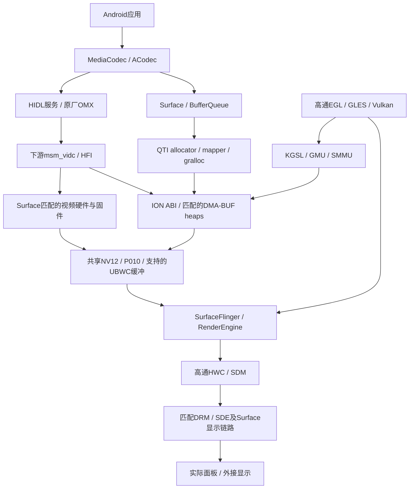

# 高通显示与视频栈整体移植方案

更新时间：2026-11-08。用户选择按整体移植方向编写后续实施说明。
本文是目标架构与实施计划，不表示下游驱动已经移植或整栈已经验收。
当前事实见 [HANDOFF](HANDOFF.md)、[BUILD](BUILD.md) 和
[部署状态](../configs/deployment-status.json)；旧局部桥接方案保留为历史成果。

## 1. 目标与范围

在唯一 Linux 6.18 基线上，逐步替换当前混合实现，接入相互匹配的高通 EGL/GLES/Vulkan、
KGSL、QTI allocator/mapper/gralloc、原厂 OMX/HIDL、下游 msm_vidc，以及 HWC/SDM 和
显示内核接口。最终以原生图形缓冲贯通硬件解码、GPU 合成和显示，覆盖硬件实际支持的
全部视频能力，包括 HDR；不以长期 CPU 拷贝或私有句柄翻译作为整体移植终点。

“整体移植”不是复制整个 donor vendor 分区，也不是替换 Android framework。
保留目标系统 MediaCodec/ACodec、SurfaceFlinger、BufferQueue 与应用接口，适配当前
Android 版本、VINTF、linker namespace、SELinux 和图形 HAL 契约。
闭源用户态库、固件与有源码的内核驱动分别管理；KGSL/msm_vidc 必须从匹配源码移植并
重新编译到 6.18，不能复制不同内核的二进制模块。

本次不新增回退机制或备份入口，不清用户数据/缓存，也不删除已有历史 EFI 入口。
保存和推送进度不触发设备部署；后续实施沿用用户已有自动部署、正常重启及默认项授权。

## 2. 当前进度与已知边界

| 层次 | 已实现与已验证 | 尚未完成 |
| --- | --- | --- |
| 基线 | Linux 6.18.60-sq2-android1，设备默认 Qualcomm Direct | 不是原厂整套下游 BSP |
| GPU | 移植高通 EGL/GLES/Vulkan 与适配层；Direct 规避大窗口花屏，设置/EasyTier及基础探针通过 | 原生 KGSL、GMEM 根因、广泛格式与长期负载 |
| 分配 | minigbm/mapper5 与局部 QTI mapper3 兼容层，限定格式已测 | 原厂 allocator/私有句柄/metadata/UBWC/protected 统一 |
| 视频服务 | OEM OMX→HIDL→ACodec 已接入，持久服务仍 AVC-only | 原生图形缓冲输出，其他 codec 的完整默认开放 |
| 视频内核 | Venus 加适配与 VIDC ioctl 桥；真实 cached DMA heap/WC 分配、原生 extradata 已测 | 完整 ION 或下游 msm_vidc 移植 |
| 输出 | 主动返回 RequiresSwRenderer=1；NV12 CPU 拷贝，P010 CPU 转 RGBA1010102 | 解码到 Surface 的零拷贝 |
| HDR | HDR10/HLG 各6帧真实 OMX/HIDL/ACodec→RGB10 ImageReader，像素、dataspace、实际 AHB 静态元数据通过 | 普通容器、物理 SDR tone-map、动态 HDR、保护路径 |
| 普通应用 | AVC 300输入/300输出、EOS/关闭通过；回调292/300，软件对照300/300 | 高通路径严格验收失败，不能把回调缺口直接当显示丢帧 |
| PM | 最后一次 poll 已就绪却报超时的边界缺陷已修正 | 真实休眠恢复仍 status=0、-110，根因未解决 |

当前默认 initramfs：
`5b9f7012ab43db5ec42f6169d57047527f19a0feff0fb824d77d7711ec68c351`。
已持久化系统库：

- `libstagefright.so`：`93312fd55e49a61f85483a46137f9bca8a98ae3c0299e07658e32590a9e104b5`
- `libsq2-p010-renderer.so`：`c67c598e90979aa9d85ce0cb8409e82d5f01366ad3c78916a373a96855848a92`

这些 hash 标识产物，不是单机准入条件，也不表示全部能力已开放。
最近正常重启89.8秒恢复SSH；收尾已读回临时锁释放、Venus健康。只是最后一次观测，
不保证之后的休眠不会再次触发已知故障。HDR回归使用RAM服务，不能写成默认已广告HDR。

## 3. 原厂共享缓冲与目标架构

框架根据 OMX usage/尺寸/格式从 Surface 获取图形缓冲，将真实句柄经 HIDL 交给 OMX。
OMX 导入 DMA-BUF，内核建立视频硬件自己的 SMMU 映射；解码后同一缓冲入 Surface，
由 GPU 或显示引擎消费。设备间 IOVA 可以不同，共享的是 backing allocation，
不能把 GPU 虚拟地址直接交给 VPU。零拷贝指这段没有 CPU 像素搬运，GPU 合成仍会写目标。

统一契约包括 native_handle ABI、平面数、offset/stride/scanline/容量、format/modifier、
usage/cache/security、metadata 布局与所有权。acquire/release fence、解码完成、
BufferQueue归还、flush/DRC/close 必须形成真实复用顺序。
OMX 的视频 metadata 缓冲模式与 HDR extradata 不是同一概念，需要分别接通。

实查 donor `libOmxVdec.so` 有 enableAndroidNativeBuffers、useAndroidNativeBuffer/2、
getAndroidNativeBufferUsage、storeMetaDataInBuffers 及 private_handle_t/P010/UBWC 痕迹。
这证明存在接口代码，不证明其 ABI 和固件路径适用于 Surface。
当前 `quest2-omx-service.cpp` 明确要求软件输出，不能只把该标志改为0冒充原生输出。

## 4. 配套版本与硬件兼容矩阵

每个候选记录来源、版本/commit、hash、构建选项、依赖、授权/分发范围与硬件适用性。
私有库、固件、原始转储、设备身份留在 private/out；Git 保存源码、补丁、清单与摘要。

| 配套组 | 必须核对 |
| --- | --- |
| GPU | 用户态与KGSL UAPI/ioctl，GMU/固件协议，真实GPU revision，SID/页表/fence ABI |
| 视频 | OMX与msm_vidc controls/events/buffer types，HFI版本、固件能力、extradata、DPB/OPB |
| 内存 | allocator/mapper/gralloc私有句柄版本，ION heap/cache ABI，metadata fd/布局，UBWC版本 |
| 显示 | HWC/SDM的DRM私有ioctl/properties，显示IP，panel/bridge/backlight，同步与电源 |
| Android | 实际HIDL/AIDL/mapper接口、C++ ABI、VINTF、linker namespace、SELinux |

SQ2营销GPU名称不能替代SC8180X/A680.1底层身份。Quest donor不是Surface BSP：
不得复制其DT、资源地址、IRQ、SID、clock/reset、电源域、保留内存、面板参数或固件。
SQ1/SQ2按真实硬件适配，不能绑定IP、用户编号、原盘UUID、序列或一次枚举结果。
固件必须同时匹配目标硬件、驱动协议与启动安全环境。

## 5. 实施顺序

### A. 完整输入与复现基准

取得匹配KGSL、msm_vidc、gralloc、HWC/显示源码或接口依据，建立上述配套矩阵。
缺项显式记录，不把ABI未定的donor组合称为完整原厂包。保留已有AVC/HDR像素、
metadata向量、普通应用回调对照和PM失败快照，作为替换前后比较基准。

完成条件：组件均有来源/依赖，区分源码重建与私有二进制，并列清硬件、固件和安全缺项。
当前接口字符串存在不能替代该检查。

### B. 统一内存与QTI gralloc

以选定原厂gralloc为契约，移植allocator/mapper及目标Android接口。
精确实现其ION ioctl、heap和cache语义；若由DMA heaps承载，证明分配/导入/同步/释放
等价，不能把所有heap/flags映射到system heap。旧ION移到6.18须适配DMA-BUF、
页分配、shrinker、cache/attachment API与实际IOMMU行为。

当前uncached适配依赖MSM GEM WC分配。切换GPU内核时必须同时替换这个依赖，
不能移除msm DRM后仍调用其GEM_NEW。先非保护线性RGBA/NV12，再P010/FP16与受支持UBWC。
protected留给真实安全闭环；minigbm句柄不能冒充QTI private_handle_t。

完成条件：同一分配可被目标消费者正确导入；平面边界、cache一致性、多进程fd传递、
引用计数、异常退出和fence通过。不是只证明allocator返回了fd。

### C. KGSL与GPU用户态

移植匹配KGSL/GMU到6.18，按Surface资源接线，适配clocks、regulators、RPMh、
interconnect、SMMU、dma_fence、调度、runtime/system PM与固件接口。
KGSL和msm DRM GPU驱动不能同时占有同一GPU；显示DRM需独立安排，
不能因替换GPU驱动把仍承担显示的组件一起拆掉。

按UAPI验证结果逐项减少当前GSL/DRM翻译与私有补丁，不认定原生KGSL必然修复花屏。
验证格式导入、GLES/Vulkan、显式fence、持续负载及GMEM/Direct对照。
GMEM须以像素和实际应用证明正确后再改变当前Direct行为；性能与功耗单独测量。

完成条件：原厂用户态经真实KGSL正确渲染与同步，桌面/应用/电源切换通过，
热保护和其他外设保持。

### D. 下游msm_vidc、原厂OMX与HIDL

移植匹配视频驱动及HFI、buffer requirements、controls/events、内存/电源依赖，
适配6.18 V4L2/VB2/DMA-BUF/IOMMU。资源、固件装载、PAS/no-TZ必须依据Surface实际环境，
不能复制donor TrustZone假设，也不能手工重复PAS或清sys_error。
当前Venus与新msm_vidc不能同时控制硬件；完整配套包通过正常重启切换。

保留HIDL→ACodec，接入原厂native-buffer输出：usage查询、注册、metadata模式、
句柄导入、回调及fence。先AVC线性NV12，再HEVC/P010。
真实像素/布局/生命周期通过后再取消RequiresSwRenderer；当前RGB10软件renderer
属于过渡成果，不是整体移植终点。

逐codec验证独立CSD、完整AU、常见容器、EOS、flush/seek、DRC、交错/重排、
参考帧/显示帧布局、损坏码流及异常关闭。按固件能力声明上限，不以测试样本定义硬件上限。
历史MPEG2挂死和HEVC独立CSD问题保留为验收项，替换驱动不自动销项。

完成条件：真实OEM OMX→HIDL→ACodec→原生Surface，无CPU像素中转，
DMA与引用生命周期闭合，普通应用持续播放正确；系统软件codec保留，退休项目C2不恢复。

### E. HWC/SDM与显示内核

移植匹配原厂composer/SDM，完成当前Android composer接口和服务接线。
盘点DRM私有ioctl/properties、framebuffer/modifier、plane/color-management、
writeback与同步依赖。现有主线DRM/KMS不满足时，本方案包括匹配SDE/显示驱动及
Surface panel/bridge适配，不能只换HWC库后把失败归给固件。

KGSL不替代显示驱动，gralloc不替代composer。
先稳定桌面/client composition，再做device composition、YUV/P010图层、
旋转/裁剪/缩放、截图/录屏、外接显示与休眠恢复。
零拷贝/overlay以buffer身份、fence和composition type证明，不依据库名或播放成功判断。

完成条件：实际Surface显示链路正常，消费者共享已验证格式；
不靠虚报HWC能力或丢弃metadata掩盖不匹配。

### F. HDR、安全路径与能力声明

贯通VUI→HFI/extradata→OMX→framework→gralloc→合成器，并保持真实10-bit数据。
HDR10校验mastering/MaxCLL/MaxFALL；HLG/SDR切换验证metadata清除及色彩范围。
动态HDR按实际支持标准分别验证，不从10-bit或静态HDR推导。
内置屏当前只观察到SDR/NATIVE，必须验收正确tone-map，不能虚报面板HDR。
外接HDR需要真实sink能力、链路格式和输出元数据验证。

secure/protected依赖真实受保护分配、SMMU/TZ/固件、GPU/显示protected消费及DRM服务。
普通no-TZ解码不等于安全解码；当前PM字段secure=1也不是DRM能力证明。
若Surface安全世界缺少必需接口，记录平台阻塞，不用普通内存冒充，
也不承诺Widevine等认证由驱动移植自动获得。

完成条件：硬件潜在能力、系统实际开放能力、实测范围分别记录；
所有可用声明都有真实路径，缺失平台依赖不写成“全部支持”。

## 6. 整体验收与操作约束

- 身份与配套：核对实际模块/库/服务/DT/固件及hash和boot ID；同一包面向SQ1/SQ2，
  两机分别验收，单机结果不推广为双机完成。
- 图形/显示：非对称像素图案、格式/alpha/crop/stride、fence、HWUI/设置/应用、
  GMEM/Direct、持续负载、刷新率及电源状态。
- 视频：逐codec/profile/level/位深对齐真实能力；原生buffer身份与实际呈现时间可追踪，
  严格PTS/帧/EOS/关闭检查保持，不能伪造frame-rendered回调凑数。
- HDR：逐像素和实际metadata/dataspace、SDR tone-map、切换与外接输出；
  离屏读回、合成结果、物理面板能力分开验收。
- 内存/PM：并发GPU/视频/显示、buffer退休、异常关闭、真睡/恢复/中止睡眠，
  无悬空DMA与泄漏；健康重启不能替代PM根因修复。
- 系统：保留音频、触摸、网络、用户设置与凭据；生产SELinux规则单独审计，
  permissive研发启动通过不等于生产安全验收。

每次实验记录假设、主要改变量、区分性观测和停止条件；失败先取证。
禁止热卸载活动Venus/provider、盲目重复固件启动或清sys_error。
正常重启按600秒窗口检查认证SSH及boot ID；窗口内单次失败不触发重复重启。
部署前/重启后检查ESP/log空间，必要开发日志先取回并核验SHA，再删除准确ESP副本。
不新增回退项，不删旧入口，不清用户数据、凭据和未知缓存。

## 7. 续接入口与保存范围

工作根：WSL Ubuntu-24.04的`/mnt/spx-workspace/chromebookOS/work/qualcomm-618`；
分支`codex/quest2-proprietary-gpu`。Windows目录仅为启动器，不放源码/构建物/缓存。

| 方向 | 源码入口 |
| --- | --- |
| OMX/HIDL/能力 | `probe/video/quest2-omx-service.cpp`、`quest2-omx-caps.h`、`scripts/build-quest2-hidl.py` |
| VIDC/内存/metadata | `probe/video/quest2-vidc-bridge.c`、`venus-sq2-extradata.h`、`scripts/patch-sq2-venus-extradata.py` |
| PM | `probe/video/venus-sq2-system-pm.h`、`sq2-venus-fw.c`、`scripts/patch-sq2-venus-boot-status.py` |
| 过渡renderer | `patches/stagefright-p010-renderer.patch`、`scripts/build-sq2-p010-renderer.py`、`scripts/pack-sq2-p010-renderer.py` |
| 帧审计 | `probe/video/player-app/RenderedFrameAudit.java`及配套测试 |

私有证据保存在`out/quest2-video-618-20261107/all-codecs/`：
`PROGRESS.json`、`CAPABILITY-STATE.json`、`user-wake-pm-failure-result.json`、
`render-audit-v1-comparison.json`、`render-audit-v1-final-state.json`、
`hidl-{hdr10,hlg}-renderer-persistent-1-result.json`。
Git保存可分享的HANDOFF/部署摘要；原始日志、库、固件、凭据与构建物不上传。
旧C2源码差异作为历史工作保存，不恢复默认注册或运行。

下一实施工作是阶段A的配套输入/接口清单，再进入阶段B内存契约核验；
不是先关闭软件renderer或一次性替换所有服务。
目前不承诺donor已提供完整、兼容、可重新分发的整栈输入。
