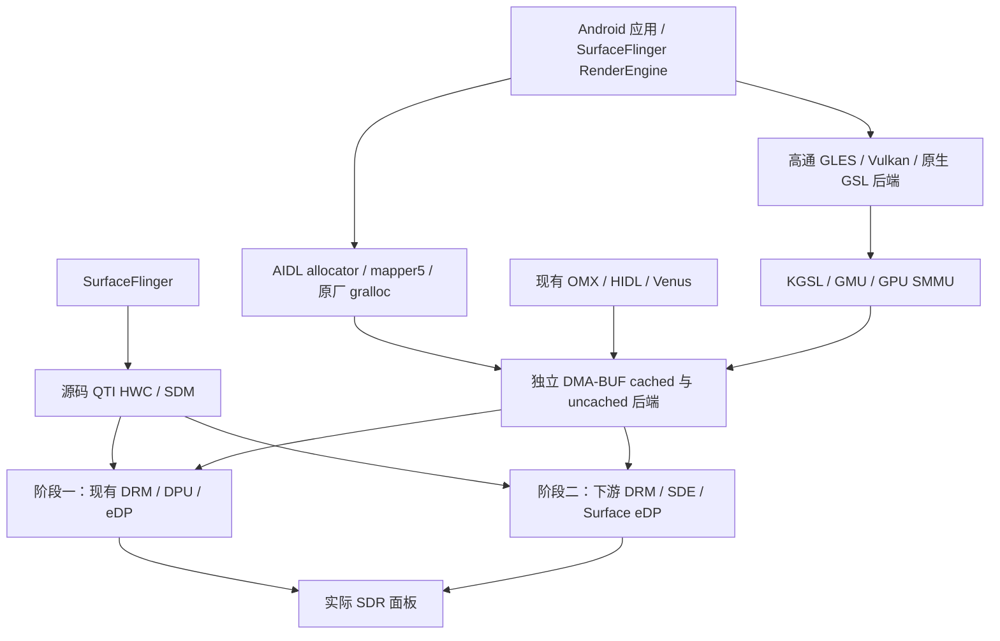

## 2026-11-11：KGSL/SDE 已暂停，保存到当前分支

用户明确暂停后，仅授权保存进展并提交当前 `codex/kgsl-sde-port-v83`。目标保持 paused，
三个子代理已中断；不得因旧段落的“继续/active”自动恢复开发、连接设备或重新构建。
已集成 KGSL58 / SDE17；SDE 三态整体构建仍 exit2/25对象/0模块，16组专项检查通过。
本次将7组未完成候选的52个源码改动另存为 `patches/wip/kgsl-sde-paused-20261111`，
仅做精确patch重建/保存完整性校验，不加入正常配置、不当作功能通过。源/私有产物及原始
证据保留本地ignored目录，不上传；原六个rescue-console文件保持未提交。
暂停续接入口：`docs/KGSL-SDE-CHECKPOINT-20261111.md` 与
`configs/kgsl-sde-checkpoint-20261111.json`。须用户明确恢复后再执行未完操作。

## 2026-11-11：SDE第17组，现代framebuffer格式契约

当前17补丁/315源。msm_framebuffer_create接受6.18 core选定的drm_format_info，同一指针
传至私有initializer、线性大小检查和真实drm_helper_mode_fill_fb_struct，不再重查而覆盖
core选择。内部writeback/stolen入口保持原调用方式，按真实pixel_format/modifier参数查询一次。
保留vendor modified-format校验、失败传播、每plane GEM引用及重复handle引用计数；不是
简单函数指针强转或跳过UBWC校验。msm_drv.h只更新create原型，未改IRQ/mode字段。

线性plane边界改真实rounded width/height及min_pitch，使用u64 min_size避免原32位回绕；
拒绝无效格式/plane数量和尺寸。327个HOST断言（非327独立场景）使用实际构造函数、真实
fourcc/fill helper，KMS/分配/GEM叶子仍模型；涵盖core-info身份、奇数chroma边界、>4GiB
大小、modifier、部分lookup/alloc/register失败、借用和重复handle。五变异先compile0后run1。
三态HOST编译1/0/1，新运行0；真实ARM64 callback/lookup/fill接口probe三态2/0/2。
完整msm_fb.c三态仍2，模式公共头阻塞，不能称完整consumer通过。最初harness把计数变量
命名puts与libc冲突，真实compile1保留；更名put_count后才统计上述有效验证。

整体BASELINE/MODIFIED/ROLLBACK均exit2/25对象/0模块，framebuffer目标API诊断清零。
317文件精确回滚/重应用、315父源与KOUT五输出保持。合并16组checker全部0，额外合并
ARM64 framebuffer probe0。完整模块/MODPOST/实际scanout和provider退休仍未验收。

IRQ/vblank代理仍实现真实PM/IRQ注册失败与原子回调睡眠边界，不接受异步work假成功。
mode代理已将精准增量rebase至独占integrated16副本，继续catalog/bridge/全消费者。
MST发现QTI primary缓存固定connector ID且热插拔路径跳过primary，因此不能用简单动态重建
取消常驻fixed-primary语义。已选择独立真实6.18 core opt-in persistent生命周期扩展，默认
其他驱动行为不变；atomic基础四角色明确未可集成。未来须新配对内核构建，不借旧dev2运行。

证据out/kgsl-resume-20261111/sde-integration-17与sde-framebuffer-api四角色；旧角色全部
保留。下一仍接收完整IRQ/vblank，并完成mode、MST persistent core/driver与late GEM owner。
物理显示、真实提交/fence退休/DDR投票/PM/性能/SQ1-SQ2未完成，无设备操作/发布pins变更/
提交推送，goal active。既有known controller清理/list锁旧open描述已在新config注明后继修复。

## 2026-11-11：SDE第16组集成，controller成功清理与fence诊断接口

当前16补丁/315源。第15组独立修复dsi_ctrl_debugfs_init：debugfs_root发布后立即return0，
不再成功落入error_remove_dir。原API-only四角色和已知缺陷反证不改写。实际同输入主机三态
均compile0，运行1/0/1；成功目录removed从1变0，3个真实file失败仍-13/只清理一次，dir
失败不清理未创建目录。72严格场景通过，5变异先编译0再运行1；不是实机debugfs并发验收。

第16组移除dma_fence_ops已不存在的字符串回调槽；sde_sync_wait/list_dump调用本地
sde_fence_timeline_value_str，先确认ops身份才访问本驱动ctx，以READ_ONCE读取done_count；
外来fence明确unavailable，不把target seqno伪装为当前timeline、不盲转私有结构。seqno仍
单独输出。13个同步/释放/信号相关函数字节不变；不能把诊断迁移称fence生命周期完成。
实际函数/真实ops声明47项HOST检查通过，三态compile1/0/1；foreign仅分配base的负控可
被ASan捕获，另错误计数/吞wait错误变异均先compile0再run1。真实6.18 ARM64窄caller TU
三态2/0/2，完整sde_fence.c三态仍2。初始提取器误禁函数body分号导致ValueError，错误保留，
修正抽取式后才产生编译/运行证据；没有将抽取错误算产品红例。

整合后BASELINE/MODIFIED/ROLLBACK均exit2/25对象/0模块；旧fence成员诊断在modified
消失，317文件精确回滚/重应用，父315源和KOUT五输出保持。合并15组checker全部0（debugfs
已启用require-controller-root严格门禁），额外合并ARM64 fence probe0。完整模块未通过。

模式v2用户态已另完成42TU/5source库严格链接；root重开6个ARM64 ELF及hash（含1个复制
libdrm），证据ROOT-USERLAND-v2-REOPEN.json。kernel catalog/bridge/全消费者仍未完成，
不据此称joint mode通过。MST代理正处理真实atomic payload/固定connector生命周期与
真实链路参数，不能删MST绕过；IRQ代理处理真实request/free、preinstall失败传播/局部回收、
vblank锁与睡眠边界，不能用假成功异步工作吞掉错误。三代理均gpt-6.1-sol/high，写集独立。

证据out/kgsl-resume-20261111/sde-integration-16与debugfs-cleanup/fence-diagnostics原
四角色。下一步验收完整IRQ/vblank、mode及MST候选并语义合并；late GEM/private-owner、
物理显示、真实提交/fence退休/DDR投票/PM/性能/SQ1-SQ2仍未完成。未操作设备、未改发布pins、
未提交推送。历史open条目按组记录前态，controller成功清理缺陷现由第15组闭合。

## 2026-11-11：SDE第14组集成与真实接口验证

当前14补丁/315源。第13组四源21位点改用真实6.18 debugfs scalar void/best-effort
接口，45个原独立调用未改；节点名/权限/value与真实file/dir错误处理保留，不提供假返回值。
host实际15个initializer函数72场景通过，三态旧/新/回滚编译1/0/1，新运行0；五个源码
变异先编译0再运行1。实际ARM64窄caller TU三态2/0/2；完整dp_debug.c仍编译2。
dsi_ctrl_debugfs_init成功落入remove目录是独立已证实遗留缺陷，严格检查运行1；API-only
补丁未掩盖或修复它，后继补丁单独处理，不能称controller debugfs生命周期已通过。

第14组为五个真实消费者补linux/pinctrl/consumer.h，并把sde_plane的
drm_gem_atomic_helper.h放回原pr_fmt定义之后。该include顺序问题由本项目第4组PRIME
插入头文件引入，本轮修正，保留原日志格式、不压制warning。六个ARM64窄probe三态
2/0/2（对象0/6/0），逐项撤销六个负例均2且仅5对象；原日志格式在实际ARM64对象常量中
核对，不冒充运行期日志验证。六个完整consumer TU仍均2，目标诊断27/0/27。

合并后实际全量构建BASELINE/MODIFIED/ROLLBACK对象数25/25/25，三者exit2、零模块。
317文件真实回滚/精确重应用、315父源及五个KOUT输出hash核对；本轮三类目标诊断清零。
合并源14组checker全部exit0；其中提取函数模型和窄API探针不替代完整模块/MODPOST/真机。

模式v2仍未集成，owner/cache基础已有35+134实际函数主机断言与29分配点失败覆盖；root
独立复跑冻结候选两组exit0。尚需完整catalog/identity/bridge/CRTC/encoder消费者，不据此
关闭模式路线。新增用户指定gpt-6.1-sol/high MST代理，负责真实6.18 topology/payload和
atomic commit生命周期，与mode代理协调msm_atomic.c增量；不是删除MST的简化路线。
late GEM/private-owner退休仍无完整交付，KGSL58与配套dev2内核复用，不重复构建。

证据out/kgsl-resume-20261111/sde-integration-14与原sde-debugfs-void、sde-api-headers
四角色，旧角色保留。下一步接收独立controller成功清理修复并继续mode/MST/owner；物理显示、
真实提交/fence退休/DDR投票/PM/性能/SQ1-SQ2仍未完成。无设备操作、发布pins变更或提交推送。

## 2026-11-11：SDE第12组整编与字符串验证纠错

当前12补丁/315源。第11组逐项审计32处strlcpy：30个固定边界改strscpy，strlen后独立
分配的完整字符串用memcpy含NUL，evtlog外参容量限到真实filter数组，保留C字符串截断/终止
及后续分支，不承诺NUL后padding逐字相同。第12组15源/21处kzfree改真实kfree_sensitive，
保留完整分配大小清零再释放语义、补直接slab头，不退化为普通kfree；不是完整析构/退休证明。

实际整编BASELINE exit2/24对象/0模块，MODIFIED exit2/25对象/0模块，真实ROLLBACK
exit2/24对象/0模块。精确317文件回滚/重应用、315父源和KOUT五输出hash核对；两种已移除
API的编译诊断在本轮MODIFIED均消失。模式private_flags/SEAMLESS、MST、bridge/DSI等仍阻塞
完整模块；25对象与减少的诊断条数都不是完成百分比。合并源码12组checker全部exit0。

重要纠错：子代理最初把字符串checker wrapper exit1说成编译失败，root逐字核对发现旧
host native-api编译/运行均0，实际链接strlcpy@GLIBC_2.38（宿主glibc2.39）；wrapper1来自
残留调用扫描。错误说法已撤回，旧记录/工具保存在pre-gate-correction。更正后显式标记为
HOST compiler-poison模型门禁，三态1/0/1；真实4.19语义scalar/word各234均通过，新版三通道
各234。root另实际6.18内核头ARM64窄API TU三态2/0/2，不能将其称完整调用者编译通过。
敏感释放实际21语句与6.18 helper有210模型场景，真实ARM64 API TU三态2/0/2；原扫描器
漏计删除调用的弱点保留并加缺失/重复site拒绝，3个生成wrapper运行反例与3个源码门禁分列。

模式入口v1仍独立未集成：125断言及精确回滚已由子代理完成；另真实Android42 TU和5个
source库--no-undefined链接成功，root重开6个ARM64 ELF/hash（其中libdrm是固定复制件）。
不是HWC服务、全内核模式消费者或真机验收。前三次真实构建失败保留；修正错误架构libc++
输入及独立C++兼容头后才通过。v2继续处理requested/derived/selected、bridge、cache identity
及共享payload资源owner，不能把入口测试或库链接当整条模式路线完成。

证据out/kgsl-resume-20261111/sde-integration-12；旧四角色保留并扩展，绝对路径/SHA见
FINAL-ROLE-PATHS.txt。late GEM owner候选只有部分测试，代理交付阶段工具错误，未闭合/未集成，
不将该工具错误当编译或产品结论。下一步debugfs真实void API及完整mode消费链；owner寿命、
硬件退休/显示/提交/PM/长时/SQ1-SQ2仍必须完成。无部署/重启/提交推送，pins不改，goal active。

## 2026-11-11：SDE第10组完成三态整编，模式请求迁移仍在进行

当前10补丁/315源，配对dev2内核沿用已完成构建。新增三组：SDE/DP五处日志判断改为真实
drm_debug_enabled(category)，保留日志路由/CORE门控；六文件仅加八条实际公开类型头；
dsi_parser_utils.get_named_gpio及函数声明/定义/禁用stub改为const device_node，与6.18 OF匹配。
GPIO读取/index/error原语义不改。原checker一度错认OF形参名，保留失败，v2改为提取实际名字，
不把该工具错误计为产品红例。新GPIO64实际源码模型场景通过，完整真实头两配置ARM64 TU通过。

实际整编三态BASELINE exit2/21对象/0模块，MODIFIED exit2/24对象/0模块，ROLLBACK
exit2/21对象/0模块。原件、317归档文件恢复/重应用及KOUT五输出hash均核对。目标日志符号、
framebuffer/bridge_funcs完整类型、GPIO回调签名错误在本轮MODIFIED中消失，但模式状态、
MST/bridge/DSI/DSC等接口仍阻塞整个模块；不能把24对象或错误条数当完成百分比。

整合树独立运行10组checker全部exit0：此前native50/joint14/active21/PRIME31/fence9保持，
debug1320/GPIO64和6个真实公开头窄TU通过。debug真实完整consumer仍有其他旧API错误；
公开头六个完整原TU仍失败，仅目标86条类型诊断消失。以上不证明硬件或完整模块可用。
原四角色保留并扩展，整合证据out/kgsl-resume-20261111/sde-integration-10；角色路径/SHA统一
更新到FINAL-ROLE-PATHS.txt。无部署/重启/提交推送，默认发布pins和运行10档OPP未改。

mode审计已保存并恢复实际QTI builder源码请求链：6.18拒绝旧VID/CMD/SEAMLESS高位，
不能仅补常量。driver-owned requested/adjusted状态、配对用户态atomic请求、mode cache payload
所有权与完整DSI消费者仍须迁移。审计中的共享payload重复释放调用仅为实际语句/函数模型，
不是完整cache或硬件UAF证明。下一步并行推进真实mode入口/消费者、字符串API、late GEM
private-owner寿命；所有候选保持独立验证再合入。整体目标active，全部full_*边界保持。

## 2026-11-11：配对内核完成，SDE 第7组已集成并实际三态整编

本节覆盖下方“新内核仍在构建／PRIME尚未集成”的旧检查点。隔离dev2的Image、486内核模块、
KGSL58的60对象/3模块及489模块depmod已完成；Image 7e0d1129…，msm_kgsl 5ff1f2e3…。
这是编译候选，不是部署/真机验收；旧配对内核和默认发布pins未改，不重新启动已完成构建。

SDE目前7补丁/315源。PRIME之后合入真实公共framebuffer/fourcc头、删除无用户的ION头依赖、
实际MDSS DMA provider及active-list引用快照/回调锁/完整DMA span校验。native DMA与active-lock
是成对int回调API迁移，不能单独拿第6组当可用候选。local走DMA API，EXTBUF保留attachment映射
所有权；不借用后释放provider域、不重复map/unmap。secure/NRT及固件identity/splash仍显式不支持。

同一dev2 KOUT、相同完整模块命令实际三态：BASELINE exit2/2对象/0模块，MODIFIED
exit2/21对象/0模块，真实ROLLBACK exit2/2对象/0模块；317个归档文件逐hash恢复并精确重应用。
原315源和KOUT关键输出不变。整合树独立复跑native50、provider→VMA14、active21、PRIME31、
fence9均通过。旧PRIME模型缺三项新增公共primitive，初次编译失败保留；仅补模型overflow/SG
遍历定义，断言/产品不改，旧/回滚失败，新/重应用31通过。不是硬件DMA、TLB、退休或safe unbind证明。

共享工具scripts/check-sde-native-{dma,kms,secure,joint}.py和check-sde-active-lock.py已归档，
支持显式源码/内核路径，不依赖私有out目录。原四角色与失败证据保留；整合扩展为
out/kgsl-resume-20261111/sde-integration-7/{MODIFIED_FILE.tar.gz,DIFF_FILE.patch,VERIFICATION.txt,ROLLBACK.sh}。
完整编译仍失败：新暴露的日志category API、mode private_flags/SEAMLESS/vrefresh、MST/bridge/DSI等
需继续真实移植；错误条目数不是独立缺陷数或完成百分比。mode请求须兼顾原厂用户态，不能把6.18
已拒绝的旧flags硬塞回核心，或用永false/无人设置的属性冒充兼容。

下一步：独立debug-category候选和mode请求/状态所有权迁移，继续完整模块构建、KGSL真机提交及
SDE物理显示/联合fence/PM/长时/SQ1-SQ2验收；full_*不提升。目标active。未提交推送、未部署重启。

## 2026-11-11：DDR联合链与SDE PRIME／DRM核心后续状态

第58 KGSL完整构建结果保持。另完成同一loader表的实际源码联合链：32场景、9个编译后运行反例；
BASELINE/ROLLBACK均0绿32红exit1，MODIFIED32绿exit0。逐项核对39 DDR+8 CNOC HFI words、
七频default/min/max及280次hint，覆盖RPMh分配失败和ICC重试；不是硬件投票/Surface校准。
证据 `out/kgsl-resume-20261111/ddr-joint/JOINT-RESULT.json`，不改运行10档OPP。

实际DRM `drm_gem_plane_helper_prepare_fb`发现并修正两条引用泄漏：无FB先get显式fence后直接返回；
chain分配失败漏put尚未转移的new fence。原件/实际回滚3定点各LSan报1个24B模型fence；
新副本41场景和4个编译后运行负例通过，主代理独立重跑也通过，KERNEL/WRITE语义不变。
已归档 `configs/drm-618-plane-fence-ownership.json` 及精确patch，旧paired kernel未改。
新隔离 `/mnt/spx-workspace/chromebookOS/work/qualcomm-618/kgsl-sde-fence-20261111-build`
已真正启动Image/modules -j12；仅source helper和CONFIG_LOCALVERSION(-sq2-kgsl-sde-fence-dev2)变化。
记录时session27827/orchestrator354/make1096运行，已有原ashmem warning；尚未宣称构建完成。
续接必须复核 `drm-fence-chain/build/STATUS.json` 和真实进程/会话，不因观察超时重新开构建。

SDE PRIME九源候选未集成，独立审阅进行中：31 owner、9 fence/state、11 native fault场景及
10个编译后运行负例通过；BASELINE/ROLLBACK owner与fence exit1，MODIFIED exit0。
真实PRIME TU三态均exit2，完整候选v4也exit2/仅2对象/无模块；共享KMS/provider旧API仍须迁移。
import_aspace从attachment前保留到真实unmap/detach后，核心resv持锁入口不递归加锁；
不读foreign私有数据，不伪造secure属性，不丢必要fence。真实PFN/SG/resv公开API迁移已纳入。
core新副本另与实际SDE九场景及chain OOM联合通过，但旧paired kernel仍含旧helper，不能混称已修部署。
下一步先独立审阅合并此候选，再移植真实MDSS DMA provider；不把DMA映射和手动paging域混搭。

原四角色及所有扩展已重开；绝对路径和SHA统一在ignored `out/kgsl-resume-20261111/FINAL-ROLE-PATHS.txt`，
执行续接点为 `CURRENT.json`。未提交/推送、未部署/重启、不改发布pins；整体目标active、full_*仍未完成。

## 2026-11-11：原生 indexed DDR 加载器与高频来源修正

第58补丁 `kgsl-xiaomi-618-native-indexed-policy.patch` 已加入完整准备链；只改 `kgsl_bus.c`。
显式 `qcom,kgsl-bus-policy = "indexed"` 保留完整十进制表及每频率 default/min/max，
原生OPP仍决定频率/电压；非零average拒绝，缺selector保留原peak-only模式，坏selector不回退。
完整表/三值与ICC成功后才发布；启用10频率但只有7行政策明确失败，不插值、不填max、不删OPP。
同输入BASELINE/ROLLBACK均23绿73红exit1，MODIFIED96绿exit0；原99 bus场景三态全绿，
12个变异均编译成功后运行断言失败。新鲜58准备副本再次通过96+99；58组现已独立完成
60对象（59个-Werror编译单元+1链接对象）/3模块/MODPOST和489模块depmod，编译stderr空。
msm_kgsl SHA409318f2…；原内核91,246源、配对输出和56/57源/对象/模块保持。
主代理新58回归bus99、含实取固件SQE51通过；component/devres严格反例仍exit1，不宣称safe unbind。
测试含真实提取函数，但OF/OPP/ICC仍为模型，不证明硬件动态投票。

纠正下方历史“高三档缺失OEM表”的解释：590/661由项目提交277c0d08…添加，700由6337faea…
复制661并调角添加，均是项目实验档；原177..514七档的SDMSHRIKE V2来源完整，仍非Surface校准。
当前10个运行OPP保持。实际DTB SHA91625e29…，GPU `/soc@0/gpu@2c00000`，所有OPP无peak/avg带宽。
同boot只读取得cmd-db静态元数据（独立mount namespace，父mountinfo未变），没有部署、重启或采样。
已用实际输入重跑：RPMh59+DDR18、GMU OPP36、GPU OPP25通过；最后一项原checker本来可用，
fdtget支持省略unit-address，未把错误的路径失败假设写成产品缺陷，也未为此修改checker。
这些验证不证明真实投票/PLL/功耗。MSM的单OFF HFI占位表不构成已验证动态DDR路径。
Windows P007输出为原始性能状态遥测，不再称带宽；兼容旧JSON字段且数值/指令不变。

四角色扩展 `ddr-indexed/`、`reference-semantics/`、`reference-classification/` 均位于
ignored `out/kgsl-resume-20261111/`；原SQE角色保留。分类元数据三态1/0/1，仅验证证据分类，
不冒充驱动回归。SDE PRIME仍是独立未集成候选，完整SDE尚未编译通过。safe unbind、
动态OPP并发、完整fence/退休、设备显示/提交/PM及SQ1/SQ2验收未完成；整体目标active，full_*不提升。
子代理按用户指定 gpt-6.1-sol/high；共享KOUT单一持有者。默认发布pins、EFI、运行OPP不变。

## 2026-11-11：第57组配对编译及SDMSHRIKE V2带宽来源

当前57补丁/109源已完成新鲜配对编译：60对象（59个GCC命令均-Werror、1个链接对象）、3模块，
MODPOST无错误警告，489模块depmod无输出；`msm_kgsl.ko` SHA `a63381e52d818bfb43cd1e01097eed1d7fa13930a038f23b67a9f5ae3afb5583`。
只修 `adreno_unbind` 输入producer/work的停止顺序：同输入BASELINE/ROLLBACK4绿22红exit1，
MODIFIED26绿exit0。原内核源/配套输出/56源与模块未改变；初次59/60计数断言失败保留。
这不是完整safe unbind/硬件退休验收，外层component/devres严格反例仍失败。

DDR找到比旧graphics参考更完整的官方4.14.105 SDMSHRIKE V2/A680.1来源，固定commit
`04749e7fec2a8a5784a984d09f03fd0f2715fd1b`：13档十进制kB/s，7个177..514MHz档位明确
对应default/min/max，且GPU/LLCC/EBI通道宽度与SC8180X拓扑相符。仅落非激活参考
`configs/kgsl-sc8180x-downstream-policy-reference.json`；590/661/700MHz仍无来源，
不能降为7频点冒充完整目标，不能从Windows MemoryFrequency换算出缺失带宽。
当前native peak-only加载会覆盖原三值，后续需显式indexed-policy模式并精确匹配全部enabled OPP；
不复制源cmd-db地址、不插值、不把max当default。本轮未改变任何运行DT/OPP或发布pins。

SDE三组已独立prepare315源，第三组将DP PHY旧常量迁到现代定义和独立CP2/CP3名称；
2308实际函数场景及9个运行反例通过，保持原支持集合与MMIO顺序。完整header/getter TU
基线/回滚exit2、改件exit0，不等于dp_link.c完整TU。全模块仍未通过，
不是Surface eDP或联合显示验收；设备未部署/重启，目标active。
详细命令、回滚和未完成边界见 `docs/KGSL-PARALLEL-20261111.md`。

## 2026-11-11：第56组 HFI worker 修复及新配对内核已编译

本节覆盖下方第55组“未新编译”的阶段记录；整体 KGSL＋DRM/SDE 目标仍 active。
子 agent 按用户指定统一使用 `gpt-6.1-sol` / `high`，保留独占写入与主代理串行集成边界。

第56项 `hfi-worker-lifecycle` 将 F2H cache 改为每实例，初始化两个链表并检查 task/cache/IRQ
创建结果；IRQ 申请最后进行，probe 失败先 join worker 再释放 cache。等待条件改为 stop 或有包，
修复 stop 唤醒后仍睡眠的问题。19 个实际函数/pthread 场景及7个编译后运行反例通过；
旧版及回滚均退出1（worker stop 超时），新版退出0。仅为 probe/worker 局部修复，未接入 live unbind，
IRQ/slab/内核调度仍为模型。component/master devres 错误释放的严格反例仍 exit1，不能称生命周期闭合。

独立复制本机 full-image 内核源和运行配置，应用全套提供者补丁，完整 Image＋486模块完成；
6个提供者对象 `-Werror` 重编。第55/56组各新鲜目录完成60对象/3模块严格编译与 MODPOST，
两套489模块 depmod 均无输出。新 release `6.18.60-sq2-kgsl-sqe-dev1`，未复用历史符号表；
第56组 `msm_kgsl.ko` SHA256 `a98eceec3635d4bc114885d59dcc04fe7b7ed58a8e741dcb8c3f5f908f435ad1`。
73个软链均留在复制树内；原源码保持。完整首编37条既有编译警告、2条KSU元数据提示及中间
5条.cmd NUL警告均保留；最终增量只有2条KSU提示，不能称全内核首编零警告。
外置 KGSL 必须使用本次真实 **6.18** 的 `drivers/devfreq/governor.h`；首次误用5.4头失败已保留。

原 Quest 2 4.19 的 DDR 输入来自 DT 政策表，经 MSM bus 拓扑/cmd-db 转成 RPMh TCS，
再由 HFI 发送整表、运行时选索引；Windows 并非必需。Kona/A650 表不能直接当作 SQ2/A680 校准，
cmd-db 也不替代频点对应的政策。DTS `/1024`、MSM bus `×1000` 换算差异已核对。
Windows Type25 仅写 MemoryFrequency 等频率字段，MemoryBandwidth 字段清零，不得把该频率当带宽。

SDE 已恢复固定313源并启动真实6.18 API移植；完整构建仍 exit2，未生成可用模块。
DP helper 第一组和UAPI include修复的单TU/主机通过不等于完整SDE或Surface eDP验收。
普通A680输入worker/独立owner、目标DDR、SDE其余API及provider、实际提交/显示/双机验证继续。
本轮没有部署、重启、修改默认pins/EFI、提交或推送；full_*仍未提升。
证据：`out/kgsl-resume-20261111/build/FINAL-BUILD-56-RESULT.json`、`teardown-owner/`、
`quest2-ddr/FINDINGS.md`；详情和沿用四角色见 `docs/KGSL-PARALLEL-20261111.md`。

## 2026-11-11：并行续接，SQE 边界候选与解绑反例

已切换并同步 `codex/kgsl-sde-port-v83` 到 `690acd6`，用户授权 sub agent 并行。
固定 donor 426 文件逐 SHA 核对，重建 v83 的54补丁/109源；当前新候选追加第55项
`sqe-bounds`，只改变 `adreno.c` 的 `get_ucode_version` / `adreno_get_firmware`。
分配前验证普通版本头至少8字节、扩展头至少16字节及整dword，使用非对齐小端读取；
合法载荷仍跳过首4字节原样复制，错误不发布size/version。A5xx PM4/PFP共用该loader，
本轮仅含捕获的A680 SQE，不能外推A5xx硬件验收。

最终精确长度夹具51场景：旧版11绿/40红、新版51绿/0红、实际回滚11绿/40红，
回滚SHA等于原件；6个反例均编译后运行失败。另独立42项对照旧6绿/36红（14个实际ASan越界）、
新42绿；独立完整51项也通过。初版较大底层缓冲的记录保留，不称40个失败全是ASan越界。
重跑v83父域45、GMU76、固件55（未带捕获GMU文件）、LPAE18、provider32及准备器18通过。

实际callback/core六函数复现普通/HWSCHED两种错误路径：即使GMU remove保留资源或callback
提前return，component与master仍各释放一次devres并清bound。严格保留契约测试exit1，
这是未修问题，不是生命周期绿例；remove errno/devres/锁仍为模型，未证明实机UAF。
下一步须处理独立owner及两阶段停机/释放，包括bind失败回收，不能靠void callback返回值阻止core清理。

当前新候选为 `source-host-tested-not-device-ready`，**未新做完整内核/模块编译、未部署/重启**；
最近完整配套构建仍是历史v83/native-kernel-v3，不得把旧Module.symvers混入新候选。
本次SSH只读核对SF/audioserver running、Android boot_completed=1，运行的仍是MSM而非原生KGSL。
默认发布pins、EFI及原未跟踪救援文件保持；整体KGSL＋DRM/SDE目标active，full_*不提升。
完整命令/证据、四角色与并行边界见 `docs/KGSL-PARALLEL-20261111.md`。

## 2026-11-11：小米 KGSL v83 保留同步失败的中间页表

新增 smmu-walk-v1 提供者补丁。ARM LPAE 撤销非叶项时使用可返回错误的 walk 同步；失败恢复完整父项及非一致性 DMA 可见性，保留子树，只返回此前成功撤销的前缀长度。原有映射替换调用收到短撤销后拒绝覆盖。未启用的其他调用者保留原有回调行为；整个 domain/root 销毁仍未改为可检查同步。
第54项 checked-unmap 补丁使 GPU 父域和 GMU 域在发布映射前启用此能力；启用验证实际域/context、PM 和 checked drain，失败沿保留归属的路径退出。GMU 启用失败后先 detach 并核对实际域，再释放空域；仍附着则保留并锁存错误。提供者 map/unmap 的 PM 获取失败在修改页表前返回。
18个真实 ARM LPAE 子树/映射替换、32个提供者、76个GMU及45个父域场景通过；15个反例均编译成功后运行失败，另18项准备器检查通过。首个缺屏障反例因 mock 未使用而编译失败，已修正为禁用调用并验证运行断言，初始记录保留。
54补丁/109源独立复现，仅KGSL两个源改变。native-kernel-v3 完整 Image/486模块成功，SMMU两个对象和 ARM LPAE 对象均 -Werror；首编47条既有驱动/WSL时钟警告原样保留，最终增量零错误警告。KGSL60对象/3模块 -Werror/MODPOST零错误警告，489模块依赖无输出。91,246个内核源逐项核对，仅5个预期文件改变，native-kernel-v2保持。内部 io-pgtable/SMMU 布局改变，必须整套重编配对，不能按相同版本字符串混装。
**实际索引/撤销/递归释放代码已执行，但物理地址、DMA、MMIO、PM和锁仍为主机模型；没有硬件TLB或并发正确性证明。整个根/域销毁、完整GPU/GMU/HFI/worker/IRQ停机、错误保留恢复及component/devres解绑仍未闭合。** SQE边界、目标DDR校准、真实提交、KGSL+DPU、下游SDE/Surface eDP及双机验收继续待完成。本轮只读复核调试设备不锁屏/接电常亮已生效，未部署或重启；设备保持B0m。

## 2026-11-11：小米 KGSL v82 接通 GMU 撤销后的 checked TLB drain

新增独立 smmu-drain-v1 提供者：arm_smmu_flush_tlb_checked 校验实际 domain owner、AArch64 S1/context bank，持初始化锁与 runtime-PM 引用，在 cb_lock 下执行 PTE 写屏障、真实 ASID invalidation 和 Qualcomm checked 同步，返回 PM/超时错误；不改变根或替调用者停止设备。不支持的提供者返回 EOPNOTSUPP。
第53项 gmu-drain 补丁将真实接口接入普通 GMU 全局内存释放。只有撤销字节数精确匹配且 checked drain 成功才释放 DMA backing；失败锁存并保留对象/domain，不重试带洞区间。HWSCHED 成功导入设置 GMU_MAPPED，GPU 父域/共享释放和直接析构保留该对象；退出时逐项撤销并同步后才清标记，最后清导入表。a6xx_gmu_remove 改为返回错误，HWSCHED unbind 收到错误不再继续销毁 dispatcher。
22个实际提供者、74个GMU/导入/共享释放、47个genpd/remove、43个父域/全局和17个释放场景，13个编译后运行反例及18准备器检查通过。53补丁/109源独立复现；9源改变、100源保持。native-kernel-v2 完整 Image/486模块成功，SMMU两个对象 -Werror；KGSL完整60对象/3模块 -Werror/MODPOST 零错误警告，489模块依赖无输出。
内核首次构建45条原有驱动/WSL时钟警告，随后4条时钟警告，最终增量复核零错误警告；不称首次整内核严格零警告。91,245原有源逐项核对，仅3源改变、1头新增，native-kernel-v1保持。
**checked同步的源码链已接通，但MMIO/PM/锁仍为模型，不能据此宣称真实GPU/GMU停机、硬件TLB或安全unbind已验证。通用unmap中的页表页释放仍使用void回调，外层component/devres及错误保留恢复继续未闭合。** 本轮未访问/部署/重启设备。SQE边界、目标DDR校准、原生提交、KGSL+DPU、下游SDE/Surface eDP及双机验收继续待完成。

## 2026-11-11：小米 KGSL v81 保留映射失败的 GMU 内存归属

第52项 gmu-map-retain 补丁将失败保留接到两个实际分配调用方。a6xx_gmu_map_sg 对真实映射尝试的负值、零和非完整长度锁存错误，不再重复撤销不确定区间；输入校验失败仍正常释放。普通 DMA 分配把 backing、尝试地址和完整大小保留在 gmu_globals，推进 VA 游标但向调用者返回原错误；后续分配、固件解析/加载拒绝继续使用该实例。
HWSCHED 导入失败复用 KGSL_MEMDESC_MAP_UNCERTAIN，保留 mem_alloc_entry、GPU 全局对象与尝试的 GMU 地址。process_mem_alloc 不发布成功句柄；已有共享内存释放入口拒绝不确定对象，保留地址和 backing。纯校验失败的未使用 GPU 对象仍由 device->globals 持有至正常清理，不宣称即时回收。
69个实际 GMU/导入/共享释放场景、69个固件场景（含捕获 A680 字节比对）、17释放和42 genpd/remove 回归、11编译后运行反例与9准备器通过。52补丁/109源重复准备一致，仅两个源改变；60对象/3模块 -Werror/MODPOST 零错误警告，489模块依赖无输出。
**这是分配/导入错误归属保留，尚无不确定映射的安全回收协议。IOMMU/DMA/PM/全局分配仍为模型；并未证明真实TLB排空、GPU退休或外层devres安全解绑。** 未部署/重启，设备保持B0m。SQE边界、目标DDR校准、真实KGSL提交/退休、KGSL+DPU、下游SDE/Surface eDP及SQ1/SQ2完整验收继续待完成。

## 2026-11-11：小米 KGSL v80 保留未完整撤销的 GMU 全局内存

第51项 gmu-unmap-errors 补丁让 a6xx_free_gmu_globals 返回真实清理结果，逐段核对 iommu_unmap 撤销长度后才释放 DMA backing。长度不符锁存 EUCLEAN，保留当前及后续对象、global_entries 和 domain；已有错误或对象缺失domain时停止清理，不对带洞区间自动重试。此前已完整释放的前缀槽位保持清零。
remove 在释放 QMP、固件、ITCM shadow 或 genpd 前检查全局清理结果；失败立即保留这些资源。成功释放后清空 fw_image/itcm_shadow 指针，重复 remove 不再重复释放它们。42个真实 genpd/全局释放/remove 场景（新增8个）与58个GMU回归通过；10反例均编译后被断言拦截。
51补丁/109源复现一致，仅GMU源改变；完整60对象/3模块 -Werror/MODPOST 零错误警告，489模块依赖与9准备器通过。**撤销长度相符不等于已证明TLB排空或硬件退休，provider/PM/DMA仍为模型，外层devres解绑仍未安全闭合。** 未部署或重启，设备保持B0m。
同时核对匹配6.18源码：iommu_map_sg 在错误回滚中忽略 iommu_unmap 的长度。因此负返回值不足以证明 backing 已安全脱离。当前 reserve_gmu_kernel_block 的映射失败释放和 HWSCHED 导入失败的归属仍未修复，已明确列为下一步；本轮只修复显式全局释放路径，未把映射失败风险标为完成。SQE边界、DDR校准、真实KGSL提交/退休、KGSL+DPU及下游SDE/eDP双机验收继续待完成。

## 2026-11-11：小米 KGSL v79 将 GMU VMA 游标归属到各实例

第50项 gmu-vma-owner 补丁把 GMU 的 VMA 指针改为内嵌数组，两个家族模板改为 const 且显式覆盖 GMU_MEM_TYPE_MAX（含不支持区间的零槽位）。分配和 HWSCHED 导入仍更新所属 GMU 的 next_va，不再改变全局模板或另一实例的游标。
probe 在修改 pdev 和请求任何 provider 资源之前初始化 VMA；存在 domain、global对象、fw引用、preallocation、原生genpd、时钟/电源引用、power_error 或 GMU_ENABLED 时返回 EBUSY，保持原对象和游标。这只是重复初始化的防覆盖检查，不能代替安全解绑/硬件退休协议；旧释放流程残留的状态不会被偷偷清零。
67场景通过（13个新增实例隔离/家族/保留对象场景＋54个固件回归），14个反例均编译后断言失败。初版“少复制最后槽位”未被全零夹具发现；已改为非零初始存储，最终完整检查通过并保留初版缺口记录。
50补丁/109源复现一致，GMU源和头两文件改变；完整60对象/3模块 -Werror/MODPOST 零错误警告，489模块依赖与9项准备器通过。**内部KGSL对象布局已改变，必须使用整套重编模块；provider ABI不变。测试执行初始化/固件函数，完整probe接线只做源码检查，未验证内核并发或真实GPU。** 部分map/unmap失败归属、safe unbind、SQE边界、目标DDR校准、真实提交/退休、KGSL+DPU和下游SDE/eDP仍未完成。未部署或重启，设备保持B0m。

## 2026-11-11：小米 KGSL v78 校验完整 GMU 固件后再分配/写入

第49项 firmware-bounds 补丁新增共享块解码与完整检查：使用 size_t/剩余长度检查头和载荷，局部复制并按 little-endian 解码以支持非对齐头；VMA/已分配区域的终点比较改为 u64，拒绝空区间与回绕造成的错误命中。
解析阶段先验证完整文件的结构、VMA、TCM地址对齐和预分配页扩展范围，再处理元数据；加载阶段在任何载荷拷贝前检查全部非TCM段的有效 backing。遵守元数据在载荷前的来源约定，保留未知版本元数据及现有 A680 载荷的非零 type 字段。旧 raw 固件分支检查空值/最大长度，按 raw 数据处理。
新增检查器提取真实解析/加载函数、VMA与结构定义。54场景通过 ASan/UBSan，包含实际 A680 文件的6个 backing 分配、9段完整载荷逐字节比对、重复加载、6个分配失败和重试，以及截断/回绕/缺映射。12反例均编译后被断言或UBSan拦截；两个顺序反例将检查移到分配/拷贝之后，确认测试观察到提前副作用。
49补丁/109源复现一致，仅 GMU 源改变；60对象/3模块 -Werror/MODPOST 零错误警告，489模块依赖和9项准备器通过。**分配/DMA/MMIO/固件请求仍为模型，未证明硬件执行或IOMMU失败回收；部分分配失败仍保留原有对象，不宣称完整回滚。** 静态VMA归属、SQE边界、目标DDR校准、真实提交/退休、KGSL+DPU及下游SDE/eDP双机验收仍未完成。未部署或重启，设备保持B0m。

## 2026-11-11：小米 KGSL v77 修正 A680 固件请求路径

实机只提供 `qcom/a680_gmu.bin` 和 `qcom/a680_sqe.fw`，匹配的 MSM catalog 也使用这两个 A680 文件；KGSL 仍请求旧的 a640/a630 名称。第48项 native-firmware 补丁只把 A680 descriptor 的两条请求改为现有 `qcom/a680_*` 路径，保留其他 GPU 定义和 ZAP 的独立生命周期。
从调试机只读采集固件到 ignored out，并与远端 SHA256 比对。离线检查20个 GMU 块（11个预分配元数据、9段载荷），6个非TCM页对齐分配区间无重叠且覆盖相应载荷；SQE 的32452字节载荷按双方 loader 相同的跳过4字节头规则检查。**这是实际文件的路径/边界/布局证据，未执行原生 KGSL loader 或 GMU/SQE 硬件，不能称为启动成功。** 数据块 type 字段为已有固件的非零值，不能擅自按 DATA=0 拒绝这些块。
48补丁/109源独立准备一致，仅 adreno-gpulist.h 改变；60对象/3模块 -Werror 与 MODPOST 零错误警告，489模块依赖检查通过，准备器9项通过。没有因两条名称变化新增模拟功能测试；v76 的 RPMh 函数和测试输入保持，既有验证仅按相同源码复用。
原生 DDR 带宽仍缺校准；固件截断/边界检查、静态 VMA 生命周期、部分分配失败回收与完整 KGSL 提交/退休仍待完成。KGSL+DPU、下游 SDE/Surface eDP、性能/PM/双机验收均未完成。本候选未部署或重启，设备保持 B0m。

## 2026-11-11：小米 KGSL v76 接入有来源的原生 CNOC OFF/ON 输入

第47项 native-cnoc 补丁移除不存在的 `qcom,bus-table-cnoc` 属性依赖，使用固定 SDMSHRIKE/A680 下游来源的 OFF=0、ON=100 输入（KGSL 消费单位 kBps）。SH2/SN15/SN3/CN0 拓扑保持；地址、unit、width、VCD 仍读取目标运行时 cmd-db，未复制来源 DT 的资源或 DDR/频点表。
来源固定为 graphics-devicetree 提交 b8c849e838ca1ce51342ececd79dc8e8dc46611b 的 gpu/sdmshrike-gpu.dtsi，配置记录 SHA256。来源是 A680 revision0，目标为 A680.1，故只作为家族输入依据，不能声称已完成 SQ1/SQ2 硬件校准。
59项 RPMh、18项 DDR 解析、9个编译后运行反例和9项准备器通过；47补丁/109源独立准备一致，仅 RPMh 源改变。60对象/3模块通过 -Werror 编译与 MODPOST，489模块依赖检查通过。测试覆盖目标 OFF/ON 命令、运行时地址/unit 变化、CNOC 元数据错误、全部分配失败及 HFI 消息失败时不变。
**CNOC 输入已接通，硬件投票未验证。当前 GPU OPP 仍没有 DDR 峰值带宽，不能从主线占位 OFF 表、手机表或 SQ1 ACPI 未确认单位直接补值。原生 probe/submit、根/回放回收、KGSL+DPU、下游 SDE/Surface eDP 与双机验收仍未完成。** 本候选未部署；调试机保持 B0m，常亮/无锁屏偏好已另行实机复核。

## 2026-11-11：SQ1原始ACPI带宽证据已可重复提取（KGSL仍v75）

新增`inspect-sq1-gpu-bandwidth-reference.py`，固定SQ1存档DSDT和Windows GPU驱动SHA，校验ACPI长度/校验和，以ACPICA离线执行原始AML的PMCL，只用SSDT包装读取graphics两张表。实际选中P004/P007，完整返回值与反编译的原始Package逐项一致；SOID=0x154、SIDV=0x20001、SIDT=1仅是该存档的静态身份，不代表当前SQ2。
P004含9个频率状态（含OFF），P007含11个带宽状态（含OFF），不能按行配对生成GPU OPP。P007非零原始数值1198000000～8369000000；**单位尚未证实，不将其直接标为GB/s或写入DT。** 固定Windows指令证明查询结果还乘`((device_u32_at_0x46c4 >> 14) & 31) * 2`；该字段会被其他路径更新，运行时因子/物理含义及HFI投票路径未闭合。
10项解析/边界/哈希拒绝测试通过；两次独立执行的语义结果一致。完整DSDT离线加载有3条既有BAUD buffer-field初始化错误，保留原日志且明确列入结果；BWQR/PMCL返回成功，不把这称为整个ACPI无错误。STA/INI禁用，无设备访问。
本轮是目标带宽依据的进展，未改KGSL补丁/内核/DT、未部署重启，不新建v76候选。v75仍缺已校准的GPU带宽与CNOC输入；首次KGSL执行、生命周期收束、KGSL+DPU、下游SDE/Surface eDP及SQ1/SQ2验收继续待完成。

## 2026-11-11：小米 KGSL v75 接入原生OPP带宽输入并补齐SH2

第46项native-bandwidth补丁让原生A680.1的DDR表按实际GPU频率精确查询OPP peak kBps，不再读取手机DDR表。保留OFF项、合并相同带宽、校验频率/带宽顺序、u32/HFI容量与gfx-mem索引；缺带宽返回ENODATA，显式average floor尚未接入governor则返回EOPNOTSUPP，不静默忽略。
在ICC路径成功获取后才发布各GPU频点的bus索引，默认/最大档取该OPP峰值、最低档取表中最小非零值。OPP引用逐项归还，查找/分配/ICC失败不改变原频点bus索引。
沿匹配内核真实ICC图核对GPU→GEM_NOC_SNOC→SNOC_CNOC→GPUSS_CFG，修复原CNOC表遗漏SH2；现在含SH2/SN15/SN3/CN0，地址/unit/width/VCD继续读运行时cmd-db，不复制手机地址。
99实际bus场景、51 RPMh＋18 DDR解析场景、7编译后运行反例和9准备器通过。46补丁/109源重复，2源改变；60对象/3模块-Werror零错误警告，489模块depmod无输出。
**这只接通带宽输入与修正拓扑。捕获目标的10个GPU OPP均无peak带宽，CNOC输入仍要求当前DT没有的qcom,bus-table-cnoc；原生probe仍不能通过。测试带宽值为合成输入，cmd-db为真实捕获，未证明硬件投票/性能。** 未部署/重启；真实带宽依据、固件/执行、根/回放回收、KGSL+DPU、SDE/eDP和双机验收仍待完成。

## 2026-11-11：小米 KGSL v74 修复空闲重试与解锁后的关机竞态

第45项idle-retry补丁让普通GMU idle worker检查关机返回值：仅仍启动且无power_error/transition_error的GPU重新安排空闲定时器；已有致命错误时不再运行调频或重新排定时器。
adreno_dispatcher_idle等待期间会释放device->mutex。a6xx_power_off在重新持锁后、OOB请求前重查新增故障、GPU_STARTED和active_cnt；其他线程已关机则直接结束，出现新活跃引用则返回EBUSY，不继续断电。
PM suspend遇到仍运行且无锁存错误的早期空闲失败，恢复dispatcher提交门；低层关机/默认根/记录失败继续保留关闭的门与引用，不发布PM_SUSPEND。未新增自动清除错误或未经停机证明的回收。
84实际关机/idle worker/PM/恢复场景、10编译后运行反例、21硬重置回归和9准备器通过。45补丁/109源重复，只有GMU源改变；60对象/3模块-Werror编译及489模块depmod通过。首次全编译有2条WSL时间偏移警告，日志保留，最终增量复核无错误警告。
**解锁交错/OOB/定时器/引用和硬件为模型，并非内核并发或物理退休证明。soft/HWSCHED/fatal恢复、submitted页表/回放回收、正常SMMU runtime-PM和safe unbind未完成。** 未部署/重启，B0m保持；原生带宽/固件/执行、KGSL+DPU、SDE/eDP与SQ1/SQ2验收继续推进。

## 2026-11-11：小米 KGSL v73 接通正常休眠后的context引用回收

第44项slumber-retire补丁让普通A6xx正常休眠与硬重置共用回收顺序：checked完整停机后清GPU_STARTED，恢复默认页表、清抢占记录，再回收switch/active引用。默认根或记录恢复失败保留引用，锁存首个power_error/transition_error，阻止误唤醒。
正常关机开始检查adreno_suspend_context返回值，空闲失败不继续OOB/断电；原OOB失败但底层停机成功的返回语义保留。回收失败不发布PM_SUSPEND，不继续dispatcher/ringbuffer/LLCC清理。
63实际关机/PM/恢复场景、8编译后运行反例、21硬重置/30 switch/36默认根/47 dispatcher回归与9准备器通过。44补丁/109源重复准备一致，2源改变、107源保持；60对象/3模块-Werror零错误警告，489模块depmod无输出。
**停机/provider/CP/引用/锁仍为模型，未证明硬件退休或缓存可见性。idle worker尚未针对早期空闲失败重排定时器；soft reset/HWSCHED/fatal恢复、submitted页表和回放回收、安全unbind仍待完成。** 未部署或重启；B0m保持，原生执行、KGSL+DPU、SDE/Surface eDP及双机验收未完成。

## 2026-11-11：小米 KGSL v72 接通硬重置后的context切换引用回收

第43项hard-reset-retire补丁在普通A6xx GMU restart中串联checked GMU/GPU shutdown、checked默认根恢复、CPU抢占记录清理，然后回收旧switch引用/active引用，最后重启。任一步失败停止后续阶段，未解除submitted/started页表保留，也不清除既有transition_error。
记录清理先校验所有CPU映射/范围，非secure路径清除用户保存地址scratch、整个非secure CP保存记录和ringbuffer页表记录，重建默认TTBR0/contextidr及固定CP头，清wptr/next/prev，停止preemption timer。禁止把未实现的secure记录重写当成功。
回收区分尚有callback与callback已完成/注册失败：前者标记stopped、取消事件后由callback最终释放；后者摘到局部列表解锁后put。callback在锁内决定是否释放，解锁后不重新读取可能被另一条回收路径释放的record。
21实际硬重置/记录场景、30实际switch/event归属场景、12编译后运行反例、36默认根/47 dispatcher/47电源/55关机恢复回归及9准备器通过；43补丁/109源重复，5源改变、104源保持。60对象/3模块-Werror零错误/警告，489模块depmod无输出。
**这是普通A6xx硬重置路径的源码回收实现，硬件停机/provider/CP/引用仍为模型，未实机验证。普通休眠、soft reset、HWSCHED、已锁存transition_error后的恢复入口、保留回放队列及submitted页表回收仍未闭合，强制unbind/devres仍不安全。** 未访问/部署/重启设备；B0m保持，原生执行、KGSL+DPU、SDE/eDP和双机验收仍待完成。

## 2026-11-11：小米 KGSL v71 保留context切换取消/注册失败的引用

第42项context-switch补丁在提交切换命令前分配旧context引用记录；提交成功后先让新context成为active，再把旧引用交给ringbuffer的context_switches列表。只有KGSL_EVENT_RETIRED回调摘链并put，CANCELLED或未知结果保留记录和引用，不冒充GPU完成。
事件注册失败发生在提交之后，因此保留新旧引用并锁存transition_error，返回原errno；后续切换先检查该错误。提交前的分配/引用/命令失败正常回收新增临时资源，旧active保持。ringbuffer重新初始化拒绝覆盖非空引用列表。
23实际switch/set_pt/event/ringbuffer-init场景、10编译后运行反例、36默认根/16 fence/47 dispatcher回归和9准备器通过；42补丁/109源重复一致，3源改变、106源保持。60对象/3模块-Werror零错误/警告，489模块depmod无输出。
**取消/注册失败现在有可追踪的引用归属，但尚无安全回收流程。CP提交、锁、引用、workqueue为模型；新列表仍须接入真实GPU/CP/preemption停止后的回收，强制close/devres和started/submitted根退休未完成。** 未访问/部署/重启设备，B0m保持；原生执行、KGSL+DPU、SDE/Surface eDP和双机验收继续待完成。

## 2026-11-11：小米 KGSL v70 修正默认根恢复与旧 context 释放顺序

第41项reset-context补丁让普通启动、GMU/RGMU启动在kgsl_mmu_start成功恢复默认根之后，再释放旧active context和更新ringbuffer全局状态；soft reset同样在checked默认根恢复之后释放。失败保留旧引用，避免恢复失败时先丢归属。
_soft_reset改为返回SP/TP regulator_enable的真实错误，普通启动和soft-reset两个调用者均检查并停止后续启动；共享context清理先清软件指针和页表元数据，再put引用，避免析构时仍暴露旧指针。
36实际默认根/reset/context/boot场景、9编译后断言反例、47 dispatcher/47电源回归和9准备器通过。41补丁/109源重复一致，3源改变、106源保持；60对象/3模块-Werror零错误/警告，489模块depmod无输出。
**这是启动/恢复失败的引用顺序修复，不是GPU退休证明。reset寄存器、SMMU/PM和引用叶节点仍为模型；未解除started/submitted根保留，未修复preemption record、context-switch事件取消/注册失败、强制close/devres或完整回收协议。** 未部署/重启，B0m保持；原生提交、KGSL+DPU、SDE/Surface eDP及双机验收继续待完成。

## 2026-11-11：小米 KGSL v69 保留普通dispatcher回放失败归属

第40项dispatcher-replay补丁将未重新提交的命令保存在队列retained_replay中；成功sendcmd后由在途队列接管并清空对应replay槽，失败保留其余槽。检查head/tail、槽指针和计数；分配失败保持原队列，不再失效/销毁context。已有保留owner拒绝覆盖。
恢复主流程收到错误立即停止其余队列回放，恢复原halt计数，锁存错误并停止定时器；已发布命令继续由在途队列持有，故障不会伪装成完成。adreno_stop也检查clear_pending_transactions返回值，失败时不继续清理ringbuffer、active context或STARTED状态。
47实际dispatcher/replay/send/stop/wait场景、9运行反例、47电源/20发布回归和9准备器通过；40补丁/109源重复一致，3源改变、106源保持。完整60对象/3模块-Werror零错误/警告，489模块depmod无输出。
**这是失败归属保留，不是完整恢复/回收。普通dispatcher的ENOSPC等回放失败目前同样锁存，保留数组尚无安全回收协议；强制close/component/devres解绑仍不安全。真实GPU/CP/preemption/SMMU退休、正常PM、原生提交及SDE/eDP未验证。** 本轮未访问/部署/重启设备，B0m保持，完整目标继续进行。

## 2026-11-11：小米 KGSL v68 修复HWSCHED重启与重放归属

第39项hwsched-recovery补丁删除reset前force_retire_timestamp，加入RESETTING状态；restart成功且未被新fault覆盖才初始化重放。inactive/未启动GPU不能当作已完成重启；失败保留旧命令、fault引用及计数并锁存错误。
故障策略要求的context失效移到成功重启之后、任何重放之前。提交成功才设置REPLAY位和增加inflight；已重放的命令不能仅因后来detach/invalid就销毁，必须等实际EOP。旧队列故障命令取消对应事件，不制造完成时间戳。
ENOSPC且有已发布在途命令时保留待提交项，靠完成通知继续重放；无进展来源或其他错误保留全部不确定owner并阻止继续提交。重复fault通知只取一次额外引用，退休时归还；profiling映射失败也不再漏掉已退休命令的释放。
26实际函数场景、11编译后运行反例、16 fence/20发布回归、9准备器通过；39补丁/109源重复，3源改变、106源保持。完整60对象/3模块-Werror零错误/警告，489模块depmod无输出。
**这些是恢复控制流与归属的源码/主机证明，硬件reset/HFI/时间戳/引用/锁仍为模型。真实GPU/CP/preemption/SMMU退休、context unregister ACK、halt引用、错误后恢复和safe unbind/PM未完成；普通dispatcher的回放失败/强制close仍待修复。** 未访问/部署/重启设备，B0m保持；原生提交、KGSL+DPU、SDE/Surface eDP及SQ1/SQ2验收继续待完成。

## 2026-11-11：小米 KGSL v67 区分 fence 取消与真实完成

第38项fence-result补丁让事件持有具体fence引用，仅回传该事件的完成/取消结果；取消先设置-ECANCELED再signal，未知结果为-EIO，不再推进整条timeline或提前完成其他fence。错误ioctl释放与异步回调之间的引用也已接通。
移除context invalidate和wait_rb中的合成SOP/EOP写入；真实已退休事件可成功，未退休事件取消。事件注册在group锁下检查terminal context，避免与flush交错后挂入永不处理的事件。
16实际函数场景、8编译后运行反例、20发布/IB回归及9准备器检查通过；38补丁/109源重复一致，5源改变、104源保持。60对象/3模块-Werror链接成功，489模块depmod无输出。
补齐TZ governor模块描述；**更正历史v64“零警告”：原compile.log存在一条大写WARNING的MODULE_DESCRIPTION警告，旧结果统计漏记。** v67无编译器/MODPOST警告，首次完整构建有WSL时钟偏移警告，保留原日志；随后增量复核零错误/警告。
**错误结果不等于已停止GPU。HWSCHED仍有reset前force_retire_timestamp，强制close/回放失败/context teardown/内存释放回调、嵌套IB/数据缓冲、根退休/回收及safe unbind/PM继续未闭合。** 本轮未访问/部署/重启设备，B0m保持；KGSL硬件提交和SDE/eDP目标仍进行中。

## 2026-11-11：小米 KGSL v64 接通映射发布与顶层IB引用

第37项map-publication补丁增加独立published_gpuaddr：attach/SVM映射完整成功后release发布，unmap前撤销；地址查找、两种info和profiling读取已发布状态，ID查找仍允许未映射SVM对象进入mmap。
dispatcher/HWSCHED均检查IB大小和地址dword对齐、进程范围及实际已映射对象边界；顶层IB持有entry引用，重复验证不重复取引用，命令对象销毁通过现有deferred put归还，两个mem-node分配点清零新指针。
20实际函数场景（含3个pthread阻塞map交错）、8编译后运行反例、20释放/39 SVM回归及9准备器通过；37补丁/109源重复一致，7源改变、102源保持。
完整60对象/3模块-Werror零错误警告，489模块depmod无输出；msm_kgsl SHA 71b0be98cf0bec07441e54f529f90953d449ec491b00950eb32c645040badc5e，内核和两个governor保持。
**这是映射发布及顶层IB到命令对象的引用归属，不是GPU退休证明。嵌套IB/其他数据缓冲、强制/错误清队列和context teardown是否已停GPU、页表退休/保留对象回收、正常PM与safe unbind仍未闭合。主机交错不是弱内存模型或实机压力验证。**
本轮未访问/部署/重启设备，B0m保持；实际带宽/固件/首次提交、SDE/Surface eDP和完整SQ1/SQ2验收继续待完成。

## 2026-11-11：小米 KGSL v63 将SVM绑定推迟到实际mmap，收紧失败归属

第36项svm-mmap补丁使get_unmapped_area只选择地址，不保留GPU VA或建立映射；CPU/GPU候选地址必须精确一致，修正VMA exclusive end并限制搜索到当前TASK_SIZE，避免减1下溢。
GPU绑定改在实际mmap回调的最后一个可失败步骤，排在核心准入和所有CPU页插入之后；检查vm_insert_page错误及页数组边界，成功后才发布VMA私有数据/回调和映射计数。
实际mmap重新lookup后再检查release_error、安全内存和SVM对齐，防止地址选择后对象状态变化绕过检查。多VMA仅第一次增加mapped字节；失败由核心撤CPU PTE，清洁GPU失败释放VA，不确定回滚保留entry/页表/后备内存并撤ID。
39个实际KGSL/核心mmap包装场景、10个编译后运行反例、19释放与25模块接口回归及9准备器检查通过；36补丁/109源可重复准备，仅kgsl.c改变、108源保持。
匹配native-kernel-v1下完整60对象和3模块-Werror零错误/警告，489模块depmod无输出；新msm_kgsl SHA为777cc28e59d123df3e5b627280e2f03bae4a8eaa137219334c428f9c7b19d9b6。两个governor/内核保持v61产物。
**主机模型不证明实际MMU/PTE、并发ioctl/提交或compat/fork/split行为。现有_gpu_set_svm_region仍在map完成前发布gpuaddr；后续须审计map-ready发布与跨调用串行化、根退休、保留对象回收、安全解绑及正常PM。**
未部署/访问/重启设备，B0m保持。DDR/CNOC、首次KGSL提交、下游SDE/Surface eDP及双机/长期验收仍未完成，完整目标保持进行中。

## 2026-11-11：小米 KGSL v61 首次完整模块链接，原生提供者全内核构建通过

第35项module-api补丁导入DMA_BUF命名空间；memstore使用已导出的mm_get_unmapped_area，保留外层mmap地址/对齐/LSM检查。
工作线程用sched_setattr_nocheck保留FIFO优先级2，设置成功后才唤醒；创建/调度错误返回原errno，失败停止线程，core退出先drain/stop并清指针。**仍要求设备先停止所有生产者，不证明安全外层解绑。**
修复三个格式警告及TZ governor缺少的显式OF头；35补丁/109源可重复准备，六源改变、103源保持。25实际helper/核心mmap包装场景、8编译后运行反例、9准备器检查通过。
独立native-kernel-v1整合SMMU-v3、SCM-DCVS-v1、clock-v1：完整Image及486模块成功，含回退MSM；版本6.18.60-sq2-kgsl-dev1。91,245个普通源文件比对，仅10个固定提供者文件改变。
KGSL使用真实新内核头及Module.symvers，无强制提供者头：全部60对象（含链接/模块元数据）及msm_kgsl、两个governor模块以-Werror零错误/警告链接。489模块depmod无缺失符号/警告。
初次内核全编译保留37条已有KernelSU/ashmem等警告及WSL时间戳警告；后续最终增量复核零错误/警告，**不称整个内核首次严格零警告或二进制可重复构建**。
状态为source-linked-not-device-ready：仍缺实际GPU启动/提交、SVM精确地址和失败回收、根退休/保留对象回收、安全解绑、正常runtime-PM交接及DDR/CNOC带宽。SDE/Surface eDP和SQ1/SQ2验收未完成。
本轮未部署/重启或访问设备；运行B0m保持。禁止把新KGSL/私有SMMU接口与旧内核/MSM二进制混装。

# 高通 Android 下游 KGSL＋DRM/SDE 移植方案

更新：2026-11-11。范围：Surface Pro X SQ1/SQ2、Linux 6.18，结合当前工程和鸣潮 v5 实测制定。
**方案已开始实施；独立内存B0m候选已构建、部署并完成本轮SQ2分项回归。原生KGSL与下游SDE仍未完成移植。**
未合并v5整分支、未改变发布pins；当前设备180b1900…候选由实际v5父包94b3f6bf…派生，详见HANDOFF。

## 0. 当前实施检查点（2026-11-11）

历史v59为34补丁/109源：实际GPU paging domain＋TTBR1父域、独立空默认TTBR0、真实SMMU PM/device归属已源码接通，删除旧手机子设备/domain属性和直接MMIO/重复时钟路径。
全局映射错误传到分配入口，部分失败保留物理内存与准确外层/设备引用；关闭前检查所有子引用和启动暴露状态。41父域、39后端＋31调用、28获取、14反例、9准备器与七严格对象通过。
**完整源码首次0编译错误并进入MODPOST；仍15项namespace/未解析符号错误、3格式警告，无模块。** 下步完成内核API/namespace与真实提供者全内核链接。
SMMU PM暂按绑定寿命保持，GPU/CP/preemption退休、保留资源回收、安全unbind、原生BW/固件/硬件提交及SDE/eDP未完成，不可部署。下方v56为历史检查点。

历史v56为33补丁/109源：v55将独立原生进程表接入创建/SG/guard/unmap，失败保留外层和父域引用；实际CP命令入口标记已导出的根，尚待真实退休后回收。
v56把CPU默认根恢复从split下的直接成功改为checked provider调用，soft-reset不再忽略恢复错误或提前发布ringbuffer默认状态。
39＋23进程/后端、18恢复、32 MMU场景，两组各7反例、9准备器、五严格ARM64对象及109源重复准备通过。
完整54对象/18错误/3警告，无MODPOST/.ko。全局父域/空TTBR0安装、全局映射失败处理、CP/preemption退休、安全解绑与SDE/eDP未完成；不能部署。下方v53为历史检查点。

最新v53增加第31项KGSL故障补丁并使用SMMU provider v3：显式opt-in保留EBUSY停滞、先mask/持PM再通知GPU、checked terminate后由rearm恢复中断/释放引用。
KGSL改读provider真实FSR信息，dispatcher和四条boot路径检查错误；28 fault＋29 dispatcher＋31 provider场景、9运行反例、六个严格对象及109＋3源重复准备通过。
整体54对象/25错误/3警告，无MODPOST/.ko；原生父域/进程表、safe detach/失败资源回收、HWSCHED恢复和SDE/eDP仍缺，未部署。主机模型不等于实机恢复。
下方v52为此前检查点。

最新v52增加第30项SCM补丁：使用6.18现有aperture接口，检查实际bank范围/就绪/能力、保留有限busy重试和错误；A5xx ZAP语义不变。
256合法bank＋17边界/错误检查、5反例、47回归、A5xx完整对象-Werror与109源重复准备通过。
整体54对象/29错误/3警告，无MODPOST/.ko；错误全部在解除旧头阻塞后的IOMMU domain/fault接口，原生父域/进程页表与生命周期接线仍未完成。
固件transport模拟，当前B0m保持、没有部署。SDE/eDP和完整目标继续；下方v50为此前检查点。

最新v50增加第29项dispatcher补丁：失败保留未退休队列/count/halt/fault，移除reset失败BUG与提前timestamp伪完成；成功reset仅取消旧内部事件，实际等待未退休返回EAGAIN。
恢复期间保护底层fault clear，已知终止错误阻止send/worker/timer；27 host场景/9反例、47回归、五对象-Werror及109源重复准备通过。
整体53对象/2错误/3警告，无MODPOST/.ko。后续重放错误/异步竞态/资源回收、原生BW/SMMU/固件和SDE/eDP仍缺；未部署。下方v47为此前检查点。

最新v47增加第28项电源回调补丁：时钟保持/供电关闭返回实际错误，保留供电flag，通用状态切换不继续失败后的关钟/状态发布。
错误锁存保护状态/first-open/active-count/reset，失败suspend不resume；47 host场景/7反例、27/33/52回归、五对象-Werror/9准备器检查及109源重复准备通过。
整体52对象/3错误/3警告，无MODPOST/.ko。通用dispatcher仍有reset前强制退休与失败BUG，完整恢复/直接MMIO/原生BW/SMMU/固件及SDE/eDP未闭环；未部署。下方v46为此前检查点。

最新v46使用独立6.18 clock-provider-v1实际保持位接口：注册时钟身份与devres生命周期、runtime-PM和寄存器错误检查；未添加伪成功。
27 host场景/6运行反例、9准备器检查、两个provider对象及A3xx对象-Werror通过。KGSL仍27补丁/109源，与v45相同。
完整51对象/5错误/4警告，无MODPOST/.ko；旧void时钟调用方、SPTPRAC关闭回调类型需继续接线，原生BW/SMMU/固件与SDE/eDP未完成；未部署。下方v45为此前检查点。

最新v45增加第27项时钟归属补丁：原生A680.1必须已完成GMU绑定，初始化不再CPU侧重取/舍入/设置时钟或获取手机regulator。
保留OPP原值和公共约束/PM/timer初始化；27 host场景/5运行反例、kgsl_pwrctrl.o -Werror、9准备器检查及109源重复准备通过。
整体50对象/5错误/3警告，无MODPOST/.ko。运行时clock/PM错误传播、DDR/CNOC、SMMU/固件/退休与SDE/eDP仍缺；未部署，B0m/常亮保持。下方v43为此前检查点。

最新v43增加第26项原生GPU OPP补丁：读取目标频率/电压等级并按KGSL降序发布，验证kHz/类型范围与HFI OFF容量，失败保留旧档位。
目标10档经实际ARC/HFI函数转换通过25 host场景，28 DT回归/8反例/adreno.o -Werror/109源重复准备通过。
bus index仍未设置且实际validator拒绝，不宣称原生带宽或GMU启动已完成。整体仍50对象/5错误/14警告，无MODPOST/.ko。
DDR/CNOC、时钟所有权、SMMU/固件/真实退休和SDE/eDP继续推进；未部署，B0m/常亮保持。下方v42为此前检查点。

最新v42增加第25项DT归属补丁：5个GPU节点查询改为直接child查找，补齐model/bins/L3引用释放和speed-bin/power早期清理。
28 host场景/6反例、adreno.o -Werror及109源重复准备通过，整体仍50对象/5错误/14警告，无MODPOST/.ko。
原生OPP/BW、SMMU/固件与完整KGSL/SDE/eDP未完成；未套用手机BW表，未部署，B0m/常亮保持。下方v41为此前检查点。

最新v41增加第24项GPU probe补丁：原生A680.1芯片/平台匹配、GPU IRQ按目标第0项申请并保持禁用；组件成功绑定状态配对解绑。
GMU/RGMU成组注册返回错误并回滚，GPU注册失败撤销GMU组；三个借用GPU节点的全局组件搜索已移除。
27 host场景/9反例、三个对象-Werror及109源重复准备通过，整体仍50对象/5错误/14警告，无MODPOST/.ko。
原生OPP/BW、其余旧DT查找与早期清理、SMMU/固件/真实退休和SDE/eDP未完成；未部署，B0m/常亮保持。下方v40为此前检查点。

最新v40增加第23项GMU资源补丁：A680采用目标MMIO/PDC与IRQ名称，范围/偏移检查、映射成功后发布；IRQ申请即NO_AUTOEN。
三处GMU compatible与GPU qcom,gmu组件引用已接入；无效原生引用返回错误。36 host场景/8反例、4对象-Werror及109源重复准备通过。
整模块仍50对象/5错误/14警告，无MODPOST/.ko。GPU原生probe/OPP、SMMU与安全生命周期、固件和SDE/eDP未完成；未部署，B0m/常亮保持。
组件框架已有bind失败devres清理，运行中unsafe unbind仍未解决；主机模拟不等于硬件启动。下方v39为此前检查点。

最新v39增加第22项原生genpd补丁：A680附加目标cx/gx，真实PM引用接入上电/复位/关闭，先GX、时钟、再CX释放。
每次put先请求synced_poweroff，避免votable CX跳过硬件poll；检查OFF状态并保留失败，时钟/域引用精确跟踪。
34原生域场景及33/52/53/36相关host检查、8反例、两个对象-Werror、109源重复准备通过。整体仍50对象/5错误/14警告，无MODPOST/.ko。
源码接线不等于硬件启动：共享域协调、外层解绑与失败回收、SMMU/IRQ/寄存器/固件资源和完整KGSL/SDE验收仍缺。
v38是缺少同步关闭请求的中间候选；下方v37为此前检查点。当前设备未部署新KGSL，B0m/常亮保持。

最新v37增加第21项硬复位错误补丁：SPTPRAC/RPMh/GBIF/GX/CX失败可返回，reset失败停止关时钟/重启，启动清理失败保留带宽floor。
33底层＋52调用方＋53 bootstrap host场景/7反例及两个对象-Werror通过，21补丁/109源可重复准备。
整体仍50对象/5错误/14警告，无MODPOST/.ko；CX helper完整ARM64对象仍被旧clock头阻断，genpd未绑定且无硬件断电证明。
原生SMMU、完整KGSL生命周期/故障退休、SDE/eDP和双机验收保持未完成；下方v36为此前检查点。

最新v36增加第20项关闭错误补丁：保留RSCC/GBIF/fault失败，向上层power_off/PM传播，禁止失败后的新启动、休眠声明与HWSCHED重放。
48实际函数host场景/5反例、三个对象-Werror和109源重复准备通过；整体仍50对象/5错误/14警告，无MODPOST/.ko。
这是genpd接线前置修复，cx/gx尚未绑定；底层void关闭/复位仍会吞错误，失败状态仅保留到重启，无自动恢复。
完整原生KGSL/SMMU、真实fence退休、SDE/eDP及双机验收保持未完成；下方v35为此前检查点。

最新v35增加第19项GMU时钟/OPP补丁：绑定SQ2原生五个时钟、读取200/500MHz及电压等级，经ARC转换后完整发送HFI v1表。
启动必须匹配实际200MHz OPP，时钟错误传播、状态后发布。36实际函数host场景/5反例、相关回归和三个对象-Werror通过。
19补丁/109源可重复准备；整体仍50对象/5错误/14警告，无MODPOST/.ko。目标genpd仍未接入，probe仍有旧regulator依赖。
真实断电不能由PM返回0推断；GPU电源/默认root/进程表生命周期、KGSL硬件提交和SDE/eDP完整验收均未完成。下方v34为此前检查点。

最新v34增加第18项ZAP/MDT补丁：用Surface设备树指定的签名镜像、预留内存与SCM PAS13替换手机SSR加载。
仅显式disabled且无安全内存能力时允许实际A6xx寄存器切换；固件缺失/认证失败不回退，失败shutdown后禁止重载。
29 host场景/5反例及adreno.o -Werror通过，整体50对象/5错误/14警告，无MODPOST/.ko。当前SQ2节点disabled已同boot只读核对。
没有签名固件/新KGSL硬件认证证明，成功PAS生命周期/恢复与完整原生SMMU、SDE/eDP仍未完成；下方v31为此前检查点。

最新v31增加第17项TZ governor补丁，并用独立6.18 SCM provider移植真实DCVS v2/CA init/update/reset。
使用qcom_tzmem共享池；transport错误与有符号档位增量分离，初始化/暂停失败正确传播。35＋25 host场景和5反例通过。
两侧对象匹配ARM64 -Werror通过；整模块推进到49对象/6错误/14警告，无MODPOST/.ko。固件能力/响应与PM尚未真机验证。
原生SMMU接线、保留对象回收、SCM aperture/ZAP、时钟/性能接口及SDE/eDP仍未完成；下方v29为此前检查点。

最新v29加入第16项失败映射归属补丁：负errno隐藏回滚结果的旧IOMMU路径、失败guard/短映射回滚标记MAP_UNCERTAIN。
拒绝释放VA/backing和重放map/unmap；SVM失败撤下用户ID，接入v28保留对象。32映射、17释放、19外层/SVM场景及5反例通过。
kgsl/MMU/sharedmem -Werror通过；整模块仍48对象/7错误/14警告，无MODPOST/.ko。保守保留可能包含已清理对象，尚无回收。
原生后端接线、全局域生命周期、真实退休/恢复、SDE/eDP与完整硬件验收均未完成；下方v28为此前检查点。

最新v28加入第15项上层对象保留：普通销毁/attach失败清理接住release错误，保留process/pt/module引用并登记只读列表。
14 host场景/4反例、9准备器检查与kgsl.o -Werror通过；尚无恢复回收，global/解绑/失败map回滚仍缺。
整模块48对象/7错误/14警告，无MODPOST/.ko；不得将失败保留机制称为原生生命周期已闭环。下方v27为此前检查点。

最新v27加入第14项释放契约补丁：unmap失败保留VA/页表，sharedmem不释放backing并传播错误。
11 host场景/3反例及MMU/sharedmem -Werror通过；上层entry/process/global owner仍忽略错误，生命周期尚未完成。
整模块仍48对象/7错误/14警告，无MODPOST/.ko；原生接线和SDE/eDP未完成。下方v26为此前检查点。

最新v26加入第13项SMMU布局补丁：真实私有接口为GPU drvdata首字段，防止provider写回调覆盖KGSL设备指针。
48对象重编及MMU/table的-Werror检查通过其各自范围；整模块仍7错误/14警告，无MODPOST/.ko。
这是接线前置修正，尚未完成native attach、root/进程表、fault/退出和SDE/eDP。下方v25为此前检查点。

最新v25加入第12项快照API补丁，普通sysfs/原子采集保留，OEM固件minidump通道未移植。
快照对象ARM64 -Werror通过，整KGSL48对象/7错误/14警告，无MODPOST/.ko；没有硬件快照证明。
时钟保持位仍需真实provider与错误传播，原生页表生命周期和SDE/eDP仍缺。下方v21为此前检查点。

最新v21增加第11补丁，删除NOMMU/共享进程页表失败回退，并拒绝缺失页表回调与global_pt配置。
32主机场景、5组旧行为反例、9准备器测试通过；MMU核心对象-Werror通过，整KGSL仍47对象/8错误、不可部署。
旧调用链接入、buffer错误所有权、fault/退休、SDE/eDP及完整实机验收仍缺；下方v20为此前检查点。

最新小米候选v20加入第10项原生io-pgtable后端补丁（109源），独立root、物理SG、部分映射回滚、4K guard及每表mutex已实现。
provider v2新增checked ASID flush并被后端unmap/rollback/destroy调用，错误时保留表引用并要求调用方保留buffer；39＋31主机场景通过。
两个新/改对象-Werror通过，整KGSL仍47个.o、8错误/14警告，无MODPOST/.ko。
**旧KGSL初始化/每进程调用链尚未切换，异常buffer的外层归属/恢复回收尚缺，不能称进程隔离或原生提交已完成。**
必须一起改设备drvdata/attach、长期默认TTBR0、CP切换/退休及旧无条件释放调用链；SDE/eDP和全部后续验收仍未完成。
现机B0m与常亮偏好未变；源码/证据/限制见HANDOFF与BUILD最新节。以下v17/provider v1等为分项历史。

新增独立6.18 SMMU provider前置补丁：真实bank/ASID查询、默认TTBR0恢复与TLB超时返回，修正PM失败时缓存污染。
28主机场景、原版缺陷＋4项反例及匹配ARM64单对象编译通过；不等于每进程SMMU完成或整个KGSL可构建。
KGSL的drvdata/attach、独立process tables、长期默认root、退出/错误处理仍待接入，必须成对重建所有私有接口消费者。
当前未部署，现机B0m与常亮保持；证据及约束见HANDOFF/BUILD最新节。小米donor候选仍为v17，以下其状态不变。

最新小米候选v17增加第9项bootstrap补丁：统一CPU ICC请求，启动峰值保持到HFI完成，释放峰值仍保留正常AB；
修正HWSCHED kB/s单位与失败清理顺序，ICC失败后的同缓存值也重新请求。49新增主机场景、6组反例及相关回归通过。
严格6.18仍46个.o、8错误/14警告，无MODPOST/.ko。当前源码不能部署，OPP/SMMU/SCM和完整PM仍缺。
校正此前软件验证的边界：DCVS零档由实际slumber流程处理，mock下的OFF调用不证明硬件投票撤销；
first_boot的reset/power调用顺序通过也不证明底层void helper的真实关闭成功。完整KGSL＋SDE验收要求不变。
以下v15/v12等为分项历史。

此前小米v15：第8项bus补丁接入必需gfx-mem ICC，修正全部powerlevel边界、带宽换算与失败重试/撤销。
有效目标DT已只读核对：十档GPU OPP含177–700MHz和电压角，但没有带宽属性；phone-only AOP DDR perfmode设备也不存在，
已移除其dummy devfreq路径，不声称等价支持该手机策略。实际DDR/CNOC档位与OPP转换仍待实现。
80个新增bus主机场景、4组缺陷反例及相关回归通过；严格6.18构建46个.o、8错误/14警告，无MODPOST/.ko。
首次启动投票清理、上层时钟/PM错误传播、每进程SMMU及真实KGSL/SDE仍未完成，不能部署；现机B0m/常亮保持。
以下v12/v10/v6为分项历史，完整目标及所有未验收要求不变。

此前小米v12：新增SC8180X真实拓扑的RPMh表生成及DDR读取适配，地址/单位按cmd-db运行时查询。
同boot只读目标元数据用于51 RPMh＋18 DDR主机场景；没有向新GMU驱动投票或切换现机。
真实6.18构建45个.o、12错误/14警告，无MODPOST/.ko；实际OPP/ICC/带宽级别接线与每进程SMMU仍未完成。
以下v10/v6是保留的分项历史，完整目标及所有未验收门槛不变。

此前小米候选v10新增GMU物理SG/DMA分配清理、paging-domain与AOSS QMP适配；58新增主机场景通过。
严格6.18构建43个.o、15错误/14警告、未到MODPOST；GMU/HWSCHED HFI自身通过编译，仍无可部署KGSL。
GPU每进程SMMU与目标GMU/ICC/OPP资源、真实cache/PM/firmware握手仍未闭环。详见HANDOFF最新节。
以下v6及B0m为历史分项检查点，不改变完整目标与未完成状态。

第一批已完成独立cached/WC共享内存实现、严格内核/图形/视频成对构建与正常重启验证。
标准mapper5的AHB/GLES/BufferQueue、YUV/P010跨进程、Vulkan三轮AHB、AVC30帧和HEVC独立CSD6帧通过；
未完成项目仍包括KGSL最小提交、SDE、实际游戏收益、完整显示fence/PM、长时与SQ1。详见HANDOFF最新节。
`build-system-uncached-heap.py`和`pack-sq2-memory-backend.py`只覆盖B0m，仍没有全KGSL/SDE一键构建。
用户已确认本轮B站HD播放、清晰度/页面切换及声音正常。Oculus源码候选v3固定104文件和三项补丁：
DMA-BUF导入所有权、物理SG计数/回滚、固定system/WC完整缓冲cache回调；90＋42主机场景通过。
未知exporter及部分范围仍拒绝，真实范围同步和通用属性契约未完成；严格6.18编译仍失败，无KGSL模块。

用户指向旧Quest2会话后，接回原小米11/SM8350参考的同一kernel提交7ede20c8…：Linux5.4.302。
完整426相关源已固定，见 `configs/kgsl-xiaomi-source-inputs.json`；保留原mapper5/原厂gralloc/QTI HWC路线。
ARM64共有62ioctl编码、92结构体876布局项全部一致，但Oculus优先级扩展和UMD运行语义仍待核对。
小米已有A680专用HWCG及ICC/GMU拆分，作为下一阶段优先适配候选；不能复制手机DT/固件或直接启用能力位。
小米ICC运行时错误传播修正通过实际函数39场景及原版反例；启动投票清理与上层错误传播尚未完成。
两份候选真实编译均未到MODPOST；小米仍需ION/SMMU/SCM/devfreq/timer/fence/shrinker等移植。
准备与验证入口见BUILD，不能把布局或mock通过当作原生KGSL/SDE实机通过。

小米候选现推进至v6：ICC、DMA-BUF、核心API与MM四项补丁；附件SG保持映射到销毁，
主线SG负错误码不再被当成功，用户页使用长期DMA pin/unpin，VMA/页池/fence语义分别验证。
176个实际函数主机场景及3组反例通过；真实6.18编译仍17错误/19警告、未到MODPOST，不能部署。
下一步继续DDR/QoS、SMMU/SCM/GMU/ICC资源等接口，不因部分.o或主机测试通过改变完整验收条件。

P0完整donor归档和406个关键源码hash见`configs/kgsl-sde-source-inputs.json`；SDE完整源码已取得，
SM8150 catalog存在，但没有显式SC8180X配对证明，仍是donor候选。4.19到6.18的明确接口落点：

| donor接口 | 6.18真实接口/缺口 |
| --- | --- |
| `dma_buf_get_flags`/ION缓存位 | 主线没有该接口；导入缓冲应通过exporter CPU access契约同步，不能默认视为uncached。自分配与import路径需分开适配 |
| `DOMAIN_ATTR_TTBR0/SPLIT_TABLES/DYNAMIC/PROCID` | `adreno_smmu_priv.get_ttbr1_cfg/set_ttbr0_cfg`与`alloc_io_pgtable_ops`提供已有主线基础；每进程页表、ASID/CP切换、TLB与回收仍须实现 |
| context-bank/IRQ属性与fault寄存器 | 主线provider实现`get_fault_info/set_stall`，头中的`resume_translation`未安装；核心IRQ对-EBUSY也会terminate，须重做故障恢复接线；不能伪造bank或裸映射共享SMMU |
| MSM bus/devbw | 用目标已有ICC路径和OPP/GMU真实频率关系；不能把旧投票函数改恒成功 |
| 下游SCM/secure_buffer/shmbridge | 核对主线`linux/firmware/qcom/qcom_scm.h`及实际固件；未适配secure路径准确拒绝、不广告 |
| donor A680资源 | donor条目是调查依据；目标参考DTS为GPU0x2c00000、GMU0x2c6a000、SMMU0x2ca0000，实际部署必须使用目标有效DT与独占绑定，不能复制donor DT/固件 |

已确认目标6.18源的`include/linux/adreno-smmu-priv.h`与`drivers/gpu/drm/msm/msm_iommu.c`有真实分进程页表实现可参照。
该表是实现方向与缺口，不是已经完成的兼容层。完整运行KGSL前仍须验证所有权、错误恢复及真实completion fence。

## 1. 路线与交付目标

最终目标是 **高通用户态 → 原生 KGSL 管理 GPU，QTI HWC/SDM → 下游 DRM/SDE 管理显示**，
共享经过验证的 DMA-BUF、缓存与 fence 契约，仍使用目标设备自己的 SC8180X 资源及 eDP 面板。
先完成 KGSL＋现有 DPU 的中间闭环，再替换显示内核为 SDE；SDE 的源码、资源和接口调查可并行准备。
中间路线用于隔离变量、复用已完成的显示工作，不把它写成已经兼容或完整目标已经完成。

保留 mapper5＋现有 AIDL allocator＋原厂 gralloc，以及源码 QTI HWC/SDM 的 Android 接线。
mapper 是 Android 图形缓冲的框架契约，换 KGSL/SDE 不会令它消失；没有新证据要求重做 mapper3/4。
本轮移植单元不同时替换 Venus/OMX 为下游 msm_vidc，也不同时重做 Codec2、开放 Main10 或安全播放。
这些仍属于[整栈总方案](QUALCOMM-FULL-STACK-PORT.md)的长期范围，现有视频路径必须随共享内存变化回归。

实施顺序：**固定来源与资源 → 独立内存后端＋KGSL → KGSL/DPU 实机和性能 → SDE/eDP → 联合验收与发布。**
是否晋升默认版本由正确性、稳定性、实测收益和新增能力决定；不能为了完成路线而删除仍有效的回退。

## 2. 当前事实和选择依据

### 2.1 三个基线必须分开

| 对象 | 已知状态 | 在本方案中的用途 |
| --- | --- | --- |
| 本地 main | `100b6d75368c1bdf8a78d411d05efba0f2aa8256`，发布 pins 为 v21-release-4k；有既存手册改动 | 已验收显示、视频、音频等功能来源；不是当前设备完整状态的镜像 |
| 已拉取 v5 分支 | `codex/gpu-submit-efficiency-v5-20261110`，`50c0d4759fdecc652ed741c3cdc5f77cb0f77c01` | MSM 提交优化及构建证据；GPU v5 未接入标准 compile/full-image/pins |
| 本次实机 | Linux 6.18.60-sq2-android1，MSM resident note `90adca013cc7f6d99babad904fa62ec26480a4264c7b8a3c666d81768b443f9a` 与 v5 对应 | 性能对照起点；有 DRM 节点，没有 `/dev/kgsl-3d0` |

v5 分支还包含 user0、触摸和镜像构建工作；不能把整分支合并当作 GPU 移植的必要动作，
也不能用 main 的旧包覆盖当前设备的这些修复。实施前记录实际有效载荷全集和源码对应关系，
明确哪些改动已接入标准构建、哪些只在独立实验包中。本方案不继续历史用户迁移或救援脚本。

### 2.2 鸣潮 v5 的已测瓶颈

| 指标 | 观测 |
| --- | --- |
| 渲染 API | 实际采样有 `libGLESv2_adreno.so` 和 OpenGL 渲染函数，本次为 GLES/GSL |
| 对齐窗口 | 60.50 秒，773 个去重的游戏 Surface 实际呈现时间戳 |
| 平均呈现速率 | 12.78 FPS；P95 呈现间隔 116.93 ms |
| 活跃 RHI 线程 | 单核 95.82%，其中内核态 81.34%、用户态 14.48% |
| GameThread | 单核 24.81% |
| 游戏 DRM 客户端执行时间 / 窗口 | 27.64%；不是完整 GPU 硬件利用率 |
| 温度与策略 | GPU 最高 45.5°C；采集未人工写频率或调速器 |

另一个独立 7.92 秒、783 样本、零丢失的 RHI 热点窗口，排他采样包括
`msm_ioctl_gem_submit` 18.65%、`submit_lock_objects` 8.56%、`submit_lookup_objects` 8.30%、
`drm_exec_unlock_all` 7.28%，以及 VMA、pin、reservation/fence 维护。这些比例不能当作同窗 FPS 分解。

当前证据支持优先改变 GSL DRM 提交及对象管理路径。原生 KGSL 有降低这部分 CPU 成本的可能，
但仍需对象验证、映射、同步和故障处理，不能预先承诺帧率翻倍或消除全部 BO 遍历。
没有证据把当前瓶颈归给显示 atomic 提交，因此 SDE 的直接价值先按接口契合、可维护能力和显示行为评估。

画质档位、帧率上限、固定路线未确认；这次不是 v4/v5 同场景对照，也没有 KGSL/SDE 的测量。
历史 v4 的约 1.6 万 BO/提交与 13%–14% 提交 CPU 降幅不得写成 v5 新测或游戏 FPS 收益。

### 2.3 已完成的工程资产

现有原厂 gralloc、mapper5 标准 metadata/缓存同步、跨进程导入、QTI HWC 内部分配和系统服务接线继续复用。
RGB UBWC、原生 NV12、部分 P010/HDR 实验、输出 fence 和物理显示已有分项证据，不能全部重列为未实现；
这些证据也不能直接覆盖更换 exporter、GPU 或显示内核后的新路径。

v21-release-4k 已修正 OMX/桥接回调 ABI 与 HEVC 独立 CSD；用户确认过 4K 清晰度切换、声音及页面正常。
保留 SoundWire 容量初始化/AHB 串行修复，以及显示真实空画面清理和黑闪修复的行为要求。
Main10 默认过滤、真实 PM 问题、完整 fence 生命周期及 SQ1/SQ2 跨机认证仍未全部关闭。
最新事实以 [HANDOFF](HANDOFF.md) 和 [BUILD](BUILD.md) 为准。

## 3. 输入与来源：已有材料和待补闭包

| 输入 | 已固定来源 | 还缺什么 |
| --- | --- | --- |
| Quest GPU 用户态/原厂 gralloc | `configs/quest2-gles-v77-inputs.json` 等清单，二进制 build `51584880050400150` | 已证保留原生 KGSL 分支；还需真实 UAPI 调用、固件和内核精确配套 |
| KGSL / GMU / ION 参考 | Oculus kernel `6f22d8e7cb7b48f3026f72bc3dbefef787a62ecc`，4.19，见 `configs/qualcomm-full-stack-inputs.json` | 完整驱动及依赖源码树；仅同 5158488 家族，不是精确 OEM 二进制源码证明 |
| QTI HWC/SDM | LineageOS QCOM display `e9bbe9a980d408af36b52f2abaae7c35647b7425`，SM8350 参考，见 `configs/sm8350-display-build.json` | 已有 Android/mapper5 适配可复用；仍需核对新 SDE 实际 UAPI |
| 小米 KGSL/SDE 完整参考 | Xiaomi SM8350 kernel `7ede20c8692e0e0fc044754429e33cfd1d75c40d`，5.4.302 | 已取得完整源码；原来仅用于SDE头，现在有独立KGSL候选，仍未移植为可运行模块，也未证明Surface显示硬件配套 |
| Surface 硬件与 6.18 基础 | 当前匹配内核、有效 DT/ACPI 资源、固件与 eDP/DPU 补丁 | 将实际资源逐项对应到 KGSL/SDE，分别核对 SQ1 与 SQ2 |

KGSL 下一阶段优先适配已固定的小米 SM8350 5.4.302 源，Quest 4.19.315 保留作原厂UMD语义与已测内存修正对照。
两者尚无运行时兼容结论；SDE 独立比较同代 SC8180X/SM8150 支持和
SM8350 用户态契约，再固定一个完整 donor commit。选择标准是目标硬件 catalog、接口和可移植性，
不是手机 Android 版本更新，也不要求 GPU 与显示必须来自同一个 donor 仓库。

固定源码树、补丁顺序、UAPI、工具链、config、固件清单及每个产物 hash。私有固件/库仍在 `private/` 或 `out/`；
Git 只保存合法可分享的源码、补丁、来源与摘要。现有两个参考 JSON 中部分 `current`、`built`、`limits`
是历史调查状态；使用其来源 pins，不把旧的 minigbm/drm_hwcomposer/AVC-only 描述当当前架构。

小米 11/一加 9 Pro 高版本 Android 的可借鉴内容是 HAL 接线和下游接口配套，不能复制 A660/SM8350
的 DT、GMU 固件、SMMU SID、时钟、供电或手机 DSI 面板参数。SQ2 营销 GPU 名称也不改变 SC8180X/A680.1 身份。

## 4. 目标架构与必须完成的接口

图中 DPU/SDE 是不同启动阶段，不能同时绑定同一显示硬件。同一 GPU 也只能由 MSM GPU 或 KGSL 一方管理。
保留显示 DRM 不等于保留 MSM GPU 提交路径；需验证只启用显示的 MSM 模式，而不是简单删除整个 msm 模块。
设备节点按实际 driver/能力发现，不固定 `card0`、`renderD128`、用户编号或调试 IP。

### 4.1 独立共享内存后端：切 KGSL 前的必需项

原基线的 `probe/graphics/quest2-system-ion.h` cached 路径用 system DMA-heap，uncached 路径用
`MSM_GEM_NEW(MSM_BO_WC)`＋PRIME。本批源码与B0m候选已改成独立system-uncached，原发布包仍为旧后端。`quest2-system-ion.c` 与 `probe/video/quest2-vidc-bridge.c`
共同编入它；只换 mapper 会遗留 OMX 对已撤掉 MSM GPU 分配器的调用。

首选在 6.18 上提供独立的普通 system cached 与 system uncached/WC DMA-heap，并由现有 ION ABI 适配层承接。
先调查目标内核已有 exporter，缺失时补齐对应实现；不能把 cached system heap 改名或忽略 flags 冒充 uncached。
旧 ION 全栈不是默认必选项；只有真实 UMD/allocator 调用证明现有 ABI 适配无法覆盖时才扩大该范围。

必须落实分配初始清理、CPU mmap 属性、DMA attachment/map/unmap、cache maintenance、引用及进程退出清理。
逐项核对 `DMA_BUF_IOCTL_SYNC` 和 exporter 的 begin/end CPU access；GPU fence 等待不替代 CPU cache 同步。
所有消费者共享 backing allocation，各设备拥有自己的 IOVA，不能在 GPU/VPU/DPU 间传递另一个设备的虚拟地址。

保留 native_handle/metadata fd、offset、stride、scanline、capacity、format/modifier、UBWC 版本与 usage。
顺序为非保护 RGBA/NV12，再已有可用的 RGB UBWC/P010；其他格式按当前实际需求推进。
安全 heap、protected、稀疏/用户页映射不能无条件降为普通 buffer；未支持的请求准确失败或不广告。

同步修改共享实现、图形/GSL/gralloc 构建、mapper 构建、视频桥和打包清单，形成一组可复建产物。
先在 v5 上验证新内存后端的功能与成本，再交给 KGSL，避免把 allocator 回归误判成 GPU 驱动问题。

### 4.2 原生 KGSL 与高通用户态

本地对应现机 hash 的 v77 GSL 已静态确认保留真实 KGSL ioctl 实现和后端选择：先检查 `/dev/kgsl-3d0`，
再尝试 DRM render 节点。当前修改没有强制 DRM；已知差异是 MSM cached-coherent 分配补丁及 ION 依赖/RUNPATH。
来源见 `scripts/prepare-quest2-cached-memory.py`、`scripts/build-quest2-native-gpu-probe.py`。
这减少了重写用户态后端的工作，但不证明 Surface 上的 UAPI、内存或同步兼容。首选复用这份有原生分支的 GSL，
审计实际可达 ioctl、依赖和运行时选择，再决定是否撤除 MSM 专用补丁；不要为换内核盲目回退全部用户态修复。
不能只创建 `/dev/kgsl-3d0` 或把 DRM ioctl 包装成同名接口就宣称完成原生移植。
冻结实际使用的 query/context/submit、GPUOBJ 分配导入释放、cache/timestamp/sync 接口集，
核对 ioctl 编号、结构尺寸、指针宽度、64/32 位兼容需求、返回值及错误所有权；不实现恒成功 stub。

KGSL 的 GPU/GMU 寄存器、IRQ、firmware、clocks/reset、regulators、RPMh/ICC、OPP/devfreq 与
thermal cooling 必须映射到目标 SC8180X 资源。A680 条目只是调查起点，仍需验证 SQ1/SQ2 实际 revision。
保留现有热保护和合理电源策略，不靠锁最高频率、屏蔽超时或复位共享 ADSP 来让测试通过。

4.19→6.18 的核心难点是 SMMU：参考 `kgsl_iommu.c` 使用下游 domain attributes/TTBR/context-bank 接口。
需给出主线 arm-smmu 对每进程页表、ASID/context-bank、GPU 页表切换、GMU 域、TLB/fault 处理、
map/unmap 与回收时序的等价实现。禁止以空函数、关闭隔离或把全部进程映射到同一全局地址空间填补差异。
同时适配 DMA-BUF、dma_resv/dma_fence/sync_file、mm/VMA/shrinker、workqueue、runtime/system PM 和恢复路径。

先用 GLES 离屏像素和真实 completion fence 打通，再验 Vulkan；鸣潮 GLES 通过不能代表 Vulkan 通过。
逐项撤销只为 DRM 后端存在的用户态改动，保留仍有必要的 Android ABI 适配。
Direct/GMEM 与换内核分开验证：GLES Direct 来自 `scripts/prepare-quest2-618-direct.py` 的独立修改，
Vulkan 另有自己的配置。KGSL 不自动证明 GMEM 花屏已修，不在首次性能对照中同时切换渲染模式。

### 4.3 KGSL＋现有 DPU 的中间集成

只停用主线 MSM 的 GPU 绑定，保留真实 DPU/eDP KMS、PRIME import/framebuffer、能力和输出 fence。
核对 component bind、GPU 可选依赖、模块符号及初始化顺序，确认显示不再隐式要求原 render 节点存在。
KGSL 输出通过同一个 DMA-BUF 交给 DPU；格式、压缩布局和 IOMMU 导入均需重新验证。

同步闭环是 GPU 完成 → HWC acquire → 显示扫描 → release → producer 复用。
现有 `OUT_FENCE_PTR` 的呈现完成与 `QCOM_DPU_RELEASE_FENCE_PTR` 的旧缓冲退休不是同一个时点；
当前帧已呈现不意味着正在扫描的缓冲可以重写。不得用立即 signal、固定延时、永久 `glFinish` 或 CPU 拷贝代替。
保留跨进程和外部缓冲所需的显式/隐式同步，不能以关闭隐式同步来制造性能收益。

独立驱动会有每设备 attachment/IOVA、fence 传递及内核对象成本，但不会天然要求额外像素拷贝或整帧排队。
合理复用映射可摊薄导入成本，也可能增加常驻页表/内存；应同时测 CPU、内存、帧延迟和功耗，不能称“零开销”。

### 4.4 下游 DRM/SDE 与 Surface eDP

SDE 是真正的内核显示替换，已有 `libsde*`/QTI HWC 不表示已经运行下游 SDE。
保留 6.18 DRM core，移植 donor 显示实现及其必要接口，不整树降级 DRM/IOMMU/内核。
核心工作如下：

| 工作块 | 实施内容与验收依据 |
| --- | --- |
| 硬件 catalog/资源 | 对应 SC8180X 的 SSPP、mixer、CTL、INTF、DSC/压缩等实际单元；核对 MMIO/IRQ/clock/reset/ICC/电源域/SID，未确认的能力不启用 |
| 6.18 DRM 接入 | device/component bind、atomic state/check/commit、GEM/PRIME、DMA-BUF、reservation/fence、IRQ/workqueue、runtime/system PM；消除与主线 MSM 的符号和驱动名冲突 |
| eDP 链路 | 面板/bridge/backlight、电源顺序、AUX/EDID/DPCD、HPD、PHY、训练、链路重建和关屏开屏；先实际内屏原生 60Hz SDR |
| QTI 私有契约 | 对照实际 SDE 的 capabilities、plane/CRTC/connector 属性、scaler/CSC、带宽/时钟和 framebuffers/modifier；按支持情况接通，不能虚构 blob 或接受后不执行 |
| timeline/fence | 核对原生 acquire/release/retire 与 HWC present 的含义；覆盖 TEST_ONLY、失败、撤层、停屏、close 和多帧复用，不能合并呈现与退休时点 |
| Android 显示 | 先 client composition 上屏，再 device overlay、RGB UBWC、NV12、裁剪/缩放/UI 遮挡；截图/录屏、外接输出及 PM 分项验收 |

eDP 复用当前 6.18 的已验证行为，尤其 `scripts/prepare-sq2-lts-edp.py` 的 eDP 1.4 link-rate 表处理、
source/repeater/sink 上限交集、`DP_LINK_RATE_SET`、DPCD 读取长度检查与短写错误传播。历史 6.3 PHY/65Hz 实验不作为已验收补丁搬入。

第一轮 SDE 显示验证可用独立内存后端的 CPU 图案，不依赖游戏，随后与已经验证的 KGSL 联合。
切 SDE 时旧 DPU 与其 DP/eDP 资源拥有者必须退出；若保留主线 bridge/PHY，需要清楚划分资源和回调，不能双重初始化。

在实际 SDE 能力成立后再逐项撤去 DPU 专用翻译，保留 mapper5 importer、Android Binder、metadata 与通用生命周期修复。
当前 DPU 的非阻塞 `-EBUSY` 单次阻塞重提是特定语义修复，不机械复制到 SDE；但 Bili 页面整屏黑闪必须继续作为回归。
真实 empty flush、失败请求的 buffer/fd 归还、输入 fence 消费一次等要求不因删除适配层而消失。

内屏已确认只支持 SDR。P010/HDR metadata 与 HDR→SDR 色调映射分项验证，SDE 不会使面板获得 HDR；
外接 HDR、动态 HDR、安全内容只能在实际硬件/固件/链路与测试支持后声明，不能从驱动功能列表推导可用。

## 5. 实施批次与验收出口

每批合并推进有依赖的一组修改和完整链路，不以一个头文件、一份模块或库加载成功结束。
离线编译和边界检查为本轮修改服务，不扩展成重跑全部历史测试；发生真实失败再定向 debug。

| 批次 | 交付内容 | 必须看到的结果；失败处理 |
| --- | --- | --- |
| P0 来源与基准 | KGSL/内存完整来源、UMD 差异、6.18 资源/API 表、运行包组成；固定游戏设置；并行调查 SDE donor | P1 所需 KGSL/内存依赖闭合；SDE 完整源码与 catalog/UAPI 在 P4 前闭合，缺项明确记录 |
| P1 内存与 KGSL 初始包 | 独立 cached/uncached exporter＋成对图形/视频库；KGSL/GMU 与显示独占配置；严格构建 | 先 v5＋新 exporter 回归通过；再 KGSL query/context/alloc/import/真实 submit/completion/释放闭环，失败取证并返回原包 |
| P2 图形与 DPU 系统闭环 | GLES/Vulkan、mapper5、SF/HWC、DPU/eDP 共享缓冲和真实 fence | 像素正确、桌面/应用/视频可用、复用与退出闭合；不以离屏正确替代物理显示 |
| P3 KGSL 性能和稳定性 | 同场景 v5 与 KGSL/DPU 对照、独立热点和 PM/恢复观察 | 判断提交 CPU 是否下降、呈现是否改善及是否有新瓶颈；没有收益就记录原因，不能由首帧推导速度 |
| P4 SDE 首屏与接口 | 完整 SDE/6.18＋Surface eDP，CPU 图案、翻页、timeline、关开屏；P0 后可先做源码工作 | SDE 独占硬件、真实扫描和退休正确；若 catalog/eDP 尚不匹配，保留已验 KGSL/DPU 继续定向补齐 |
| P5 KGSL＋SDE 联合 | 复用 Android/mapper5 用户态，替换实际显示 backend，视频/UI/游戏/PM 回归与显示收益对照 | 无图像、fence、页面黑闪或音视频退化；新增能力有证据，区分 GPU 收益与显示收益 |
| P6 复建、清理与发布 | 统一构建接线、输入/产物清单、真实恢复路径、干净默认包与必要 debug 入口 | 同一配套产物可重建/验证；正常重启后确认实际生效，SQ1/SQ2 分别记录，不把未测设备写成通过 |

P1–P3 优先上机，P4 的资料与编译工作可以并行；SDE 源码未齐不阻塞已满足自身条件的 KGSL 阶段。SDE 作为完整目标保留，但其默认晋升不以“理论更原厂”为理由：
至少说明真实新增能力、兼容性或维护收益，并证明现有日常使用没有退化。若仅 KGSL/DPU 已有收益，可以先交付这个
经过验收的阶段成果；仍明确全 KGSL＋SDE 尚未完成，而非暗中缩减任务范围。

每个失败记录假设、主要变量、区分性观测和停止条件。连续实验不增加证据时换调查方向；
历史双 context 所有权压力测试曾卡死，先重新设计退出/超时/资源隔离，再分级验证并发，不原样重跑。

## 6. 性能与功能验收方法

### 6.1 对照矩阵

| 组别 | GPU / 内存 / 显示 | 要回答的问题 |
| --- | --- | --- |
| B0 | 当前 v5 / 原分配器 / DPU | 保存实际可复现起点 |
| B0m | v5 / 新独立分配器 / DPU | 分配变化是否正确、有无额外成本；也是 P1 的中间验证 |
| K1 | 原生 KGSL / 同一新分配器 / DPU | GPU 提交与用户态后端配套变更的收益 |
| K2 | 原生 KGSL / 同一新分配器 / SDE | 单独替换显示内核及必要 HWC backend 后的收益与回归 |

这些是实验配置，不是长期维护四套发布版本。每组记录 UMD/GSL、内核/模块、allocator/mapper/HWC、DT/固件的实际 hash。
若必需更换用户态，明确结论针对配套路径，不将所有提升归因于 KGSL 内核某一个函数。

先固定游戏版本、同一 GLES 或 Vulkan API、画质、渲染比例/分辨率、帧率上限、路线/场景、亮度、供电、温度起点和后台负载。
预热与 shader 编译过程单列；保持游戏数据和缓存，不用清空数据制造不对等起点。
正常 governor/thermal 为主要测法，频率动态变化照实记录；确需固定频率的微基准另列且恢复策略，不当作用户游戏体验。

每组建议至少三次 60 秒同路线窗口，并穿插基线复测，报告各轮及分布而非只选最好一轮。
提升需超过重复测量波动；FPS 封顶时比较帧间隔、CPU/功耗等，不预设无法由现有资料支持的 30/60 FPS 承诺。

统一记录游戏 Surface 实际呈现 FPS、P50/P95/P99/最大间隔、长帧比例，RHI/主线程 user/kernel CPU，
每帧及每次有效提交的 CPU 成本、对象数量、GPU 执行/频率/温度、RSS/页表/映射增长、实际合成类型。
KGSL 与 MSM 的计数器含义可能不同，校准前不能直接比较“利用率”；有可靠电流/电量计才给功耗结论。

沿用本次纠正后的帧源：独立游戏 Surface 的实际呈现时间去重，排除未完成值，与 CPU 计数同窗。
若 Surface 重建就记录代次并重新绑定；不把 SF 显示级刷新、提交数或 ACodec callback 当游戏帧数。
低干扰帧率采集和热点 profiling 分开；统计 trace 丢失/采集开销，完成后取回并移除临时工具。

### 6.2 必保回归与完整目标

| 路径 | 观察内容 |
| --- | --- |
| 内存/同步 | CPU↔GPU↔VPU↔显示；cached/uncached；跨进程 import/dup/close；有效 acquire、旧帧 retirement、超时/错误/进程退出；不提前复用，不残留 DMA |
| 图形 | 非对称像素/stride/alpha、RGB/UBWC、GLES 与 Vulkan 分别正确、GMEM/Direct 分别记录、正常 HWUI 与应用生命周期 |
| 视频与页面 | 真实 AVC/HEVC 硬解、独立 CSD、seek/flush/停止；Bili 4K→1080p→4K 与播放页/主页；区分解码器重建与同流 DRC，不接受软件回退冒充通过 |
| 显示 | 原生 60Hz SDR、native NV12 overlay、P010 已有路径、色彩/metadata、裁剪缩放/遮挡、空画面、截图录屏、关屏开屏；外接输出据实际设备分项 |
| 系统 | 内置扬声器实际听音、音频服务、触摸、Wi-Fi/SSH、存储/LTE、用户设置；服务 running 不替代听音 |
| PM/恢复 | runtime idle、真实 suspend/resume、失败/中止睡眠和 GPU 错误恢复；保护热控制及共享电源，健康重启不等于旧 PM 故障解决 |
| 长时/跨机 | 稳态帧率/温度/内存、重复启动和退出、相同镜像在 SQ1 与 SQ2；未测机型列缺口 |

reuse/exit、正常与错误 fence、SMMU 隔离和泄漏属于新路径必须重新证明的正确性。
主机测试复用现有实际源码夹具，只扩展变更涉及的边界；硬件生命周期不能由 mock 测试代替。
旧 `full_stack_complete` / `full_hwc_verified` / `full_fence_lifecycle_verified` 不因文档或部分验收自动改为 true。

## 7. 构建、部署、回退与清理

工作区仅使用 WSL `/mnt/spx-workspace/chromebookOS/work/qualcomm-618`；Windows 目录仍为启动器。
实施候选使用独立源码/构建目录，复用现有 `scripts/build.py` 的 verify/compile/package 语义与清单，
扩展真正缺失的 KGSL/SDE 构建和打包步骤；**当前没有可执行的 KGSL/SDE 一键命令**。
不把旧包复制的 package 称为新驱动源码构建或完整磁盘镜像。完整镜像接线需要另核对 v5 分支对应构建入口。

候选清单须配对 Image、全部必要模块及 Module.symvers、DT、固件、用户态、init/VINTF/SELinux 和有效启动参数，
严格 MODPOST，不忽略未解析符号或拿旧 4.19 模块混入 6.18。不把诊断 permissive 当生产 SELinux 验收。

切内核 GPU/显示提供者采用正常重启，不热卸活动 msm/KGSL/SDE/Venus 或手工重复启动固件。
试启前重新识别实际磁盘/ESP、菜单及载荷，验证现有可启动回退；既有 SQ2QDbg 与 debug 的历史名称不代替现场核对。
保留现有恢复能力，不因方案创建一批新备份/启动项，也不把清理前 debug 包当作包含最新 CSD 的发布包。
候选、已验收包及默认 pins 分开；验证和正常重启读回完成后才晋升。

正常重启先等待至少 120 秒再尝试 SSH，按已有流程有界重连；暂时不可达不触发重复重启。
部署前/重启后核对 ESP 可用空间与日志占用。黑屏/故障先取有界证据，再通过已确认入口恢复，
不以格式化 userdata、全局重定向 `/data/data`、更换用户或清应用数据处理驱动失败。

正常发布移除随包测试客户端、一次性探针、逐帧信息日志和持续采集器，保留正常错误处理及必要错误日志。
不恢复历史已退休的诊断入口；有界测试数据只在忽略目录，收尾确认临时进程、挂载和 tracing 已撤销。
通用镜像不内嵌样机 SSH/Wi-Fi 身份或校准，不以序列号、IP、用户编号或固定枚举顺序做准入。

## 8. 下一批具体落点与参考

下一开发批次从 P0＋P1 开始：补全并固定 KGSL 依赖源码，列出实际 UMD 的原生接口与 SC8180X SMMU/GMU 对应，
同时完成独立 uncached exporter 和图形/视频成对构建。源码准备、内存闭环与最小真实提交应作为一个连续开发批次推进；
必要硬件前置条件不满足时记录具体缺口，不用假接口凑首帧。SDE 并行只读比对 donor/catalog/UAPI 与 eDP 依赖。

| 现有入口 | 本轮后续职责 |
| --- | --- |
| `configs/qualcomm-full-stack-inputs.json`、`configs/sm8350-display-build.json` | 固定完整来源/接口并区分历史状态，补真实依赖闭包 |
| `probe/graphics/quest2-system-ion.h`、`quest2-system-ion.c`、`probe/video/quest2-vidc-bridge.c` | 独立内存后端及全部消费者 |
| `scripts/build-quest2-native-gpu-probe.py`、`build-quest2-mapper5.py`、`build-quest2-video-probe.py` | 复用构建清单/依赖校验；测试客户端保持独立，不装入发布包 |
| `scripts/build-sm8350-display.py`、`build-sm8350-composer.py` | 保留 Android/mapper 接线，分清 DPU 与实际 SDE 后端依赖 |
| `probe/graphics/qti-dpu-*.h`、`patches/sm8350-dpu-*.patch` | 中间 DPU 路径保持；SDE 接通后逐项撤销专用翻译，不丢通用生命周期修复 |
| `scripts/prepare-sq2-lts-edp.py`、`patches/sq2-dpu-output-fence.patch` | eDP 已验行为、真实呈现/退休语义的迁移依据 |
| `scripts/pack-sq2-qti-system-display.py`、`scripts/build.py` | 新 kernel/module/用户态配对、有效归档审计及候选/发布隔离 |

参考：[整栈总方案](QUALCOMM-FULL-STACK-PORT.md)、[共享内存](QUALCOMM-GRALLOC-MEMORY.md)、
[最新交接](HANDOFF.md)、[构建手册](BUILD.md)。
v5 原始设计在已拉取分支的 `docs/GPU-SUBMIT-EFFICIENCY-20261110.md` 和
`configs/gpu-submit-efficiency-v5.json`，其“性能尚未采样”是此前检查点，后续实测以本文件第 2 节与 HANDOFF 为准。
本地证据为忽略目录 `out/kgsl-sde-assessment-20261110/{REPORT.txt,RESULT.json}`；
此方案只摘录可分享汇总，不提交原始性能日志、私有库、固件或身份信息。
